# Báo Cáo Backtest SMC Pro MTF - CEX_BTCUSD_1h

## 1. Cấu hình tham số hệ thống

- **Dữ liệu đầu vào:** `data/CEX_BTCUSD_1h.csv` (LTF: 1H -> HTF: 4H)
- **Cơ chế vào lệnh:** Limit tại Extreme OB/FVG sau CHoCH
- **Bộ lọc phiên Killzones (London/NY):** `TẮT`
- **Quản lý vốn Partial TP (50% tại 2.0R) + BE:** `BẬT`

## 2. Thống kê hiệu suất tổng quan

| Chỉ số | Giá trị |
| :--- | :--- |
| **Tổng số lệnh đã khớp** | 32 |
| **Thắng trọn vẹn (Full WIN)** | 12 |
| **Thắng từng phần (Partial WIN +1R)** | 0 |
| **Thua (LOSS -1R)** | 20 |
| **Tỷ lệ lệnh có lãi (Winrate)** | **37.50%** |
| **Tổng lợi nhuận ròng (R)** | **+13.42R** |
| **Tỷ lệ R:R mục tiêu trung bình** | 1:4.04 |

## 3. Chi tiết lệnh & Biểu đồ phân tích Zone Shading

### Lệnh #1 — LONG | Kết quả: **LOSS (-1.00R)**
- **Tín hiệu CHoCH:** `2016-09-12 03:00:00+00:00` | **Khớp Limit:** `2016-09-12 04:00:00+00:00` | **Đóng lệnh:** `2016-09-16 05:00:00+00:00`
- **Entry Limit:** `627.4052` | **SL:** `613.519` | **TP:** `669.0637` | **RR mục tiêu:** `1:3.0`
- **Vùng OB 4H:** `614.4 - 615.0` (Cấu trúc 4H: `BULL`)

#### Khung cấu trúc HTF 4H
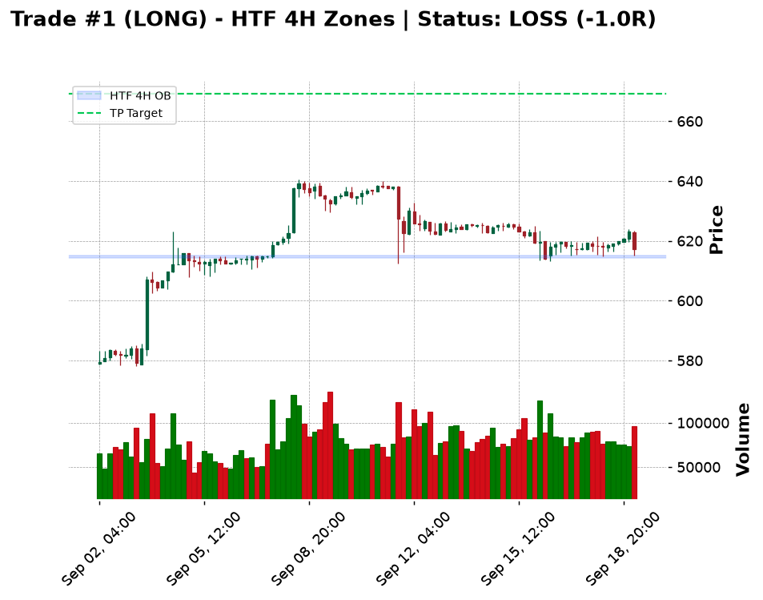

#### Khung vào lệnh Limit LTF

---

### Lệnh #2 — SHORT | Kết quả: **WIN (+3.48R)**
- **Tín hiệu CHoCH:** `2017-03-16 03:00:00+00:00` | **Khớp Limit:** `2017-03-16 04:00:00+00:00` | **Đóng lệnh:** `2017-03-17 03:00:00+00:00`
- **Entry Limit:** `1262.2304` | **SL:** `1262.2304` | **TP:** `1147.0` | **RR mục tiêu:** `1:4.97`
- **Vùng OB 4H:** `1240.9704 - 1271.5012` (Cấu trúc 4H: `SIDEWAY`)

#### Khung cấu trúc HTF 4H

#### Khung vào lệnh Limit LTF

---

### Lệnh #3 — SHORT | Kết quả: **LOSS (-1.00R)**
- **Tín hiệu CHoCH:** `2017-05-17 21:00:00+00:00` | **Khớp Limit:** `2017-05-17 23:00:00+00:00` | **Đóng lệnh:** `2017-05-18 16:00:00+00:00`
- **Entry Limit:** `1875.2508` | **SL:** `1904.7077` | **TP:** `1406.432` | **RR mục tiêu:** `1:15.92`
- **Vùng OB 4H:** `1850.1001 - 1893.0792` (Cấu trúc 4H: `SIDEWAY`)

#### Khung cấu trúc HTF 4H

#### Khung vào lệnh Limit LTF

---

### Lệnh #4 — LONG | Kết quả: **WIN (+2.50R)**
- **Tín hiệu CHoCH:** `2018-04-18 16:00:00+00:00` | **Khớp Limit:** `2018-04-18 17:00:00+00:00` | **Đóng lệnh:** `2018-04-20 22:00:00+00:00`
- **Entry Limit:** `8088.5` | **SL:** `8088.5` | **TP:** `8754.305` | **RR mục tiêu:** `1:3.0`
- **Vùng OB 4H:** `7910.5 - 8000.0` (Cấu trúc 4H: `BULL`)

#### Khung cấu trúc HTF 4H

#### Khung vào lệnh Limit LTF
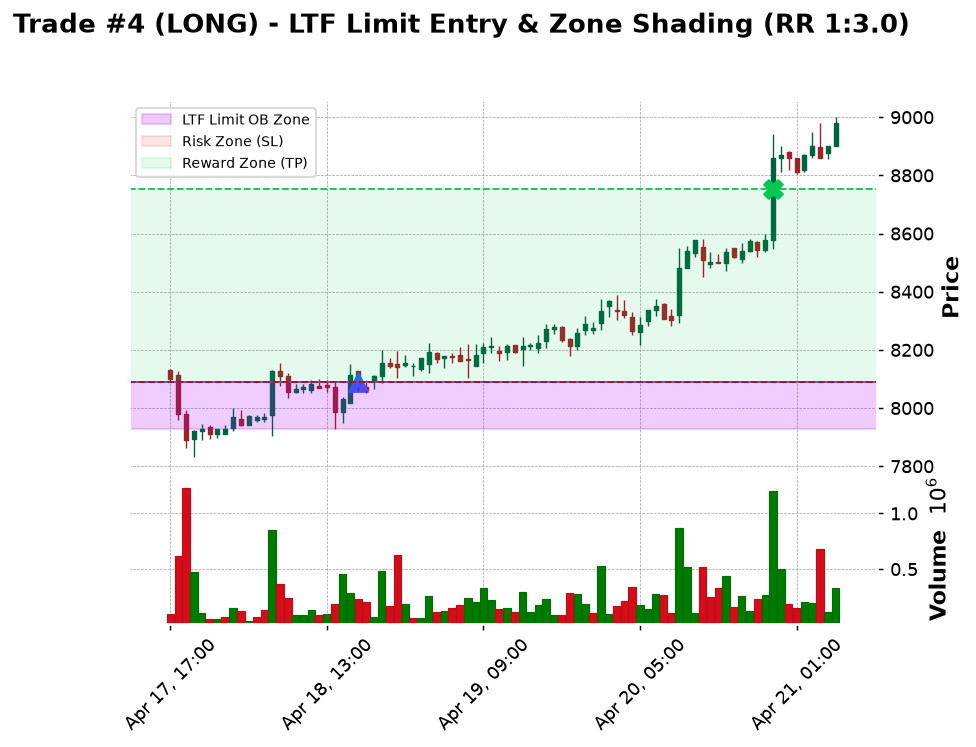

---

### Lệnh #5 — SHORT | Kết quả: **WIN (+3.12R)**
- **Tín hiệu CHoCH:** `2018-06-06 16:00:00+00:00` | **Khớp Limit:** `2018-06-06 20:00:00+00:00` | **Đóng lệnh:** `2018-06-10 17:00:00+00:00`
- **Entry Limit:** `7645.7` | **SL:** `7645.7` | **TP:** `7156.0` | **RR mục tiêu:** `1:4.25`
- **Vùng OB 4H:** `7650.1 - 7739.9` (Cấu trúc 4H: `SIDEWAY`)

#### Khung cấu trúc HTF 4H

#### Khung vào lệnh Limit LTF
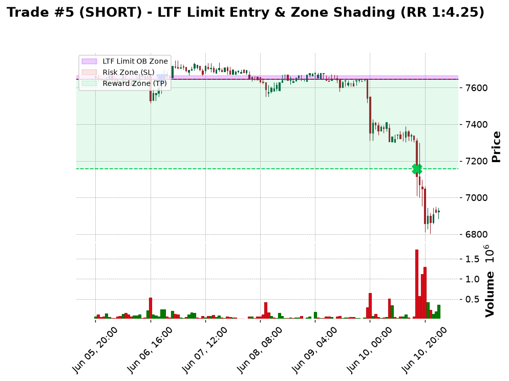

---

### Lệnh #6 — LONG | Kết quả: **LOSS (-1.00R)**
- **Tín hiệu CHoCH:** `2019-01-25 15:00:00+00:00` | **Khớp Limit:** `2019-01-25 16:00:00+00:00` | **Đóng lệnh:** `2019-01-28 05:00:00+00:00`
- **Entry Limit:** `3599.0` | **SL:** `3505.2607` | **TP:** `3880.2179` | **RR mục tiêu:** `1:3.0`
- **Vùng OB 4H:** `3517.7 - 3586.3` (Cấu trúc 4H: `SIDEWAY`)

#### Khung cấu trúc HTF 4H

#### Khung vào lệnh Limit LTF

---

### Lệnh #7 — SHORT | Kết quả: **LOSS (-1.00R)**
- **Tín hiệu CHoCH:** `2019-02-23 04:00:00+00:00` | **Khớp Limit:** `2019-02-23 10:00:00+00:00` | **Đóng lệnh:** `2019-02-23 17:00:00+00:00`
- **Entry Limit:** `3955.7` | **SL:** `3992.445` | **TP:** `3658.6` | **RR mục tiêu:** `1:8.09`
- **Vùng OB 4H:** `3957.7 - 3978.9` (Cấu trúc 4H: `SIDEWAY`)

#### Khung cấu trúc HTF 4H

#### Khung vào lệnh Limit LTF
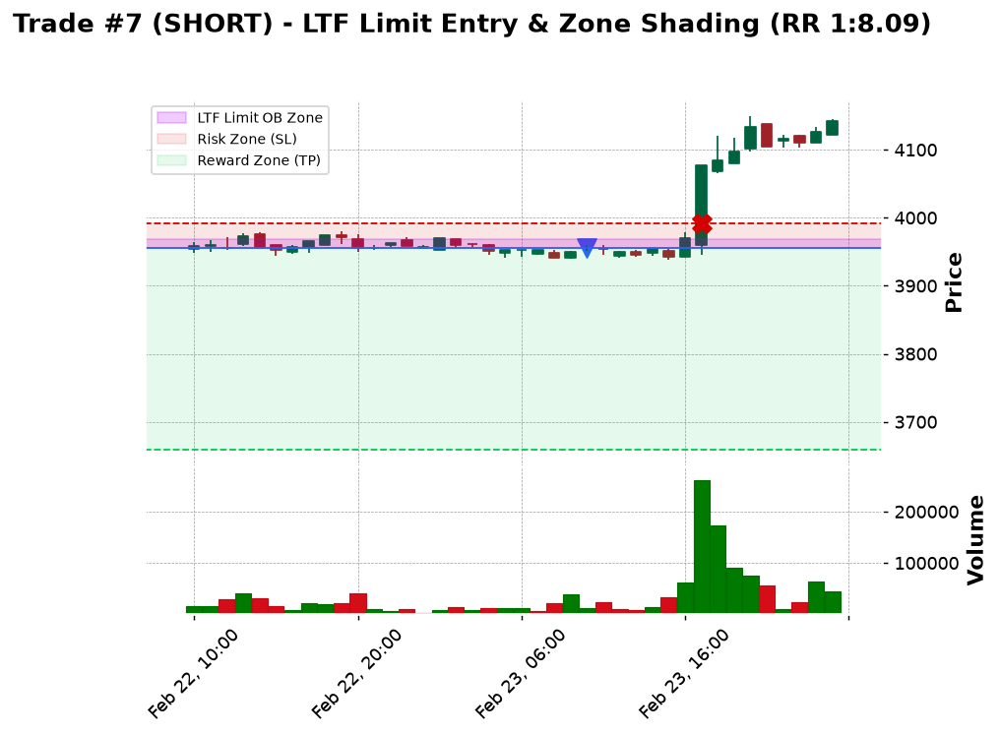

---

### Lệnh #8 — SHORT | Kết quả: **LOSS (-1.00R)**
- **Tín hiệu CHoCH:** `2020-06-18 20:00:00+00:00` | **Khớp Limit:** `2020-06-18 23:00:00+00:00` | **Đóng lệnh:** `2020-06-22 16:00:00+00:00`
- **Entry Limit:** `9409.4` | **SL:** `9561.5193` | **TP:** `8908.5` | **RR mục tiêu:** `1:3.29`
- **Vùng OB 4H:** `9475.7 - 9523.1` (Cấu trúc 4H: `SIDEWAY`)

#### Khung cấu trúc HTF 4H

#### Khung vào lệnh Limit LTF

---

### Lệnh #9 — SHORT | Kết quả: **LOSS (-1.00R)**
- **Tín hiệu CHoCH:** `2020-07-15 19:00:00+00:00` | **Khớp Limit:** `2020-07-15 20:00:00+00:00` | **Đóng lệnh:** `2020-07-21 07:00:00+00:00`
- **Entry Limit:** `9230.0` | **SL:** `9383.8071` | **TP:** `8768.5786` | **RR mục tiêu:** `1:3.0`
- **Vùng OB 4H:** `9309.8 - 9364.5` (Cấu trúc 4H: `BULL`)

#### Khung cấu trúc HTF 4H
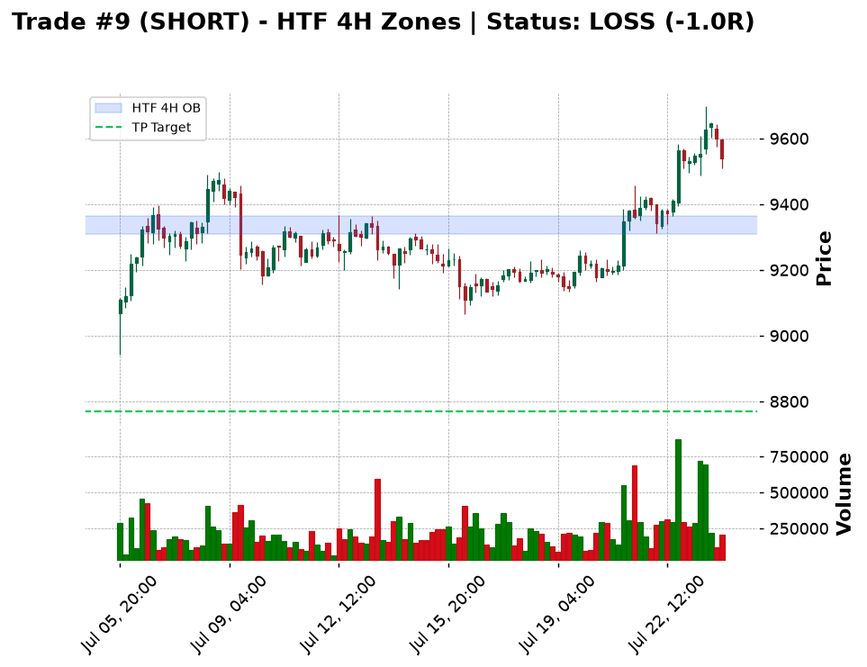

#### Khung vào lệnh Limit LTF

---

### Lệnh #10 — SHORT | Kết quả: **LOSS (-1.00R)**
- **Tín hiệu CHoCH:** `2020-08-31 20:00:00+00:00` | **Khớp Limit:** `2020-08-31 21:00:00+00:00` | **Đóng lệnh:** `2020-09-01 06:00:00+00:00`
- **Entry Limit:** `11717.1` | **SL:** `11836.7307` | **TP:** `11358.2079` | **RR mục tiêu:** `1:3.0`
- **Vùng OB 4H:** `11690.9 - 11804.5` (Cấu trúc 4H: `SIDEWAY`)

#### Khung cấu trúc HTF 4H

#### Khung vào lệnh Limit LTF

---

### Lệnh #11 — LONG | Kết quả: **WIN (+2.50R)**
- **Tín hiệu CHoCH:** `2020-10-18 23:00:00+00:00` | **Khớp Limit:** `2020-10-19 00:00:00+00:00` | **Đóng lệnh:** `2020-10-21 03:00:00+00:00`
- **Entry Limit:** `11486.7` | **SL:** `11486.7` | **TP:** `12150.4993` | **RR mục tiêu:** `1:3.0`
- **Vùng OB 4H:** `11298.5 - 11438.8` (Cấu trúc 4H: `SIDEWAY`)

#### Khung cấu trúc HTF 4H
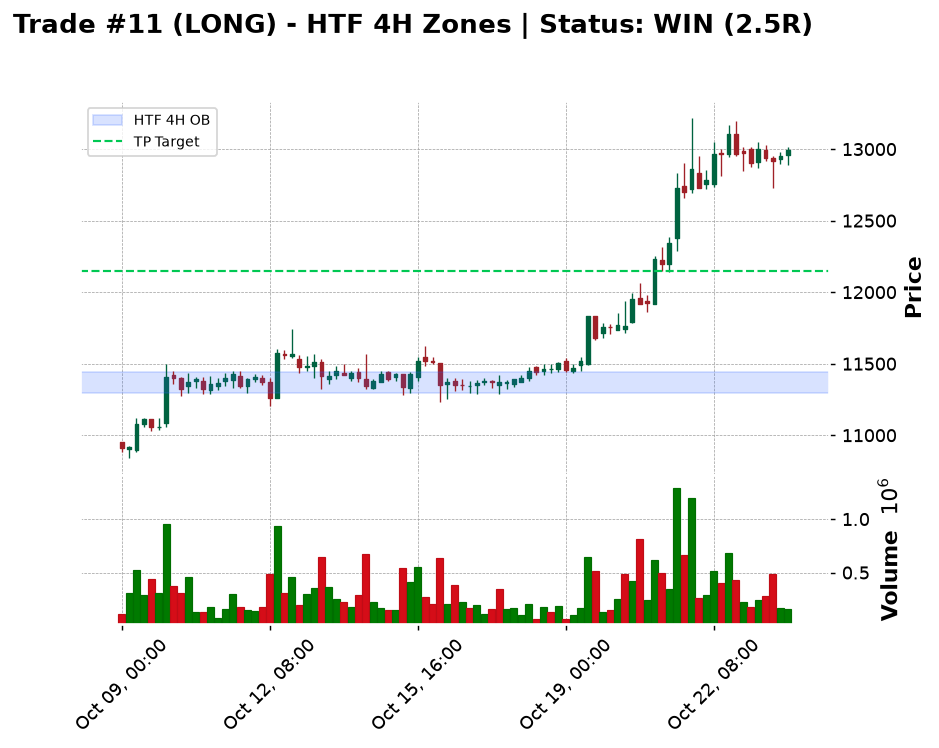

#### Khung vào lệnh Limit LTF
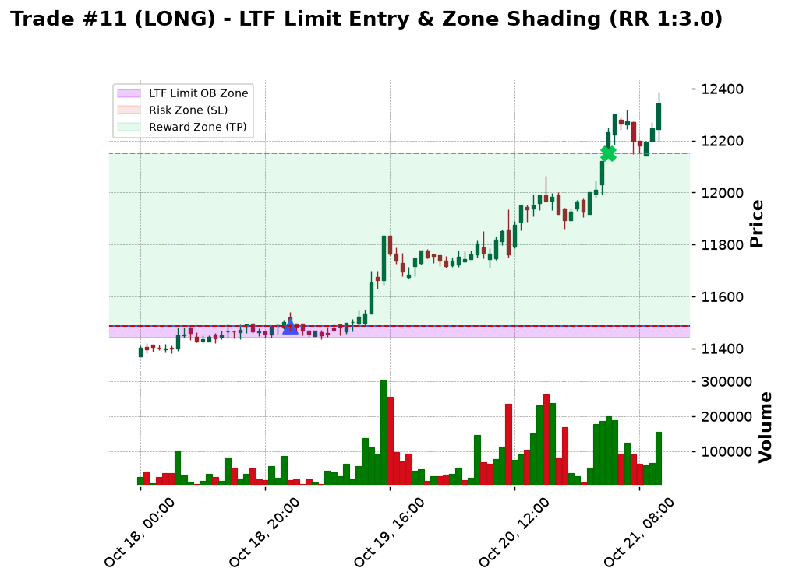

---

### Lệnh #12 — LONG | Kết quả: **LOSS (-1.00R)**
- **Tín hiệu CHoCH:** `2021-07-17 09:00:00+00:00` | **Khớp Limit:** `2021-07-17 10:00:00+00:00` | **Đóng lệnh:** `2021-07-19 12:00:00+00:00`
- **Entry Limit:** `31581.2` | **SL:** `30966.2007` | **TP:** `34616.9` | **RR mục tiêu:** `1:4.94`
- **Vùng OB 4H:** `31111.6 - 31761.9` (Cấu trúc 4H: `BULL`)

#### Khung cấu trúc HTF 4H

#### Khung vào lệnh Limit LTF
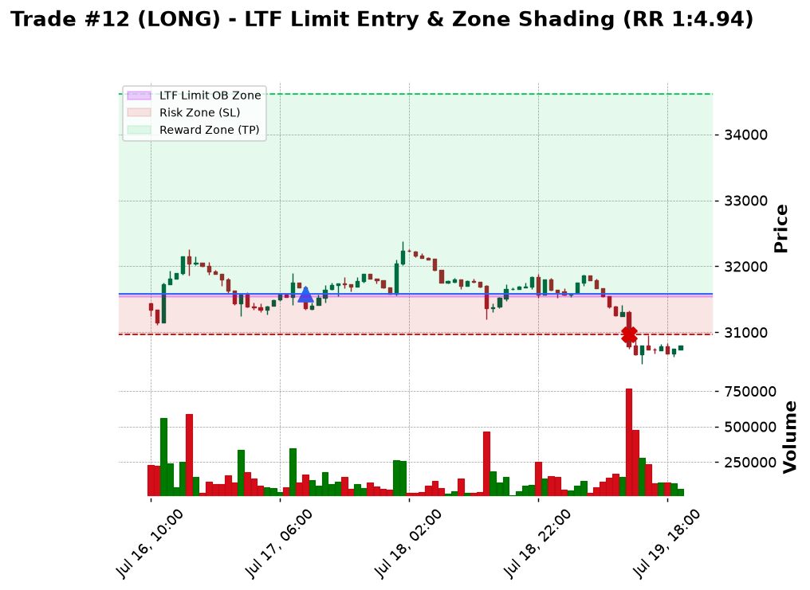

---

### Lệnh #13 — SHORT | Kết quả: **LOSS (-1.00R)**
- **Tín hiệu CHoCH:** `2021-09-02 14:00:00+00:00` | **Khớp Limit:** `2021-09-02 21:00:00+00:00` | **Đóng lệnh:** `2021-09-03 12:00:00+00:00`
- **Entry Limit:** `49834.7` | **SL:** `50694.3157` | **TP:** `44000.1` | **RR mục tiêu:** `1:6.79`
- **Vùng OB 4H:** `50100.5 - 50483.9` (Cấu trúc 4H: `SIDEWAY`)

#### Khung cấu trúc HTF 4H

#### Khung vào lệnh Limit LTF
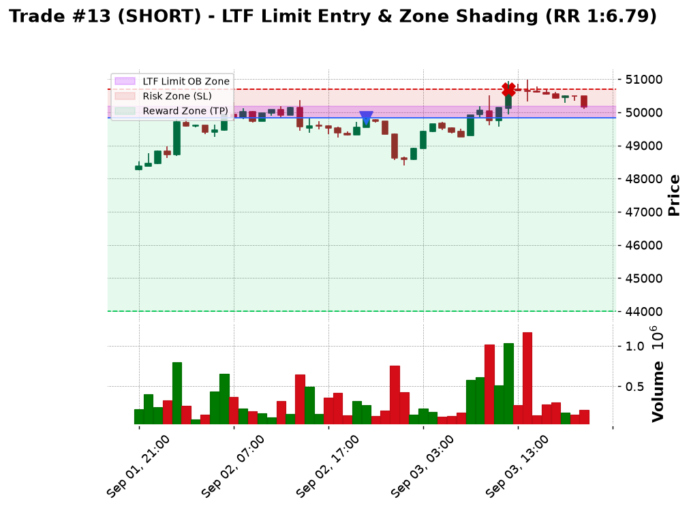

---

### Lệnh #14 — SHORT | Kết quả: **WIN (+2.50R)**
- **Tín hiệu CHoCH:** `2022-01-14 10:00:00+00:00` | **Khớp Limit:** `2022-01-14 14:00:00+00:00` | **Đóng lệnh:** `2022-01-21 22:00:00+00:00`
- **Entry Limit:** `42467.3` | **SL:** `42467.3` | **TP:** `36122.8979` | **RR mục tiêu:** `1:3.0`
- **Vùng OB 4H:** `42940.2 - 44379.5` (Cấu trúc 4H: `BEAR`)

#### Khung cấu trúc HTF 4H
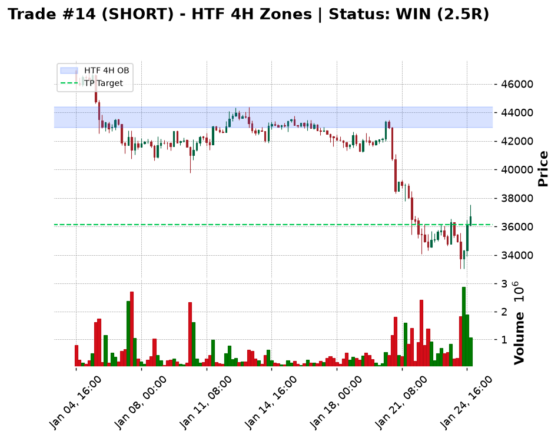

#### Khung vào lệnh Limit LTF

---

### Lệnh #15 — SHORT | Kết quả: **WIN (+2.52R)**
- **Tín hiệu CHoCH:** `2022-04-26 09:00:00+00:00` | **Khớp Limit:** `2022-04-26 10:00:00+00:00` | **Đóng lệnh:** `2022-04-26 15:00:00+00:00`
- **Entry Limit:** `40400.1` | **SL:** `40400.1` | **TP:** `38600.0` | **RR mục tiêu:** `1:3.05`
- **Vùng OB 4H:** `40240.7 - 40778.6` (Cấu trúc 4H: `SIDEWAY`)

#### Khung cấu trúc HTF 4H

#### Khung vào lệnh Limit LTF
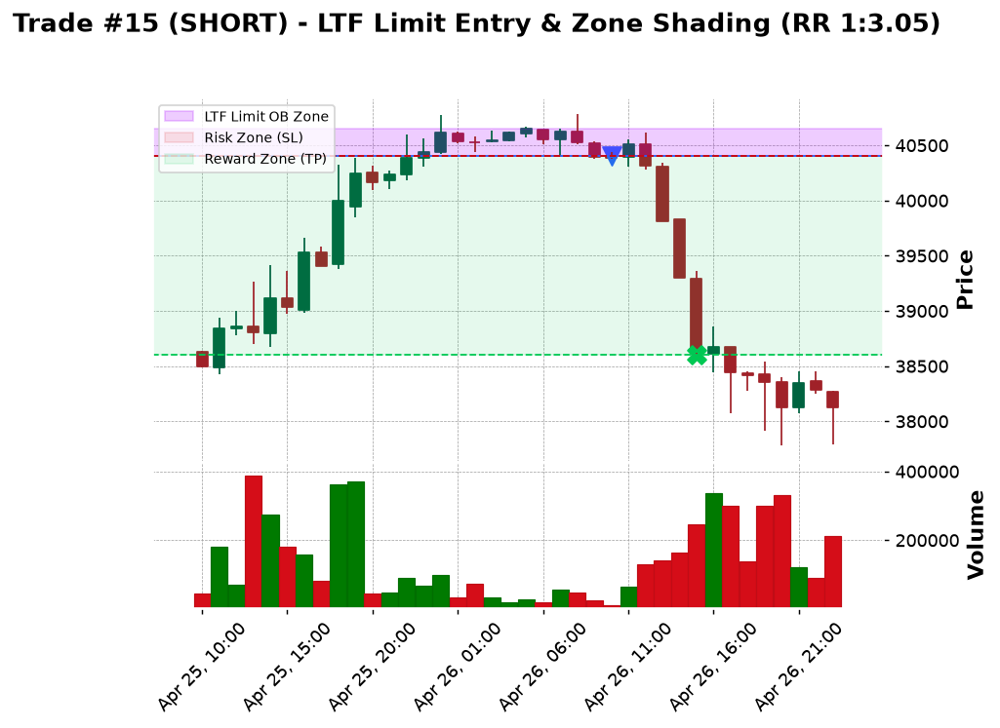

---

### Lệnh #16 — SHORT | Kết quả: **WIN (+2.50R)**
- **Tín hiệu CHoCH:** `2022-06-10 00:00:00+00:00` | **Khớp Limit:** `2022-06-10 03:00:00+00:00` | **Đóng lệnh:** `2022-06-13 07:00:00+00:00`
- **Entry Limit:** `30023.1` | **SL:** `30023.1` | **TP:** `24945.1264` | **RR mục tiêu:** `1:3.0`
- **Vùng OB 4H:** `31276.4 - 31566.0` (Cấu trúc 4H: `SIDEWAY`)

#### Khung cấu trúc HTF 4H
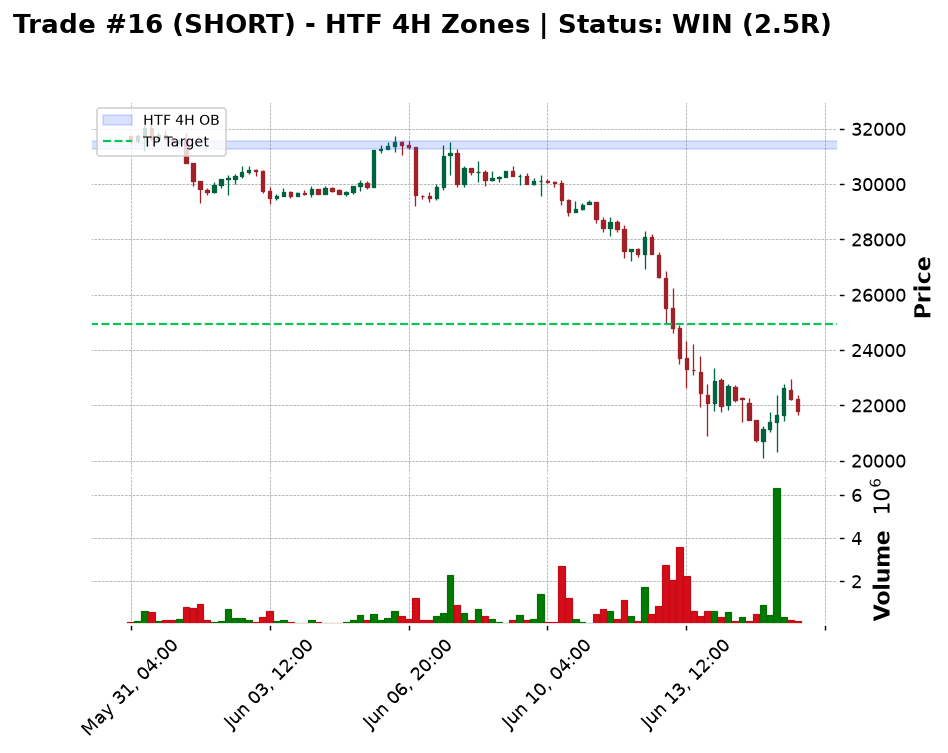

#### Khung vào lệnh Limit LTF

---

### Lệnh #17 — LONG | Kết quả: **WIN (+3.43R)**
- **Tín hiệu CHoCH:** `2022-07-02 12:00:00+00:00` | **Khớp Limit:** `2022-07-02 13:00:00+00:00` | **Đóng lệnh:** `2022-07-08 01:00:00+00:00`
- **Entry Limit:** `19282.3` | **SL:** `19282.3` | **TP:** `21865.0` | **RR mục tiêu:** `1:4.86`
- **Vùng OB 4H:** `18900.0 - 19302.6` (Cấu trúc 4H: `BEAR`)

#### Khung cấu trúc HTF 4H

#### Khung vào lệnh Limit LTF
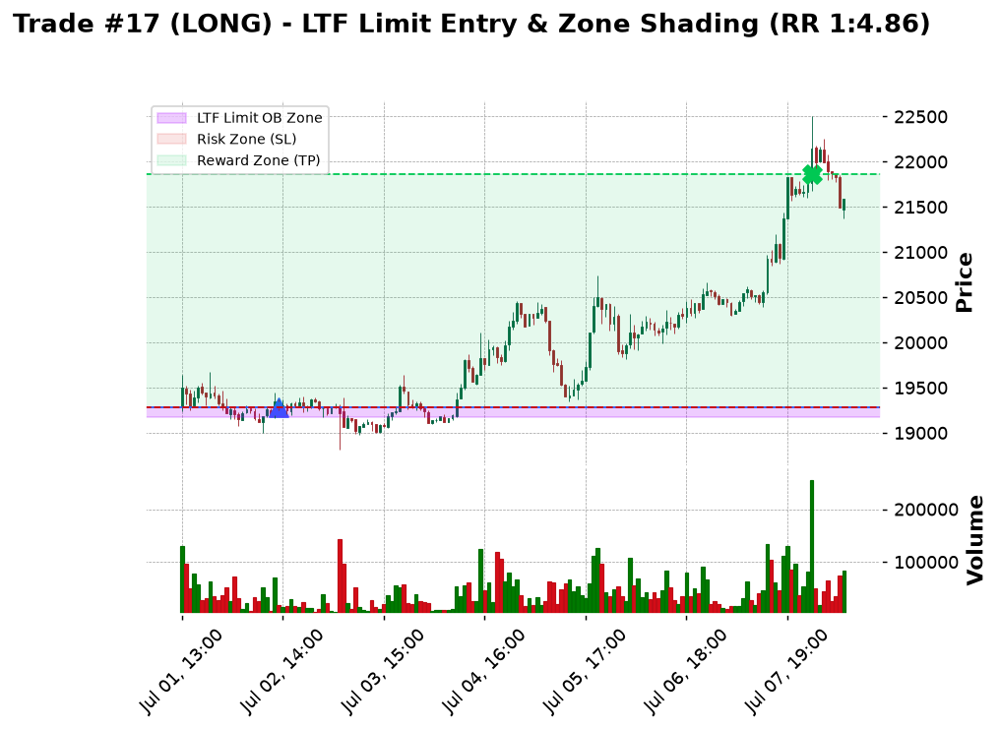

---

### Lệnh #18 — LONG | Kết quả: **WIN (+2.50R)**
- **Tín hiệu CHoCH:** `2022-07-13 23:00:00+00:00` | **Khớp Limit:** `2022-07-14 06:00:00+00:00` | **Đóng lệnh:** `2022-07-19 19:00:00+00:00`
- **Entry Limit:** `19979.0` | **SL:** `19979.0` | **TP:** `23664.1871` | **RR mục tiêu:** `1:3.0`
- **Vùng OB 4H:** `18900.0 - 19302.6` (Cấu trúc 4H: `BULL`)

#### Khung cấu trúc HTF 4H

#### Khung vào lệnh Limit LTF

---

### Lệnh #19 — LONG | Kết quả: **LOSS (-1.00R)**
- **Tín hiệu CHoCH:** `2022-08-18 09:00:00+00:00` | **Khớp Limit:** `2022-08-18 14:00:00+00:00` | **Đóng lệnh:** `2022-08-19 01:00:00+00:00`
- **Entry Limit:** `23465.8` | **SL:** `22867.8529` | **TP:** `25259.6414` | **RR mục tiêu:** `1:3.0`
- **Vùng OB 4H:** `22979.8 - 23237.5` (Cấu trúc 4H: `BULL`)

#### Khung cấu trúc HTF 4H

#### Khung vào lệnh Limit LTF

---

### Lệnh #20 — LONG | Kết quả: **LOSS (-1.00R)**
- **Tín hiệu CHoCH:** `2022-09-01 23:00:00+00:00` | **Khớp Limit:** `2022-09-02 00:00:00+00:00` | **Đóng lệnh:** `2022-09-03 19:00:00+00:00`
- **Entry Limit:** `20161.0` | **SL:** `19706.2107` | **TP:** `21950.7` | **RR mục tiêu:** `1:3.94`
- **Vùng OB 4H:** `19785.7 - 19938.7` (Cấu trúc 4H: `SIDEWAY`)

#### Khung cấu trúc HTF 4H

#### Khung vào lệnh Limit LTF
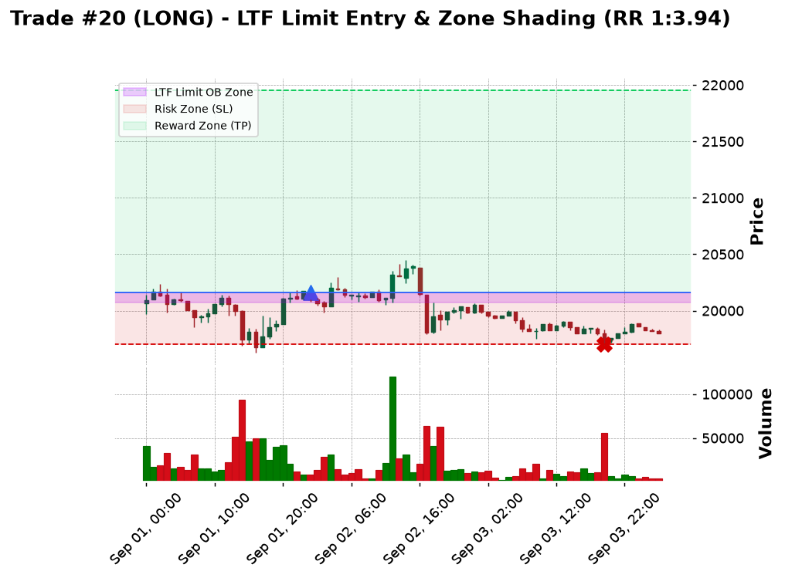

---

### Lệnh #21 — SHORT | Kết quả: **LOSS (-1.00R)**
- **Tín hiệu CHoCH:** `2022-09-23 10:00:00+00:00` | **Khớp Limit:** `2022-09-23 13:00:00+00:00` | **Đóng lệnh:** `2022-09-27 01:00:00+00:00`
- **Entry Limit:** `19075.0` | **SL:** `19610.6471` | **TP:** `17468.0586` | **RR mục tiêu:** `1:3.0`
- **Vùng OB 4H:** `19126.8 - 19472.6` (Cấu trúc 4H: `BEAR`)

#### Khung cấu trúc HTF 4H
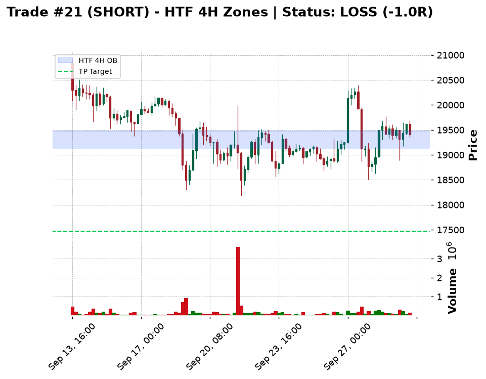

#### Khung vào lệnh Limit LTF
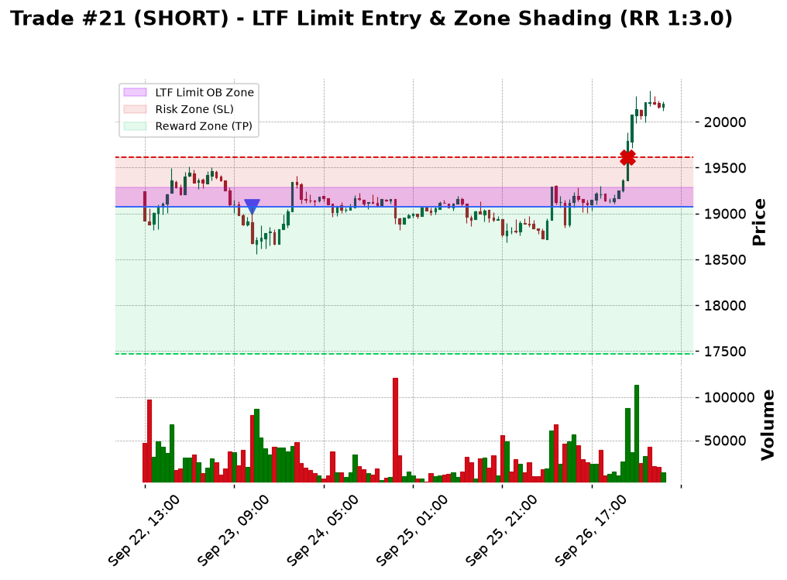

---

### Lệnh #22 — LONG | Kết quả: **LOSS (-1.00R)**
- **Tín hiệu CHoCH:** `2022-10-09 11:00:00+00:00` | **Khớp Limit:** `2022-10-09 19:00:00+00:00` | **Đóng lệnh:** `2022-10-10 22:00:00+00:00`
- **Entry Limit:** `19445.0` | **SL:** `19121.3114` | **TP:** `20416.0657` | **RR mục tiêu:** `1:3.0`
- **Vùng OB 4H:** `19180.0 - 19507.0` (Cấu trúc 4H: `SIDEWAY`)

#### Khung cấu trúc HTF 4H
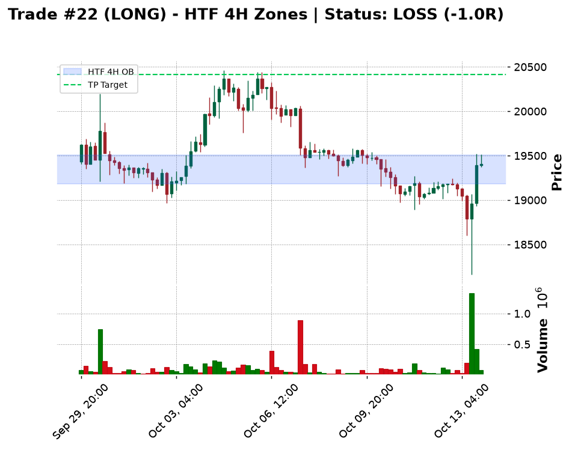

#### Khung vào lệnh Limit LTF

---

### Lệnh #23 — SHORT | Kết quả: **LOSS (-1.00R)**
- **Tín hiệu CHoCH:** `2022-12-03 22:00:00+00:00` | **Khớp Limit:** `2022-12-04 00:00:00+00:00` | **Đóng lệnh:** `2022-12-04 18:00:00+00:00`
- **Entry Limit:** `16972.4` | **SL:** `17185.75` | **TP:** `16044.3` | **RR mục tiêu:** `1:4.35`
- **Vùng OB 4H:** `17068.1 - 17133.4` (Cấu trúc 4H: `SIDEWAY`)

#### Khung cấu trúc HTF 4H

#### Khung vào lệnh Limit LTF

---

### Lệnh #24 — SHORT | Kết quả: **WIN (+3.37R)**
- **Tín hiệu CHoCH:** `2023-02-18 07:00:00+00:00` | **Khớp Limit:** `2023-02-18 12:00:00+00:00` | **Đóng lệnh:** `2023-03-09 18:00:00+00:00`
- **Entry Limit:** `24618.3` | **SL:** `24618.3` | **TP:** `21351.8` | **RR mục tiêu:** `1:4.74`
- **Vùng OB 4H:** `24648.4 - 25154.1` (Cấu trúc 4H: `SIDEWAY`)

#### Khung cấu trúc HTF 4H

#### Khung vào lệnh Limit LTF

---

### Lệnh #25 — SHORT | Kết quả: **LOSS (-1.00R)**
- **Tín hiệu CHoCH:** `2023-04-10 13:00:00+00:00` | **Khớp Limit:** `2023-04-10 15:00:00+00:00` | **Đóng lệnh:** `2023-04-10 16:00:00+00:00`
- **Entry Limit:** `28381.6` | **SL:** `28757.22` | **TP:** `27254.74` | **RR mục tiêu:** `1:3.0`
- **Vùng OB 4H:** `28508.7 - 28650.0` (Cấu trúc 4H: `SIDEWAY`)

#### Khung cấu trúc HTF 4H

#### Khung vào lệnh Limit LTF

---

### Lệnh #26 — SHORT | Kết quả: **WIN (+2.50R)**
- **Tín hiệu CHoCH:** `2023-04-28 13:00:00+00:00` | **Khớp Limit:** `2023-04-28 14:00:00+00:00` | **Đóng lệnh:** `2023-05-12 02:00:00+00:00`
- **Entry Limit:** `29337.9` | **SL:** `29337.9` | **TP:** `26913.4221` | **RR mục tiêu:** `1:3.0`
- **Vùng OB 4H:** `29078.4 - 30005.4` (Cấu trúc 4H: `BULL`)

#### Khung cấu trúc HTF 4H
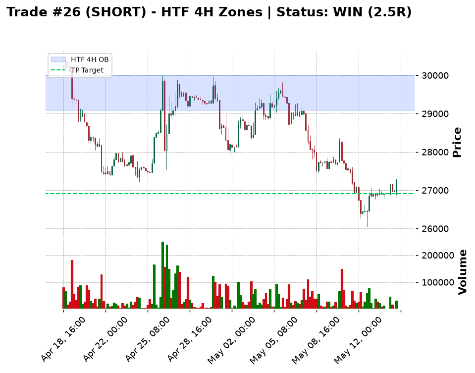

#### Khung vào lệnh Limit LTF

---

### Lệnh #27 — LONG | Kết quả: **LOSS (-1.00R)**
- **Tín hiệu CHoCH:** `2023-05-19 12:00:00+00:00` | **Khớp Limit:** `2023-05-19 14:00:00+00:00` | **Đóng lệnh:** `2023-05-24 13:00:00+00:00`
- **Entry Limit:** `26925.2` | **SL:** `26597.1757` | **TP:** `27909.2729` | **RR mục tiêu:** `1:3.0`
- **Vùng OB 4H:** `26663.6 - 26859.9` (Cấu trúc 4H: `BULL`)

#### Khung cấu trúc HTF 4H
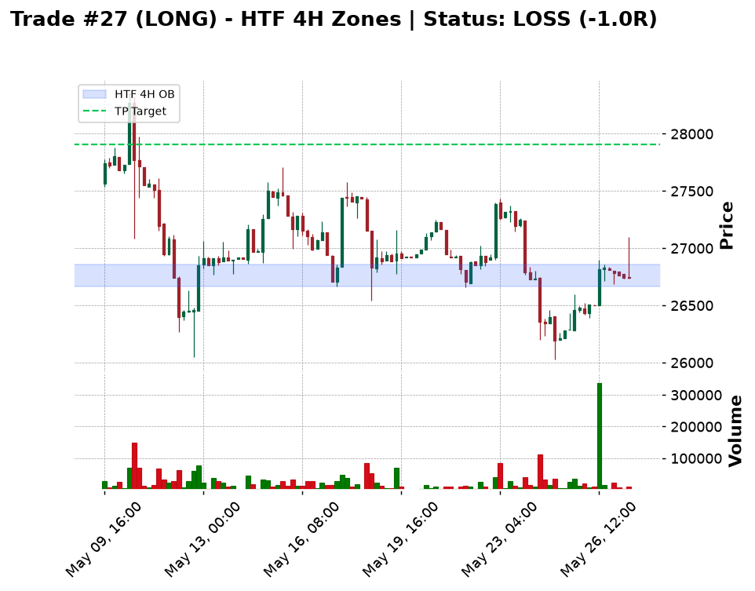

#### Khung vào lệnh Limit LTF

---

### Lệnh #28 — SHORT | Kết quả: **LOSS (-1.00R)**
- **Tín hiệu CHoCH:** `2024-01-07 23:00:00+00:00` | **Khớp Limit:** `2024-01-08 06:00:00+00:00` | **Đóng lệnh:** `2024-01-08 18:00:00+00:00`
- **Entry Limit:** `44146.4` | **SL:** `45720.1136` | **TP:** `39425.2593` | **RR mục tiêu:** `1:3.0`
- **Vùng OB 4H:** `43786.6 - 45450.0` (Cấu trúc 4H: `SIDEWAY`)

#### Khung cấu trúc HTF 4H

#### Khung vào lệnh Limit LTF

---

### Lệnh #29 — LONG | Kết quả: **WIN (+2.50R)**
- **Tín hiệu CHoCH:** `2024-09-13 18:00:00+00:00` | **Khớp Limit:** `2024-09-16 13:00:00+00:00` | **Đóng lệnh:** `2024-11-11 19:00:00+00:00`
- **Entry Limit:** `58269.0` | **SL:** `58269.0` | **TP:** `85753.9714` | **RR mục tiêu:** `1:3.0`
- **Vùng OB 4H:** `49660.2 - 53185.6` (Cấu trúc 4H: `BULL`)

#### Khung cấu trúc HTF 4H

#### Khung vào lệnh Limit LTF

---

### Lệnh #30 — SHORT | Kết quả: **LOSS (-1.00R)**
- **Tín hiệu CHoCH:** `2025-08-08 15:00:00+00:00` | **Khớp Limit:** `2025-08-08 17:00:00+00:00` | **Đóng lệnh:** `2025-08-10 15:00:00+00:00`
- **Entry Limit:** `116625.0` | **SL:** `118802.0729` | **TP:** `110093.7814` | **RR mục tiêu:** `1:3.0`
- **Vùng OB 4H:** `117898.3 - 118523.3` (Cấu trúc 4H: `SIDEWAY`)

#### Khung cấu trúc HTF 4H
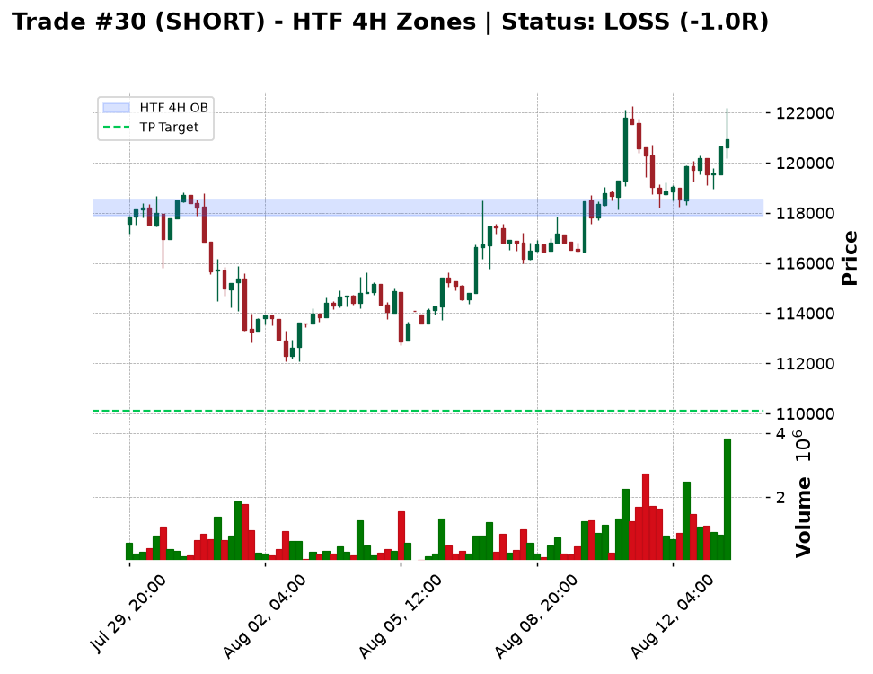

#### Khung vào lệnh Limit LTF

---

### Lệnh #31 — LONG | Kết quả: **LOSS (-1.00R)**
- **Tín hiệu CHoCH:** `2026-02-20 22:00:00+00:00` | **Khớp Limit:** `2026-02-21 00:00:00+00:00` | **Đóng lệnh:** `2026-02-23 01:00:00+00:00`
- **Entry Limit:** `67785.6` | **SL:** `65669.8436` | **TP:** `74132.8693` | **RR mục tiêu:** `1:3.0`
- **Vùng OB 4H:** `66135.6 - 67160.6` (Cấu trúc 4H: `BEAR`)

#### Khung cấu trúc HTF 4H

#### Khung vào lệnh Limit LTF
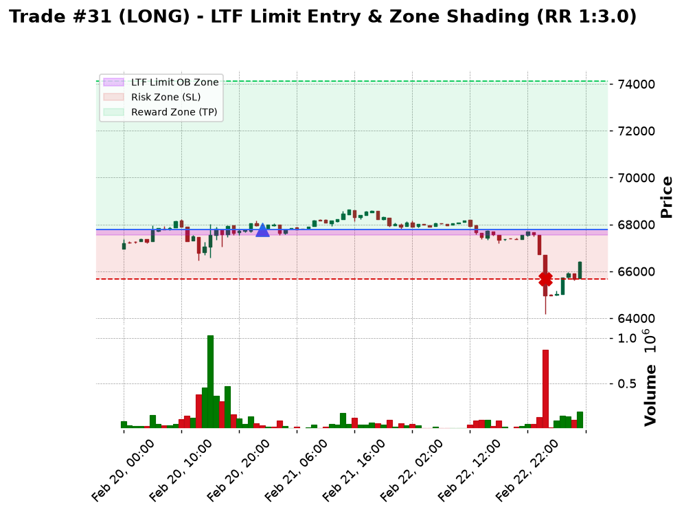

---

### Lệnh #32 — SHORT | Kết quả: **LOSS (-1.00R)**
- **Tín hiệu CHoCH:** `2026-03-01 16:00:00+00:00` | **Khớp Limit:** `2026-03-02 01:00:00+00:00` | **Đóng lệnh:** `2026-03-02 15:00:00+00:00`
- **Entry Limit:** `66783.5` | **SL:** `69199.9593` | **TP:** `59534.1221` | **RR mục tiêu:** `1:3.0`
- **Vùng OB 4H:** `67810.6 - 68660.6` (Cấu trúc 4H: `SIDEWAY`)

#### Khung cấu trúc HTF 4H

#### Khung vào lệnh Limit LTF

---
