# Báo Cáo Backtest SMC Pro MTF - CEX_BTCUSD_1h

## 1. Cấu hình tham số hệ thống

- **Dữ liệu đầu vào:** `data/CEX_BTCUSD_1h.csv` (LTF: 1H -> HTF: 4H)
- **Cơ chế vào lệnh:** Limit tại Extreme OB/FVG sau CHoCH
- **Bộ lọc phiên Killzones (London/NY):** `BẬT`
- **Quản lý vốn Break-even (1.5R / BOS):** `BẬT`

## 2. Thống kê hiệu suất tổng quan

| Chỉ số | Giá trị |
| :--- | :--- |
| **Tổng số lệnh đã khớp** | 30 |
| **Thắng (WIN)** | 2 |
| **Hòa vốn (Break-Even)** | 24 |
| **Thua (LOSS)** | 4 |
| **Tỷ lệ thắng (Winrate)** | 6.67% |
| **Tổng lợi nhuận ròng (R)** | **+6.68R** |
| **Tỷ lệ R:R trung bình** | 1:3.80 |

## 3. Chi tiết lệnh & Biểu đồ phân tích Zone Shading

### Lệnh #1 — SHORT | Kết quả: **BE (+0.00R)**
- **Tín hiệu CHoCH:** `2017-03-16 09:00:00+00:00` | **Khớp Limit:** `2017-03-16 10:00:00+00:00` | **Đóng lệnh:** `2017-03-16 11:00:00+00:00`
- **Entry Limit:** `1242.3854` | **SL:** `1242.3854` | **TP:** `1113.2534` | **RR:** `1:3.0`
- **Vùng OB 4H:** `1240.9704 - 1271.5012` (Cấu trúc 4H: `SIDEWAY`)

#### Khung cấu trúc HTF 4H

#### Khung vào lệnh Limit LTF
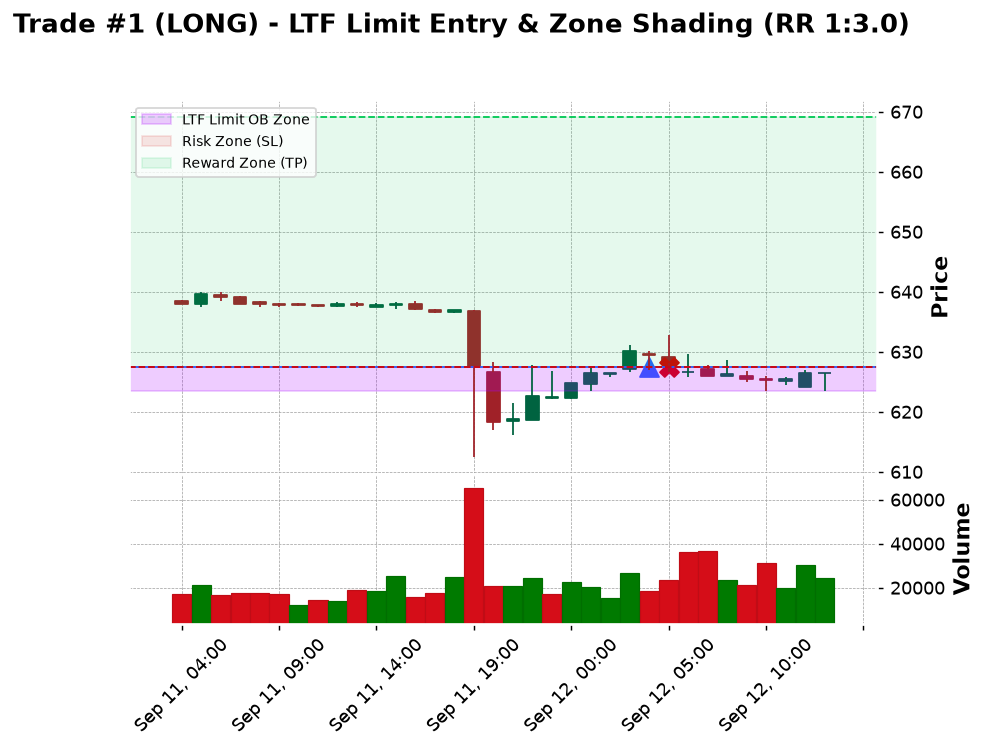

---

### Lệnh #2 — SHORT | Kết quả: **BE (+0.00R)**
- **Tín hiệu CHoCH:** `2017-03-16 12:00:00+00:00` | **Khớp Limit:** `2017-03-16 13:00:00+00:00` | **Đóng lệnh:** `2017-03-16 14:00:00+00:00`
- **Entry Limit:** `1231.203` | **SL:** `1231.203` | **TP:** `1068.5238` | **RR:** `1:3.0`
- **Vùng OB 4H:** `1240.9704 - 1271.5012` (Cấu trúc 4H: `SIDEWAY`)

#### Khung cấu trúc HTF 4H

#### Khung vào lệnh Limit LTF
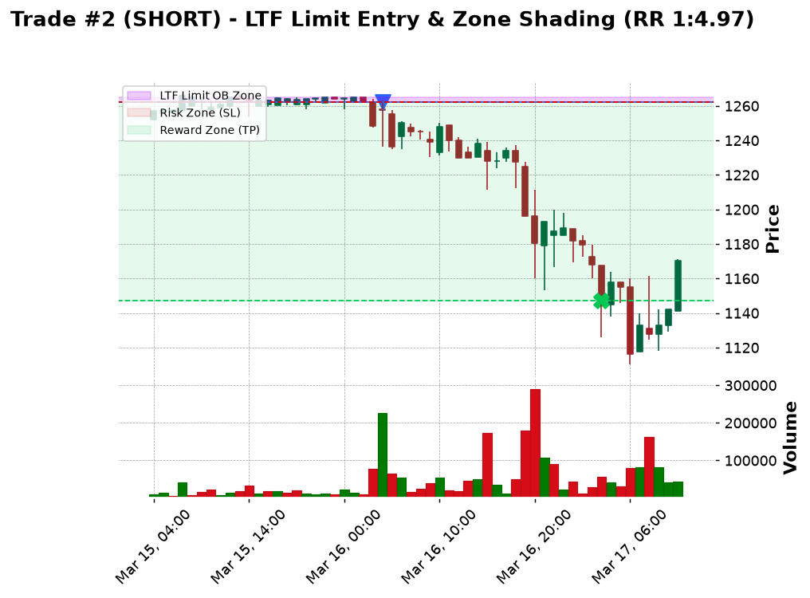

---

### Lệnh #3 — LONG | Kết quả: **BE (+0.00R)**
- **Tín hiệu CHoCH:** `2018-04-18 16:00:00+00:00` | **Khớp Limit:** `2018-04-18 17:00:00+00:00` | **Đóng lệnh:** `2018-04-18 20:00:00+00:00`
- **Entry Limit:** `8088.5` | **SL:** `8088.5` | **TP:** `8754.305` | **RR:** `1:3.0`
- **Vùng OB 4H:** `7910.5 - 8000.0` (Cấu trúc 4H: `BULL`)

#### Khung cấu trúc HTF 4H

#### Khung vào lệnh Limit LTF

---

### Lệnh #4 — SHORT | Kết quả: **BE (+0.00R)**
- **Tín hiệu CHoCH:** `2018-06-06 16:00:00+00:00` | **Khớp Limit:** `2018-06-06 20:00:00+00:00` | **Đóng lệnh:** `2018-06-08 04:00:00+00:00`
- **Entry Limit:** `7645.7` | **SL:** `7645.7` | **TP:** `7156.0` | **RR:** `1:4.25`
- **Vùng OB 4H:** `7650.1 - 7739.9` (Cấu trúc 4H: `SIDEWAY`)

#### Khung cấu trúc HTF 4H

#### Khung vào lệnh Limit LTF

---

### Lệnh #5 — SHORT | Kết quả: **BE (+0.00R)**
- **Tín hiệu CHoCH:** `2018-06-08 08:00:00+00:00` | **Khớp Limit:** `2018-06-08 09:00:00+00:00` | **Đóng lệnh:** `2018-06-08 16:00:00+00:00`
- **Entry Limit:** `7640.0` | **SL:** `7640.0` | **TP:** `7156.0` | **RR:** `1:4.01`
- **Vùng OB 4H:** `7650.1 - 7739.9` (Cấu trúc 4H: `BULL`)

#### Khung cấu trúc HTF 4H
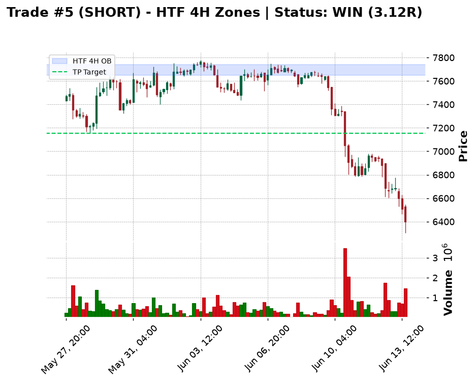

#### Khung vào lệnh Limit LTF

---

### Lệnh #6 — SHORT | Kết quả: **BE (+0.00R)**
- **Tín hiệu CHoCH:** `2018-06-09 13:00:00+00:00` | **Khớp Limit:** `2018-06-09 20:00:00+00:00` | **Đóng lệnh:** `2018-06-09 23:00:00+00:00`
- **Entry Limit:** `7645.0` | **SL:** `7645.0` | **TP:** `7156.0` | **RR:** `1:4.22`
- **Vùng OB 4H:** `7650.1 - 7739.9` (Cấu trúc 4H: `SIDEWAY`)

#### Khung cấu trúc HTF 4H

#### Khung vào lệnh Limit LTF
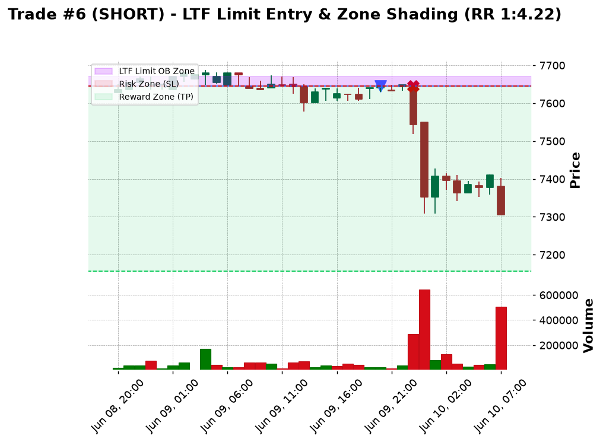

---

### Lệnh #7 — LONG | Kết quả: **BE (+0.00R)**
- **Tín hiệu CHoCH:** `2019-01-25 15:00:00+00:00` | **Khớp Limit:** `2019-01-25 16:00:00+00:00` | **Đóng lệnh:** `2019-01-25 18:00:00+00:00`
- **Entry Limit:** `3599.0` | **SL:** `3599.0` | **TP:** `3880.2179` | **RR:** `1:3.0`
- **Vùng OB 4H:** `3517.7 - 3586.3` (Cấu trúc 4H: `SIDEWAY`)

#### Khung cấu trúc HTF 4H

#### Khung vào lệnh Limit LTF

---

### Lệnh #8 — SHORT | Kết quả: **LOSS (-1.00R)**
- **Tín hiệu CHoCH:** `2019-02-23 08:00:00+00:00` | **Khớp Limit:** `2019-02-23 09:00:00+00:00` | **Đóng lệnh:** `2019-02-23 17:00:00+00:00`
- **Entry Limit:** `3942.0` | **SL:** `3992.445` | **TP:** `3658.6` | **RR:** `1:5.62`
- **Vùng OB 4H:** `3957.7 - 3978.9` (Cấu trúc 4H: `BULL`)

#### Khung cấu trúc HTF 4H
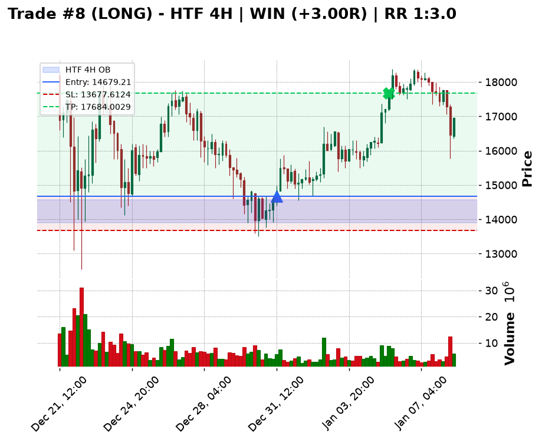

#### Khung vào lệnh Limit LTF

---

### Lệnh #9 — LONG | Kết quả: **BE (+0.00R)**
- **Tín hiệu CHoCH:** `2021-07-17 09:00:00+00:00` | **Khớp Limit:** `2021-07-17 10:00:00+00:00` | **Đóng lệnh:** `2021-07-18 00:00:00+00:00`
- **Entry Limit:** `31581.2` | **SL:** `31581.2` | **TP:** `34616.9` | **RR:** `1:4.94`
- **Vùng OB 4H:** `31111.6 - 31761.9` (Cấu trúc 4H: `BULL`)

#### Khung cấu trúc HTF 4H

#### Khung vào lệnh Limit LTF
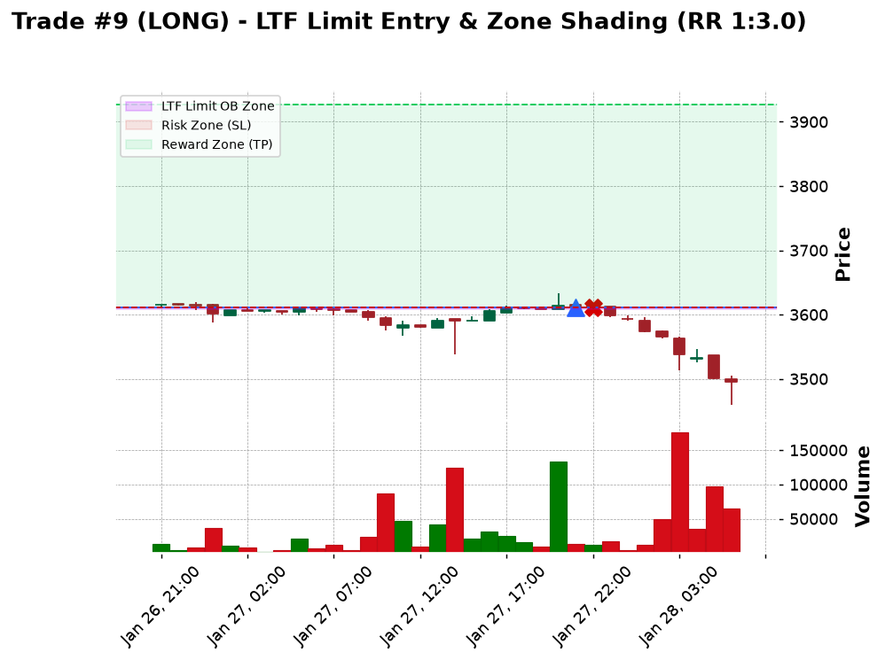

---

### Lệnh #10 — SHORT | Kết quả: **BE (+0.00R)**
- **Tín hiệu CHoCH:** `2021-09-02 14:00:00+00:00` | **Khớp Limit:** `2021-09-02 21:00:00+00:00` | **Đóng lệnh:** `2021-09-03 08:00:00+00:00`
- **Entry Limit:** `49834.7` | **SL:** `49834.7` | **TP:** `44000.1` | **RR:** `1:6.79`
- **Vùng OB 4H:** `50100.5 - 50483.9` (Cấu trúc 4H: `SIDEWAY`)

#### Khung cấu trúc HTF 4H

#### Khung vào lệnh Limit LTF

---

### Lệnh #11 — SHORT | Kết quả: **BE (+0.00R)**
- **Tín hiệu CHoCH:** `2022-01-14 10:00:00+00:00` | **Khớp Limit:** `2022-01-14 14:00:00+00:00` | **Đóng lệnh:** `2022-01-15 12:00:00+00:00`
- **Entry Limit:** `42467.3` | **SL:** `42467.3` | **TP:** `36122.8979` | **RR:** `1:3.0`
- **Vùng OB 4H:** `42940.2 - 44379.5` (Cấu trúc 4H: `BEAR`)

#### Khung cấu trúc HTF 4H

#### Khung vào lệnh Limit LTF

---

### Lệnh #12 — SHORT | Kết quả: **BE (+0.00R)**
- **Tín hiệu CHoCH:** `2022-01-21 12:00:00+00:00` | **Khớp Limit:** `2022-01-21 15:00:00+00:00` | **Đóng lệnh:** `2022-02-01 09:00:00+00:00`
- **Entry Limit:** `38895.4` | **SL:** `38895.4` | **TP:** `24283.8679` | **RR:** `1:3.0`
- **Vùng OB 4H:** `42866.3 - 43480.0` (Cấu trúc 4H: `BEAR`)

#### Khung cấu trúc HTF 4H
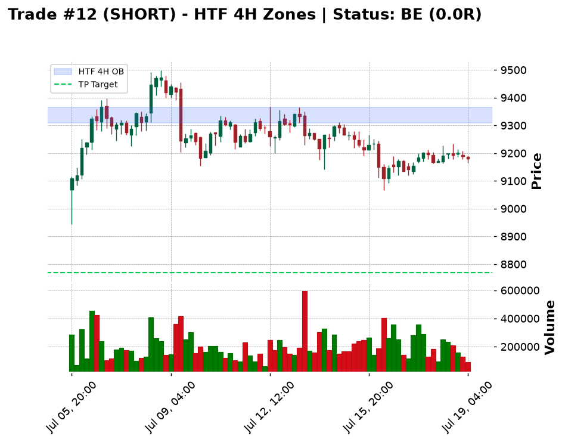

#### Khung vào lệnh Limit LTF

---

### Lệnh #13 — SHORT | Kết quả: **BE (+0.00R)**
- **Tín hiệu CHoCH:** `2022-04-26 09:00:00+00:00` | **Khớp Limit:** `2022-04-26 10:00:00+00:00` | **Đóng lệnh:** `2022-04-26 12:00:00+00:00`
- **Entry Limit:** `40400.1` | **SL:** `40400.1` | **TP:** `38600.0` | **RR:** `1:3.05`
- **Vùng OB 4H:** `40240.7 - 40778.6` (Cấu trúc 4H: `SIDEWAY`)

#### Khung cấu trúc HTF 4H

#### Khung vào lệnh Limit LTF

---

### Lệnh #14 — LONG | Kết quả: **BE (+0.00R)**
- **Tín hiệu CHoCH:** `2022-07-02 12:00:00+00:00` | **Khớp Limit:** `2022-07-02 13:00:00+00:00` | **Đóng lệnh:** `2022-07-02 14:00:00+00:00`
- **Entry Limit:** `19282.3` | **SL:** `19282.3` | **TP:** `21865.0` | **RR:** `1:4.86`
- **Vùng OB 4H:** `18900.0 - 19302.6` (Cấu trúc 4H: `BEAR`)

#### Khung cấu trúc HTF 4H

#### Khung vào lệnh Limit LTF

---

### Lệnh #15 — LONG | Kết quả: **WIN (+7.68R)**
- **Tín hiệu CHoCH:** `2022-07-03 17:00:00+00:00` | **Khớp Limit:** `2022-07-04 03:00:00+00:00` | **Đóng lệnh:** `2022-07-08 01:00:00+00:00`
- **Entry Limit:** `19109.2` | **SL:** `19109.2` | **TP:** `21865.0` | **RR:** `1:7.68`
- **Vùng OB 4H:** `18900.0 - 19302.6` (Cấu trúc 4H: `BEAR`)

#### Khung cấu trúc HTF 4H

#### Khung vào lệnh Limit LTF

---

### Lệnh #16 — LONG | Kết quả: **LOSS (-1.00R)**
- **Tín hiệu CHoCH:** `2022-09-02 12:00:00+00:00` | **Khớp Limit:** `2022-09-02 16:00:00+00:00` | **Đóng lệnh:** `2022-09-03 19:00:00+00:00`
- **Entry Limit:** `20190.0` | **SL:** `19706.2107` | **TP:** `21950.7` | **RR:** `1:3.64`
- **Vùng OB 4H:** `19785.7 - 19938.7` (Cấu trúc 4H: `SIDEWAY`)

#### Khung cấu trúc HTF 4H

#### Khung vào lệnh Limit LTF
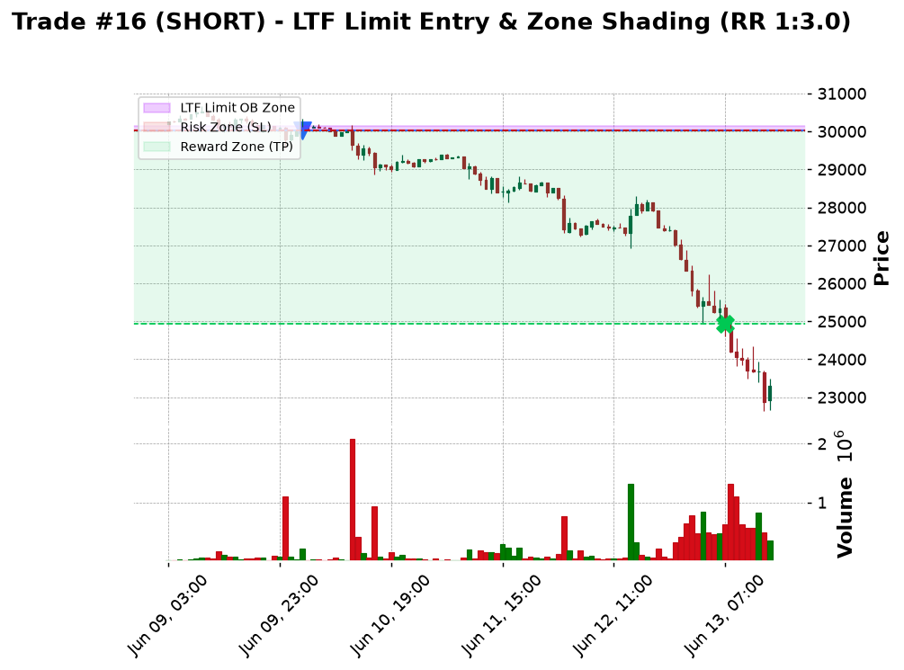

---

### Lệnh #17 — SHORT | Kết quả: **BE (+0.00R)**
- **Tín hiệu CHoCH:** `2022-09-23 10:00:00+00:00` | **Khớp Limit:** `2022-09-23 13:00:00+00:00` | **Đóng lệnh:** `2022-09-23 22:00:00+00:00`
- **Entry Limit:** `19075.0` | **SL:** `19075.0` | **TP:** `17468.0586` | **RR:** `1:3.0`
- **Vùng OB 4H:** `19126.8 - 19472.6` (Cấu trúc 4H: `BEAR`)

#### Khung cấu trúc HTF 4H
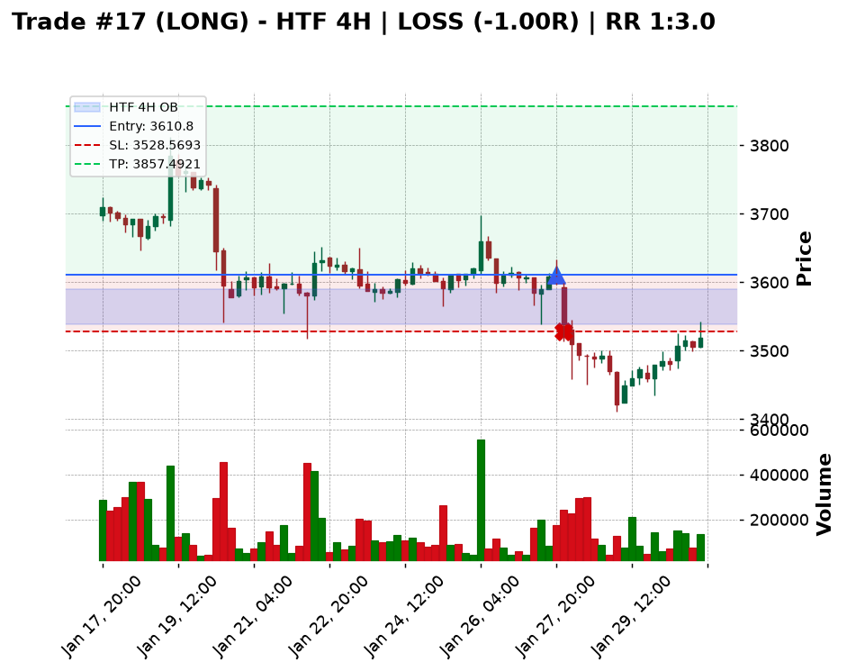

#### Khung vào lệnh Limit LTF

---

### Lệnh #18 — LONG | Kết quả: **LOSS (-1.00R)**
- **Tín hiệu CHoCH:** `2022-10-09 11:00:00+00:00` | **Khớp Limit:** `2022-10-09 19:00:00+00:00` | **Đóng lệnh:** `2022-10-10 22:00:00+00:00`
- **Entry Limit:** `19445.0` | **SL:** `19121.3114` | **TP:** `20416.0657` | **RR:** `1:3.0`
- **Vùng OB 4H:** `19180.0 - 19507.0` (Cấu trúc 4H: `SIDEWAY`)

#### Khung cấu trúc HTF 4H

#### Khung vào lệnh Limit LTF
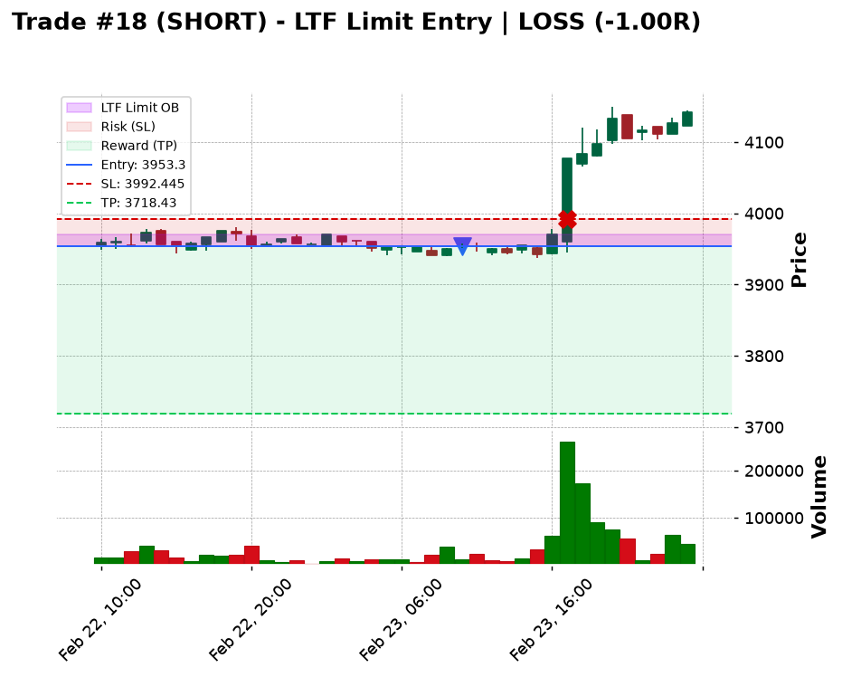

---

### Lệnh #19 — SHORT | Kết quả: **BE (+0.00R)**
- **Tín hiệu CHoCH:** `2023-02-19 08:00:00+00:00` | **Khớp Limit:** `2023-02-19 13:00:00+00:00` | **Đóng lệnh:** `2023-02-19 17:00:00+00:00`
- **Entry Limit:** `24714.3` | **SL:** `24714.3` | **TP:** `21351.8` | **RR:** `1:5.67`
- **Vùng OB 4H:** `24648.4 - 25154.1` (Cấu trúc 4H: `SIDEWAY`)

#### Khung cấu trúc HTF 4H

#### Khung vào lệnh Limit LTF

---

### Lệnh #20 — SHORT | Kết quả: **BE (+0.00R)**
- **Tín hiệu CHoCH:** `2023-02-21 13:00:00+00:00` | **Khớp Limit:** `2023-02-21 14:00:00+00:00` | **Đóng lệnh:** `2023-02-21 15:00:00+00:00`
- **Entry Limit:** `24658.3` | **SL:** `24658.3` | **TP:** `21351.8` | **RR:** `1:5.1`
- **Vùng OB 4H:** `24648.4 - 25154.1` (Cấu trúc 4H: `SIDEWAY`)

#### Khung cấu trúc HTF 4H

#### Khung vào lệnh Limit LTF

---

### Lệnh #21 — SHORT | Kết quả: **BE (+0.00R)**
- **Tín hiệu CHoCH:** `2023-02-22 15:00:00+00:00` | **Khớp Limit:** `2023-02-22 23:00:00+00:00` | **Đóng lệnh:** `2023-02-23 10:00:00+00:00`
- **Entry Limit:** `24077.6` | **SL:** `24077.6` | **TP:** `20388.9779` | **RR:** `1:3.0`
- **Vùng OB 4H:** `24648.4 - 25154.1` (Cấu trúc 4H: `SIDEWAY`)

#### Khung cấu trúc HTF 4H

#### Khung vào lệnh Limit LTF

---

### Lệnh #22 — SHORT | Kết quả: **BE (+0.00R)**
- **Tín hiệu CHoCH:** `2023-04-28 13:00:00+00:00` | **Khớp Limit:** `2023-04-28 14:00:00+00:00` | **Đóng lệnh:** `2023-04-28 19:00:00+00:00`
- **Entry Limit:** `29337.9` | **SL:** `29337.9` | **TP:** `26913.4221` | **RR:** `1:3.0`
- **Vùng OB 4H:** `29078.4 - 30005.4` (Cấu trúc 4H: `BULL`)

#### Khung cấu trúc HTF 4H

#### Khung vào lệnh Limit LTF
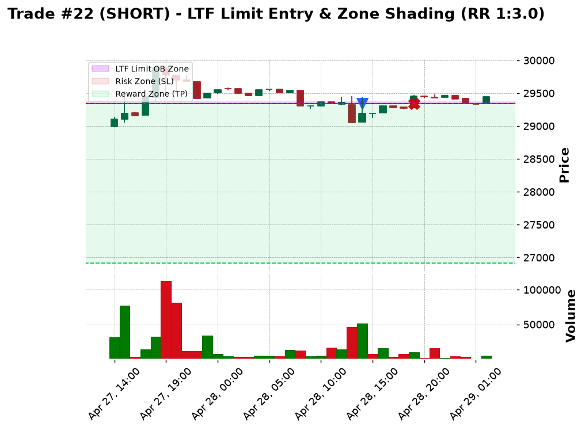

---

### Lệnh #23 — SHORT | Kết quả: **BE (+0.00R)**
- **Tín hiệu CHoCH:** `2023-05-01 15:00:00+00:00` | **Khớp Limit:** `2023-05-01 17:00:00+00:00` | **Đóng lệnh:** `2023-05-02 14:00:00+00:00`
- **Entry Limit:** `28616.7` | **SL:** `28616.7` | **TP:** `24028.6221` | **RR:** `1:3.0`
- **Vùng OB 4H:** `29078.4 - 30005.4` (Cấu trúc 4H: `SIDEWAY`)

#### Khung cấu trúc HTF 4H

#### Khung vào lệnh Limit LTF

---

### Lệnh #24 — SHORT | Kết quả: **BE (+0.00R)**
- **Tín hiệu CHoCH:** `2023-05-04 12:00:00+00:00` | **Khớp Limit:** `2023-05-04 13:00:00+00:00` | **Đóng lệnh:** `2023-05-05 01:00:00+00:00`
- **Entry Limit:** `29143.0` | **SL:** `29143.0` | **TP:** `26133.8221` | **RR:** `1:3.0`
- **Vùng OB 4H:** `29078.4 - 30005.4` (Cấu trúc 4H: `BEAR`)

#### Khung cấu trúc HTF 4H
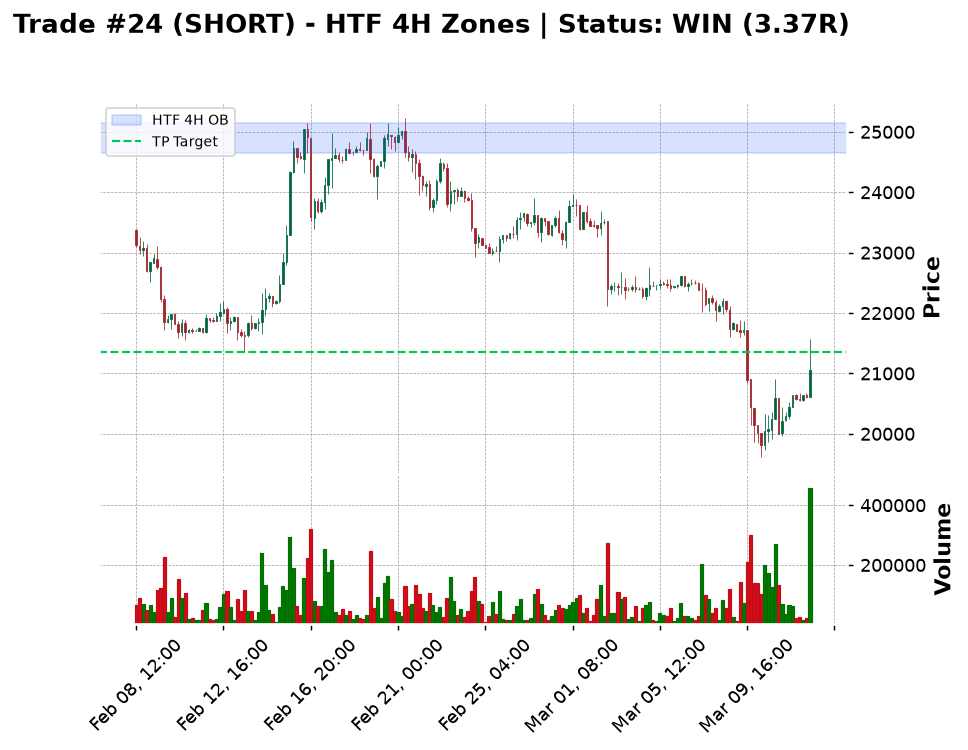

#### Khung vào lệnh Limit LTF

---

### Lệnh #25 — SHORT | Kết quả: **WIN (+3.00R)**
- **Tín hiệu CHoCH:** `2023-05-06 14:00:00+00:00` | **Khớp Limit:** `2023-05-07 01:00:00+00:00` | **Đóng lệnh:** `2023-05-12 06:00:00+00:00`
- **Entry Limit:** `29194.3` | **SL:** `29194.3` | **TP:** `26339.0221` | **RR:** `1:3.0`
- **Vùng OB 4H:** `29078.4 - 30005.4` (Cấu trúc 4H: `BEAR`)

#### Khung cấu trúc HTF 4H

#### Khung vào lệnh Limit LTF
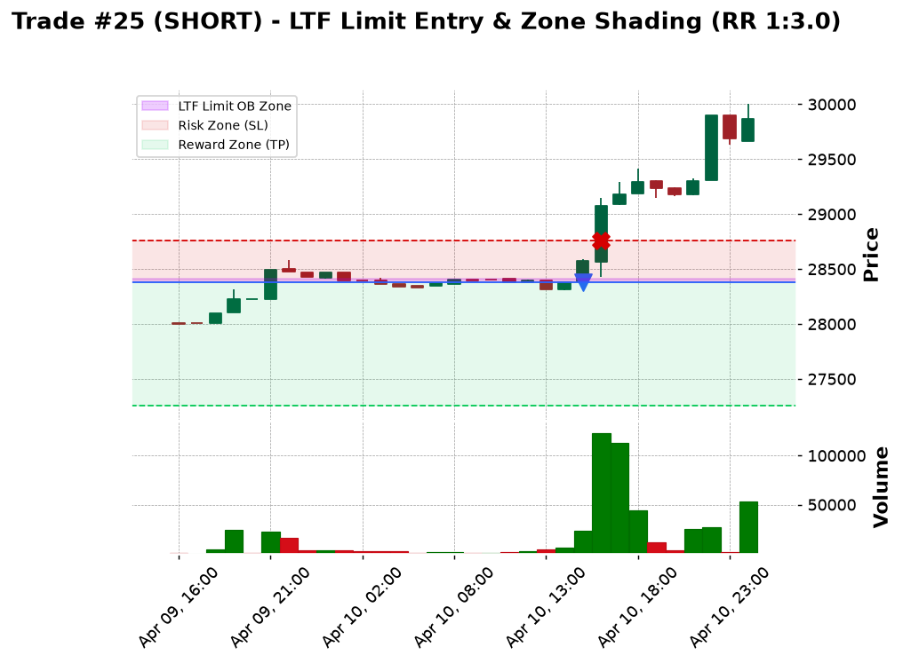

---

### Lệnh #26 — LONG | Kết quả: **BE (+0.00R)**
- **Tín hiệu CHoCH:** `2023-05-19 12:00:00+00:00` | **Khớp Limit:** `2023-05-19 14:00:00+00:00` | **Đóng lệnh:** `2023-05-21 12:00:00+00:00`
- **Entry Limit:** `26925.2` | **SL:** `26925.2` | **TP:** `27909.2729` | **RR:** `1:3.0`
- **Vùng OB 4H:** `26663.6 - 26859.9` (Cấu trúc 4H: `BULL`)

#### Khung cấu trúc HTF 4H

#### Khung vào lệnh Limit LTF

---

### Lệnh #27 — LONG | Kết quả: **BE (+0.00R)**
- **Tín hiệu CHoCH:** `2023-05-22 13:00:00+00:00` | **Khớp Limit:** `2023-05-22 17:00:00+00:00` | **Đóng lệnh:** `2023-05-24 03:00:00+00:00`
- **Entry Limit:** `26868.9` | **SL:** `26868.9` | **TP:** `27707.7` | **RR:** `1:3.09`
- **Vùng OB 4H:** `26663.6 - 26859.9` (Cấu trúc 4H: `BEAR`)

#### Khung cấu trúc HTF 4H

#### Khung vào lệnh Limit LTF

---

### Lệnh #28 — SHORT | Kết quả: **LOSS (-1.00R)**
- **Tín hiệu CHoCH:** `2025-08-08 15:00:00+00:00` | **Khớp Limit:** `2025-08-08 17:00:00+00:00` | **Đóng lệnh:** `2025-08-10 15:00:00+00:00`
- **Entry Limit:** `116625.0` | **SL:** `118802.0729` | **TP:** `110093.7814` | **RR:** `1:3.0`
- **Vùng OB 4H:** `117898.3 - 118523.3` (Cấu trúc 4H: `SIDEWAY`)

#### Khung cấu trúc HTF 4H
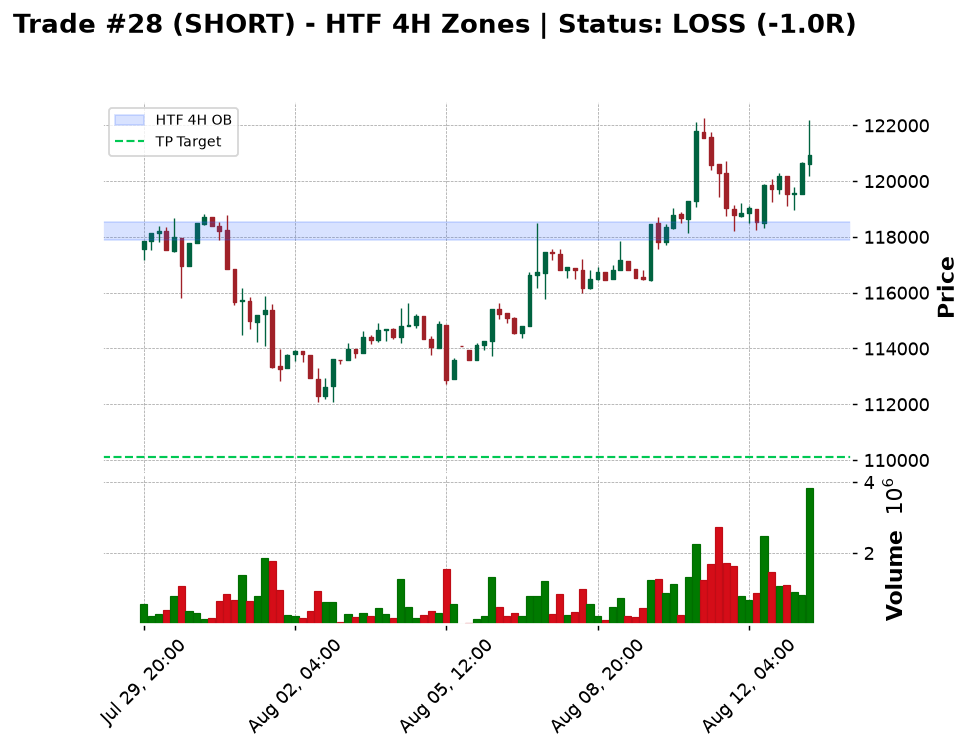

#### Khung vào lệnh Limit LTF

---

### Lệnh #29 — LONG | Kết quả: **BE (+0.00R)**
- **Tín hiệu CHoCH:** `2026-02-20 09:00:00+00:00` | **Khớp Limit:** `2026-02-20 10:00:00+00:00` | **Đóng lệnh:** `2026-02-20 22:00:00+00:00`
- **Entry Limit:** `67935.6` | **SL:** `67935.6` | **TP:** `74732.8693` | **RR:** `1:3.0`
- **Vùng OB 4H:** `66135.6 - 67160.6` (Cấu trúc 4H: `BEAR`)

#### Khung cấu trúc HTF 4H
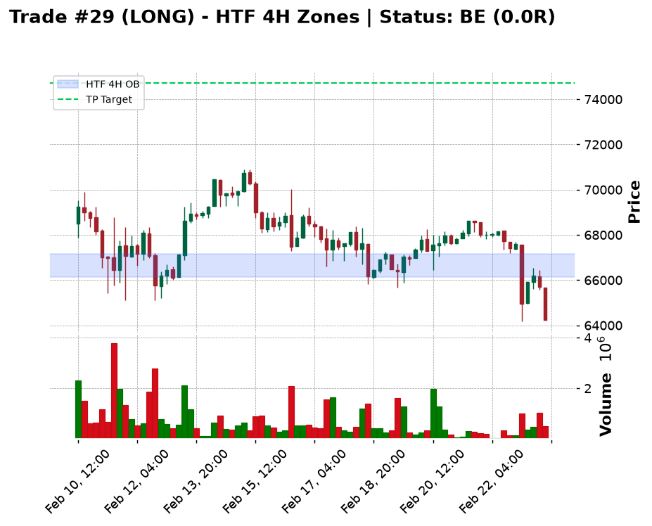

#### Khung vào lệnh Limit LTF

---

### Lệnh #30 — LONG | Kết quả: **BE (+0.00R)**
- **Tín hiệu CHoCH:** `2026-08-02 16:00:00+00:00` | **Khớp Limit:** `2026-08-03 01:00:00+00:00` | **Đóng lệnh:** `2026-08-03 13:00:00+00:00`
- **Entry Limit:** `63087.5` | **SL:** `63087.5` | **TP:** `65624.0621` | **RR:** `1:3.0`
- **Vùng OB 4H:** `62475.0 - 62800.0` (Cấu trúc 4H: `BEAR`)

#### Khung cấu trúc HTF 4H

#### Khung vào lệnh Limit LTF

---
