# Báo Cáo Backtest SMC Pro MTF - CEX_BTCUSD_1h

## 1. Cấu hình & Phạm vi dữ liệu

- **Dữ liệu đầu vào:** `data/CEX_BTCUSD_1h.csv` (LTF: 1H -> HTF: 4H)
- **Thời gian dữ liệu:** `2015-09-22 11:00:00+00:00` -> `2026-11-17 23:00:00+00:00`
- **Cơ chế vào lệnh:** Limit tại Extreme OB/FVG sau CHoCH
- **Bộ lọc phiên Killzones (London/NY):** `TẮT`
- **Quản lý vốn Partial TP (50% tại 2.0R) + BE:** `TẮT`

## 2. Thống kê hiệu suất tổng quan

| Chỉ số | Giá trị |
| :--- | :--- |
| **Tổng số lệnh đã khớp** | 71 |
| **Thắng trọn vẹn (Full WIN)** | 25 |
| **Thắng từng phần (Partial WIN +1R)** | 0 |
| **Thua (LOSS -1R)** | 46 |
| **Tỷ lệ lệnh có lãi (Winrate)** | **35.21%** |
| **Tổng lợi nhuận ròng (R)** | **+37.50R** |
| **Tỷ lệ R:R mục tiêu trung bình** | 1:3.55 |

## 3. Chi tiết lệnh & Biểu đồ phân tích Zone Shading

### Lệnh #1 — SHORT | Kết quả: **WIN (+5.49R)**
- **Tín hiệu CHoCH:** `2015-12-19 13:00:00+00:00` | **Khớp Limit:** `2015-12-19 14:00:00+00:00` | **Đóng lệnh:** `2015-12-20 16:00:00+00:00`
- **Entry Limit:** `466.3283` | **SL:** `469.3571` | **TP:** `449.6898` | **RR mục tiêu:** `1:5.49`
- **Vùng OB 4H:** `464.565 - 467.57` (Cấu trúc 4H: `SIDEWAY`)

#### Khung cấu trúc HTF 4H (Kèm Entry / SL / TP)

#### Khung vào lệnh Limit LTF

---

### Lệnh #2 — SHORT | Kết quả: **LOSS (-1.00R)**
- **Tín hiệu CHoCH:** `2016-06-27 11:00:00+00:00` | **Khớp Limit:** `2016-06-27 14:00:00+00:00` | **Đóng lệnh:** `2016-06-30 17:00:00+00:00`
- **Entry Limit:** `650.7698` | **SL:** `672.4476` | **TP:** `548.85` | **RR mục tiêu:** `1:4.7`
- **Vùng OB 4H:** `654.5109 - 665.0` (Cấu trúc 4H: `BEAR`)

#### Khung cấu trúc HTF 4H (Kèm Entry / SL / TP)
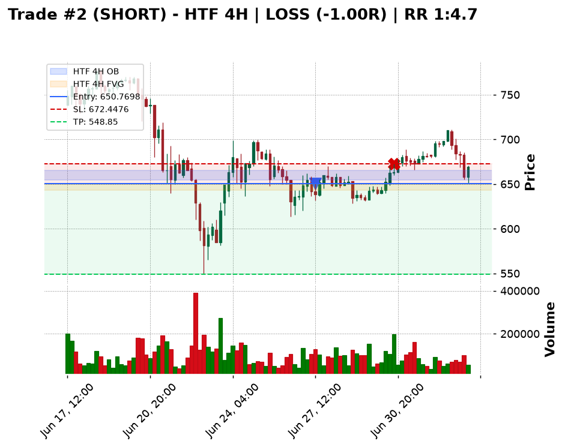

#### Khung vào lệnh Limit LTF

---

### Lệnh #3 — LONG | Kết quả: **WIN (+3.00R)**
- **Tín hiệu CHoCH:** `2016-08-30 07:00:00+00:00` | **Khớp Limit:** `2016-08-30 08:00:00+00:00` | **Đóng lệnh:** `2016-09-08 08:00:00+00:00`
- **Entry Limit:** `589.37` | **SL:** `576.0496` | **TP:** `629.3313` | **RR mục tiêu:** `1:3.0`
- **Vùng OB 4H:** `577.982 - 588.3223` (Cấu trúc 4H: `SIDEWAY`)

#### Khung cấu trúc HTF 4H (Kèm Entry / SL / TP)
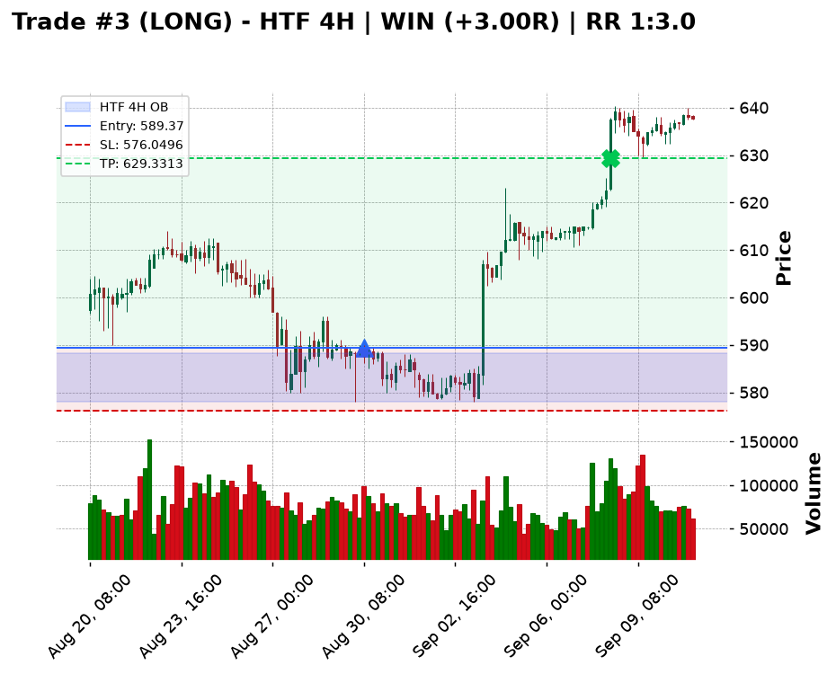

#### Khung vào lệnh Limit LTF
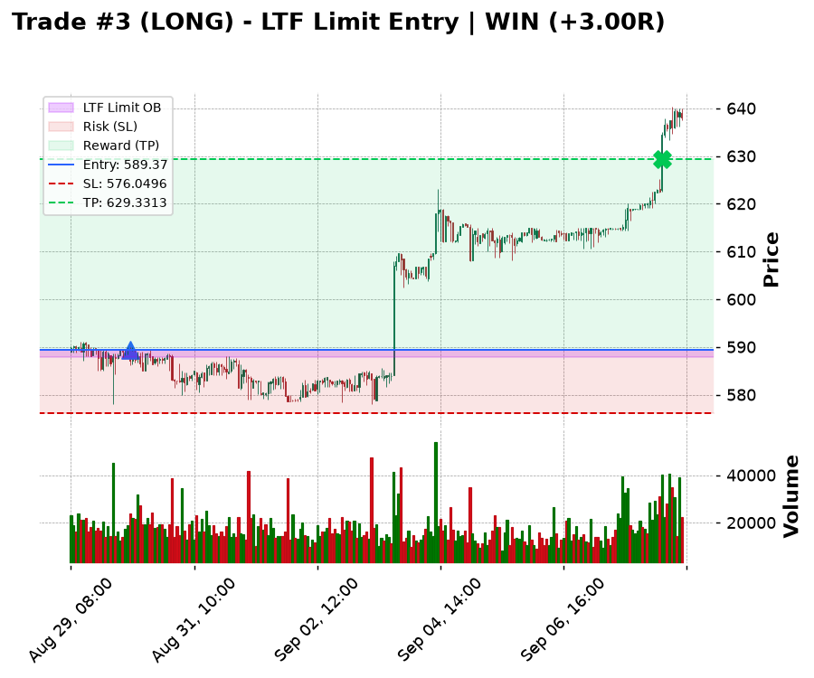

---

### Lệnh #4 — LONG | Kết quả: **LOSS (-1.00R)**
- **Tín hiệu CHoCH:** `2016-09-12 03:00:00+00:00` | **Khớp Limit:** `2016-09-12 04:00:00+00:00` | **Đóng lệnh:** `2016-09-16 05:00:00+00:00`
- **Entry Limit:** `628.28` | **SL:** `613.519` | **TP:** `672.5629` | **RR mục tiêu:** `1:3.0`
- **Vùng OB 4H:** `614.4 - 614.7902` (Cấu trúc 4H: `BULL`)

#### Khung cấu trúc HTF 4H (Kèm Entry / SL / TP)
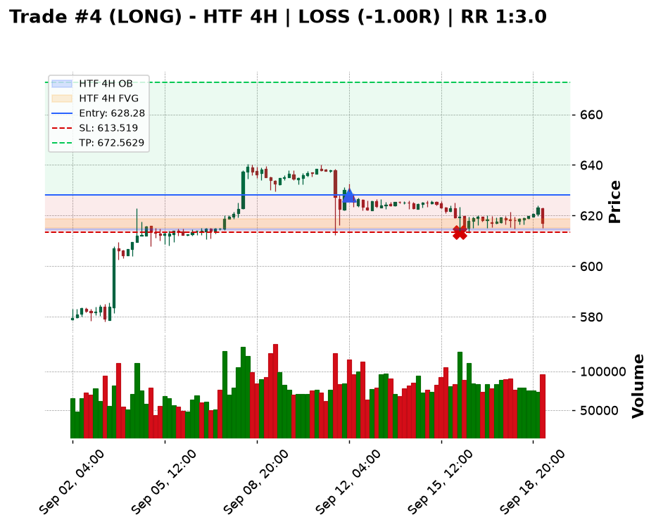

#### Khung vào lệnh Limit LTF

---

### Lệnh #5 — SHORT | Kết quả: **LOSS (-1.00R)**
- **Tín hiệu CHoCH:** `2016-12-14 00:00:00+00:00` | **Khớp Limit:** `2016-12-14 01:00:00+00:00` | **Đóng lệnh:** `2016-12-17 02:00:00+00:00`
- **Entry Limit:** `781.806` | **SL:** `791.1014` | **TP:** `753.9198` | **RR mục tiêu:** `1:3.0`
- **Vùng OB 4H:** `777.86 - 789.1236` (Cấu trúc 4H: `SIDEWAY`)

#### Khung cấu trúc HTF 4H (Kèm Entry / SL / TP)

#### Khung vào lệnh Limit LTF

---

### Lệnh #6 — SHORT | Kết quả: **WIN (+4.97R)**
- **Tín hiệu CHoCH:** `2017-03-16 03:00:00+00:00` | **Khớp Limit:** `2017-03-16 04:00:00+00:00` | **Đóng lệnh:** `2017-03-17 03:00:00+00:00`
- **Entry Limit:** `1262.2304` | **SL:** `1285.4294` | **TP:** `1147.0` | **RR mục tiêu:** `1:4.97`
- **Vùng OB 4H:** `1242.1154 - 1271.5012` (Cấu trúc 4H: `SIDEWAY`)

#### Khung cấu trúc HTF 4H (Kèm Entry / SL / TP)
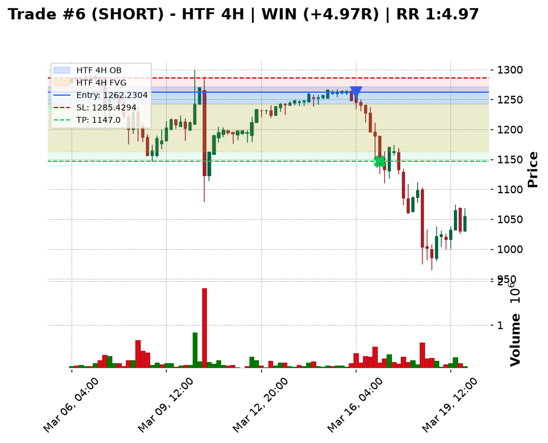

#### Khung vào lệnh Limit LTF

---

### Lệnh #7 — SHORT | Kết quả: **LOSS (-1.00R)**
- **Tín hiệu CHoCH:** `2017-09-20 04:00:00+00:00` | **Khớp Limit:** `2017-09-20 05:00:00+00:00` | **Đóng lệnh:** `2017-09-20 14:00:00+00:00`
- **Entry Limit:** `4055.3` | **SL:** `4151.0647` | **TP:** `3674.9997` | **RR mục tiêu:** `1:3.97`
- **Vùng OB 4H:** `4067.196 - 4113.9999` (Cấu trúc 4H: `SIDEWAY`)

#### Khung cấu trúc HTF 4H (Kèm Entry / SL / TP)
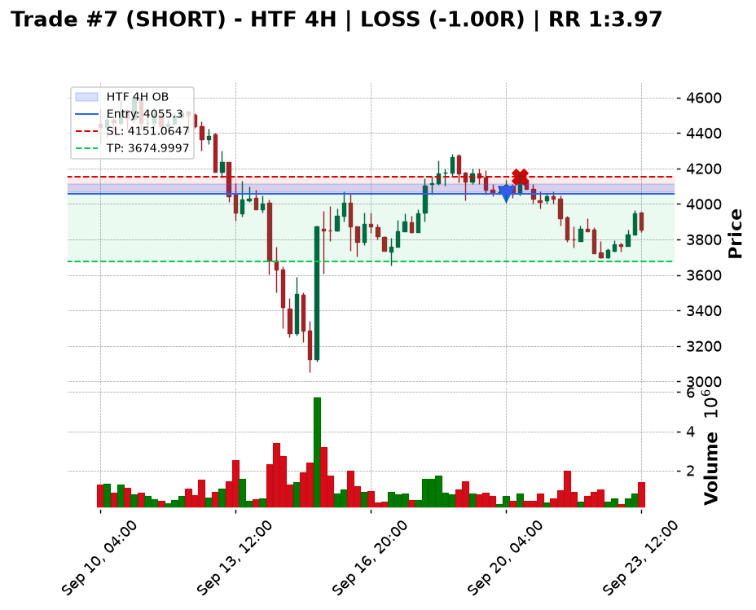

#### Khung vào lệnh Limit LTF

---

### Lệnh #8 — LONG | Kết quả: **WIN (+3.00R)**
- **Tín hiệu CHoCH:** `2017-12-31 14:00:00+00:00` | **Khớp Limit:** `2017-12-31 15:00:00+00:00` | **Đóng lệnh:** `2018-01-05 17:00:00+00:00`
- **Entry Limit:** `14679.21` | **SL:** `13677.6124` | **TP:** `17684.0029` | **RR mục tiêu:** `1:3.0`
- **Vùng OB 4H:** `13900.0 - 14569.98` (Cấu trúc 4H: `SIDEWAY`)

#### Khung cấu trúc HTF 4H (Kèm Entry / SL / TP)

#### Khung vào lệnh Limit LTF
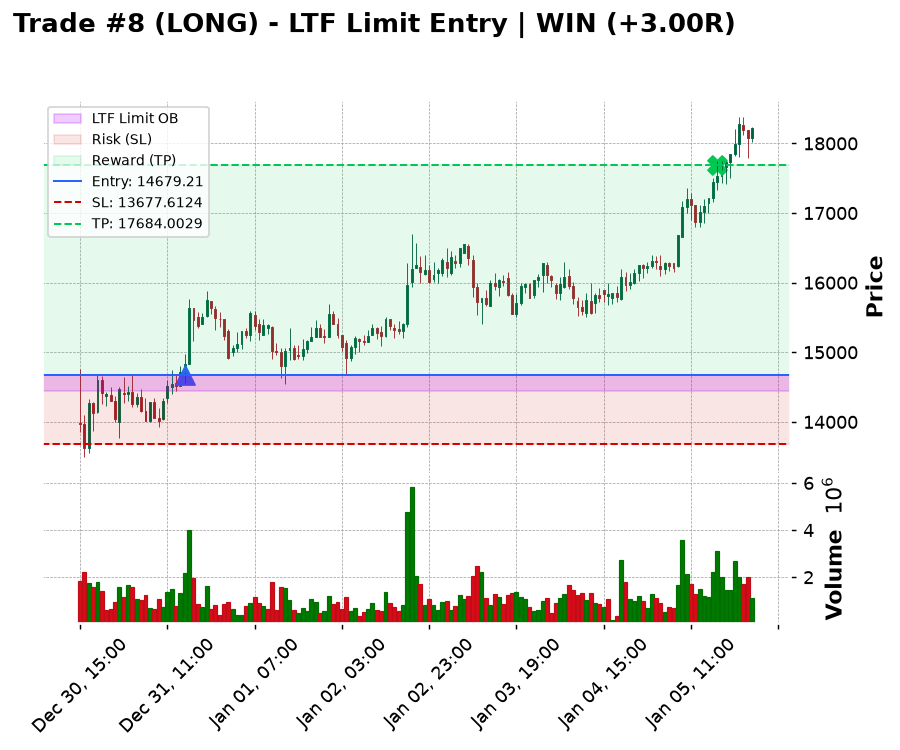

---

### Lệnh #9 — LONG | Kết quả: **LOSS (-1.00R)**
- **Tín hiệu CHoCH:** `2018-02-25 07:00:00+00:00` | **Khớp Limit:** `2018-02-25 08:00:00+00:00` | **Đóng lệnh:** `2018-02-25 13:00:00+00:00`
- **Entry Limit:** `9855.1` | **SL:** `9662.085` | **TP:** `11013.19` | **RR mục tiêu:** `1:6.0`
- **Vùng OB 4H:** `9777.0 - 9980.0` (Cấu trúc 4H: `SIDEWAY`)

#### Khung cấu trúc HTF 4H (Kèm Entry / SL / TP)

#### Khung vào lệnh Limit LTF

---

### Lệnh #10 — LONG | Kết quả: **WIN (+3.00R)**
- **Tín hiệu CHoCH:** `2018-04-18 16:00:00+00:00` | **Khớp Limit:** `2018-04-18 17:00:00+00:00` | **Đóng lệnh:** `2018-04-20 22:00:00+00:00`
- **Entry Limit:** `8088.5` | **SL:** `7866.565` | **TP:** `8754.305` | **RR mục tiêu:** `1:3.0`
- **Vùng OB 4H:** `7910.5 - 7973.0` (Cấu trúc 4H: `BULL`)

#### Khung cấu trúc HTF 4H (Kèm Entry / SL / TP)
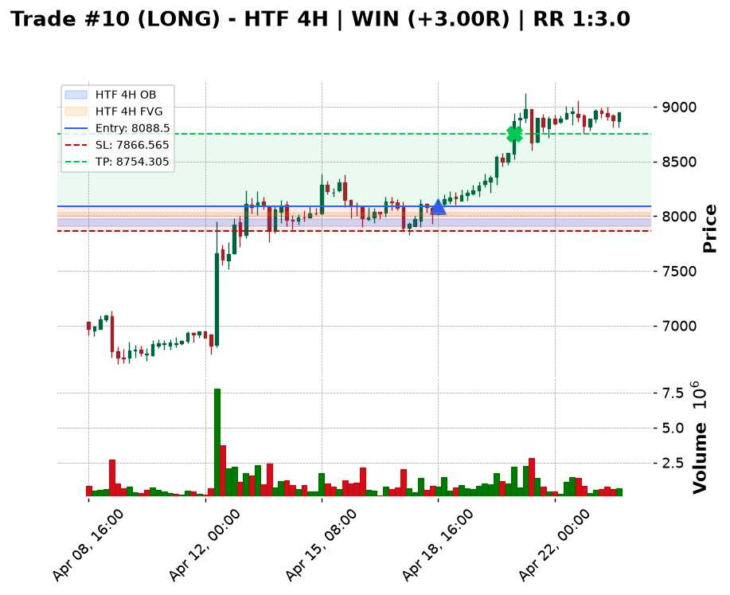

#### Khung vào lệnh Limit LTF
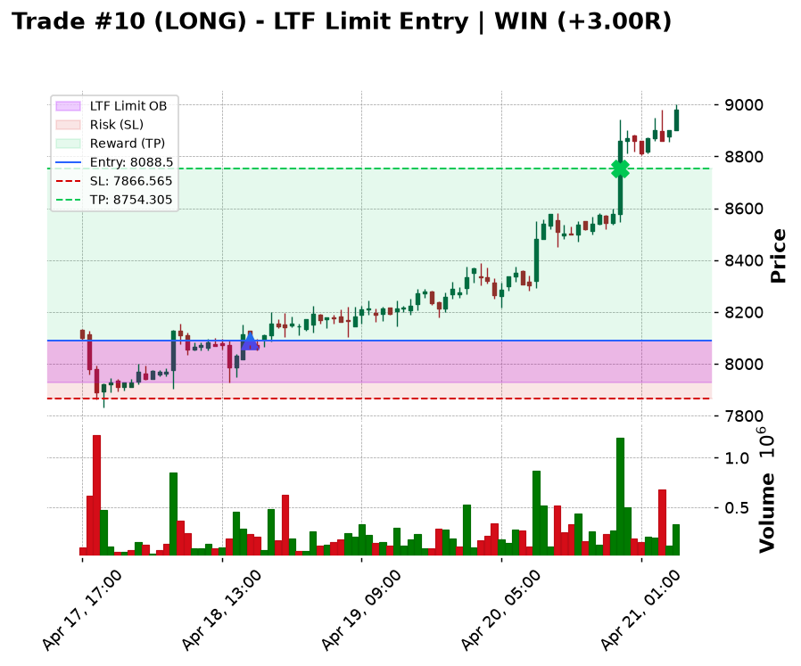

---

### Lệnh #11 — SHORT | Kết quả: **WIN (+4.03R)**
- **Tín hiệu CHoCH:** `2018-06-06 16:00:00+00:00` | **Khớp Limit:** `2018-06-06 20:00:00+00:00` | **Đóng lệnh:** `2018-06-10 17:00:00+00:00`
- **Entry Limit:** `7640.5` | **SL:** `7760.8036` | **TP:** `7156.0` | **RR mục tiêu:** `1:4.03`
- **Vùng OB 4H:** `7651.0 - 7739.9` (Cấu trúc 4H: `SIDEWAY`)

#### Khung cấu trúc HTF 4H (Kèm Entry / SL / TP)

#### Khung vào lệnh Limit LTF

---

### Lệnh #12 — SHORT | Kết quả: **LOSS (-1.00R)**
- **Tín hiệu CHoCH:** `2018-08-15 23:00:00+00:00` | **Khớp Limit:** `2018-08-16 07:00:00+00:00` | **Đóng lệnh:** `2018-08-22 01:00:00+00:00`
- **Entry Limit:** `6365.6` | **SL:** `6692.6786` | **TP:** `5384.3643` | **RR mục tiêu:** `1:3.0`
- **Vùng OB 4H:** `6394.3 - 6639.9` (Cấu trúc 4H: `SIDEWAY`)

#### Khung cấu trúc HTF 4H (Kèm Entry / SL / TP)

#### Khung vào lệnh Limit LTF

---

### Lệnh #13 — LONG | Kết quả: **LOSS (-1.00R)**
- **Tín hiệu CHoCH:** `2018-11-11 23:00:00+00:00` | **Khớp Limit:** `2018-11-12 00:00:00+00:00` | **Đóng lệnh:** `2018-11-13 02:00:00+00:00`
- **Entry Limit:** `6368.9` | **SL:** `6330.825` | **TP:** `6521.055` | **RR mục tiêu:** `1:4.0`
- **Vùng OB 4H:** `6339.3 - 6358.1` (Cấu trúc 4H: `SIDEWAY`)

#### Khung cấu trúc HTF 4H (Kèm Entry / SL / TP)
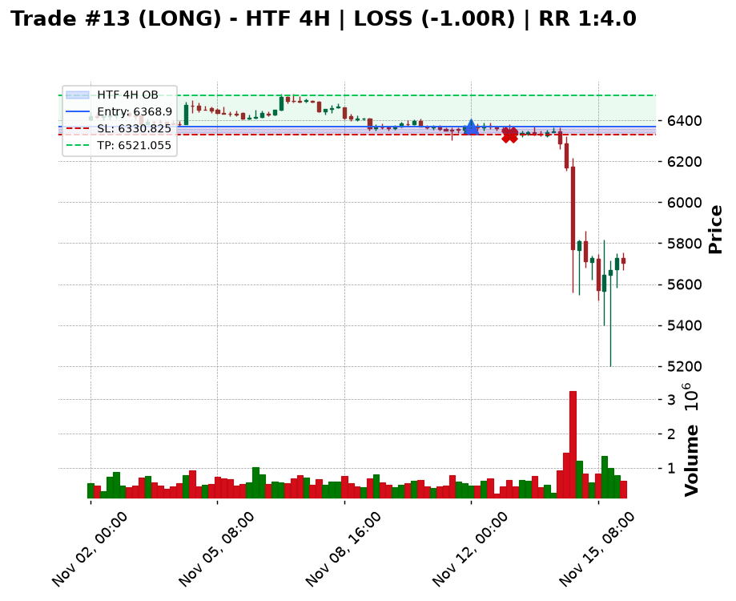

#### Khung vào lệnh Limit LTF

---

### Lệnh #14 — SHORT | Kết quả: **WIN (+3.00R)**
- **Tín hiệu CHoCH:** `2018-11-29 19:00:00+00:00` | **Khớp Limit:** `2018-11-29 20:00:00+00:00` | **Đóng lệnh:** `2018-12-06 14:00:00+00:00`
- **Entry Limit:** `4260.6` | **SL:** `4446.2007` | **TP:** `3703.7979` | **RR mục tiêu:** `1:3.0`
- **Vùng OB 4H:** `4250.2 - 4393.0` (Cấu trúc 4H: `SIDEWAY`)

#### Khung cấu trúc HTF 4H (Kèm Entry / SL / TP)

#### Khung vào lệnh Limit LTF
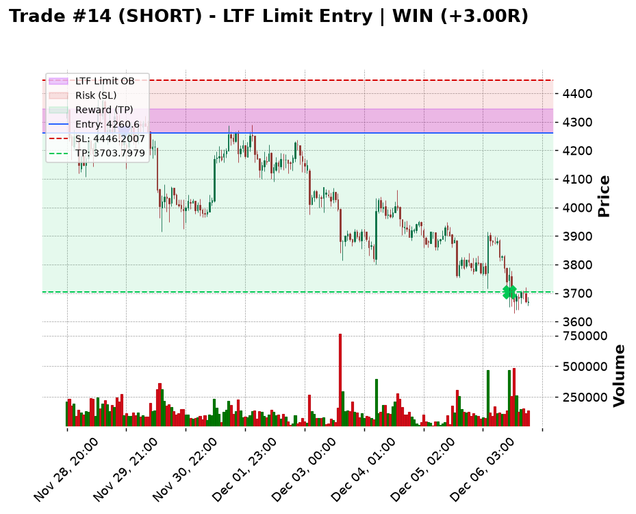

---

### Lệnh #15 — SHORT | Kết quả: **LOSS (-1.00R)**
- **Tín hiệu CHoCH:** `2019-01-17 02:00:00+00:00` | **Khớp Limit:** `2019-01-17 04:00:00+00:00` | **Đóng lệnh:** `2019-01-19 10:00:00+00:00`
- **Entry Limit:** `3666.7` | **SL:** `3737.7643` | **TP:** `3453.5071` | **RR mục tiêu:** `1:3.0`
- **Vùng OB 4H:** `3709.1 - 3722.1` (Cấu trúc 4H: `BEAR`)

#### Khung cấu trúc HTF 4H (Kèm Entry / SL / TP)
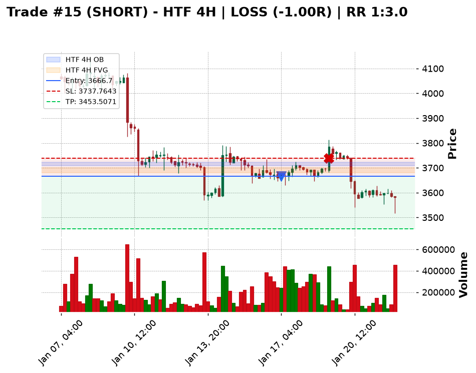

#### Khung vào lệnh Limit LTF

---

### Lệnh #16 — LONG | Kết quả: **LOSS (-1.00R)**
- **Tín hiệu CHoCH:** `2019-01-25 15:00:00+00:00` | **Khớp Limit:** `2019-01-25 16:00:00+00:00` | **Đóng lệnh:** `2019-01-27 14:00:00+00:00`
- **Entry Limit:** `3607.4` | **SL:** `3557.1679` | **TP:** `3758.0964` | **RR mục tiêu:** `1:3.0`
- **Vùng OB 4H:** `3564.7 - 3601.2` (Cấu trúc 4H: `SIDEWAY`)

#### Khung cấu trúc HTF 4H (Kèm Entry / SL / TP)

#### Khung vào lệnh Limit LTF

---

### Lệnh #17 — LONG | Kết quả: **LOSS (-1.00R)**
- **Tín hiệu CHoCH:** `2019-01-27 20:00:00+00:00` | **Khớp Limit:** `2019-01-27 21:00:00+00:00` | **Đóng lệnh:** `2019-01-28 03:00:00+00:00`
- **Entry Limit:** `3610.8` | **SL:** `3528.5693` | **TP:** `3857.4921` | **RR mục tiêu:** `1:3.0`
- **Vùng OB 4H:** `3538.6 - 3590.4` (Cấu trúc 4H: `SIDEWAY`)

#### Khung cấu trúc HTF 4H (Kèm Entry / SL / TP)

#### Khung vào lệnh Limit LTF

---

### Lệnh #18 — SHORT | Kết quả: **LOSS (-1.00R)**
- **Tín hiệu CHoCH:** `2019-02-23 04:00:00+00:00` | **Khớp Limit:** `2019-02-23 10:00:00+00:00` | **Đóng lệnh:** `2019-02-23 17:00:00+00:00`
- **Entry Limit:** `3953.3` | **SL:** `3992.445` | **TP:** `3718.43` | **RR mục tiêu:** `1:6.0`
- **Vùng OB 4H:** `3958.0 - 3978.9` (Cấu trúc 4H: `SIDEWAY`)

#### Khung cấu trúc HTF 4H (Kèm Entry / SL / TP)
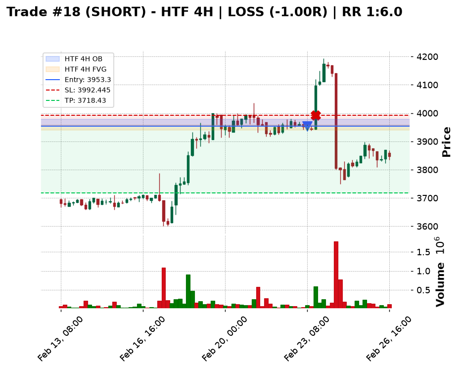

#### Khung vào lệnh Limit LTF

---

### Lệnh #19 — LONG | Kết quả: **WIN (+3.00R)**
- **Tín hiệu CHoCH:** `2019-04-08 00:00:00+00:00` | **Khớp Limit:** `2019-04-08 08:00:00+00:00` | **Đóng lệnh:** `2019-05-09 00:00:00+00:00`
- **Entry Limit:** `5248.9` | **SL:** `4987.4364` | **TP:** `6033.2907` | **RR mục tiêu:** `1:3.0`
- **Vùng OB 4H:** `5013.8 - 5056.0` (Cấu trúc 4H: `BULL`)

#### Khung cấu trúc HTF 4H (Kèm Entry / SL / TP)

#### Khung vào lệnh Limit LTF
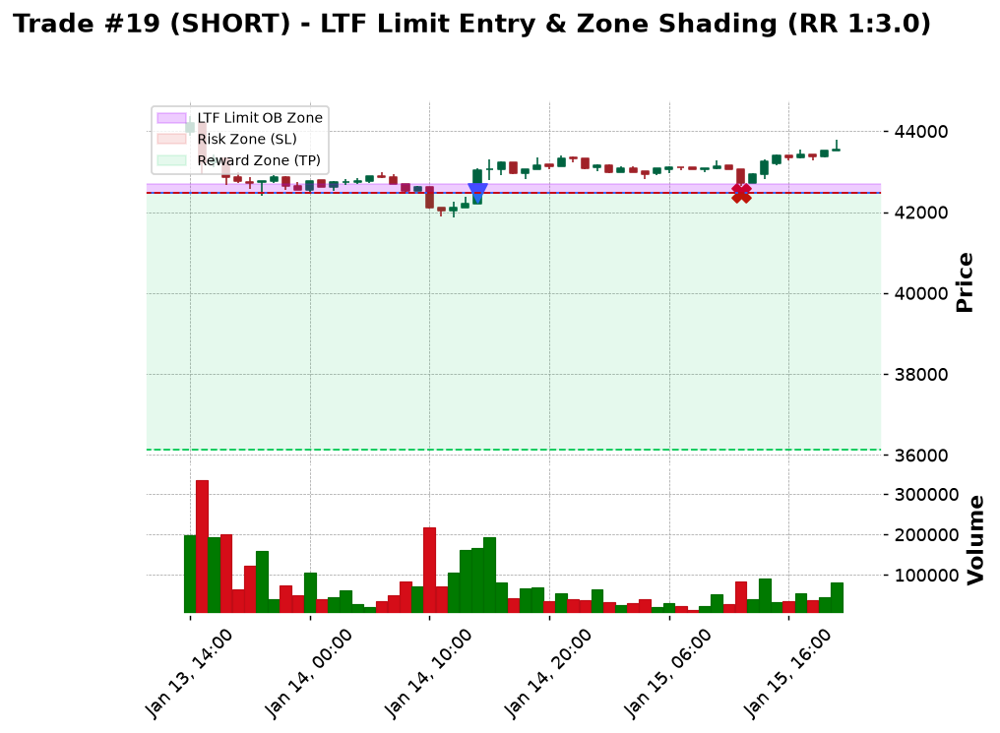

---

### Lệnh #20 — SHORT | Kết quả: **LOSS (-1.00R)**
- **Tín hiệu CHoCH:** `2019-05-26 11:00:00+00:00` | **Khớp Limit:** `2019-05-26 12:00:00+00:00` | **Đóng lệnh:** `2019-05-26 19:00:00+00:00`
- **Entry Limit:** `7965.9` | **SL:** `8183.4693` | **TP:** `7313.1921` | **RR mục tiêu:** `1:3.0`
- **Vùng OB 4H:** `8021.0 - 8135.9` (Cấu trúc 4H: `SIDEWAY`)

#### Khung cấu trúc HTF 4H (Kèm Entry / SL / TP)
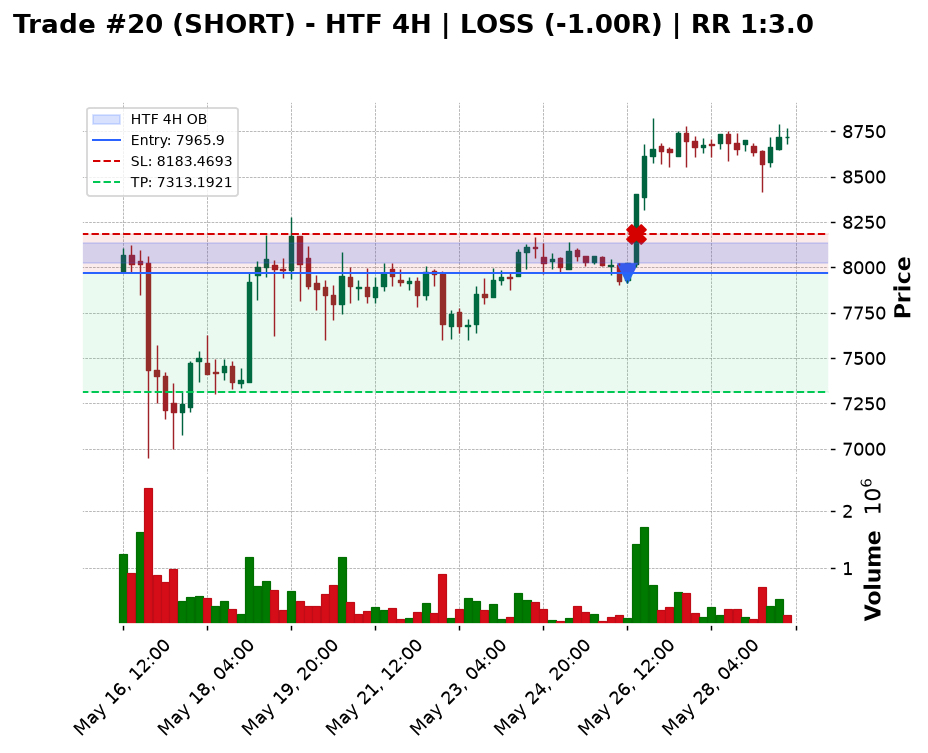

#### Khung vào lệnh Limit LTF

---

### Lệnh #21 — SHORT | Kết quả: **LOSS (-1.00R)**
- **Tín hiệu CHoCH:** `2019-08-01 05:00:00+00:00` | **Khớp Limit:** `2019-08-01 12:00:00+00:00` | **Đóng lệnh:** `2019-08-01 18:00:00+00:00`
- **Entry Limit:** `10018.5` | **SL:** `10192.0543` | **TP:** `9497.8371` | **RR mục tiêu:** `1:3.0`
- **Vùng OB 4H:** `10047.8 - 10134.3` (Cấu trúc 4H: `SIDEWAY`)

#### Khung cấu trúc HTF 4H (Kèm Entry / SL / TP)

#### Khung vào lệnh Limit LTF

---

### Lệnh #22 — LONG | Kết quả: **LOSS (-1.00R)**
- **Tín hiệu CHoCH:** `2019-09-24 05:00:00+00:00` | **Khớp Limit:** `2019-09-24 08:00:00+00:00` | **Đóng lệnh:** `2019-09-24 13:00:00+00:00`
- **Entry Limit:** `9736.8` | **SL:** `9616.3929` | **TP:** `10329.28` | **RR mục tiêu:** `1:4.92`
- **Vùng OB 4H:** `9651.0 - 9818.4` (Cấu trúc 4H: `SIDEWAY`)

#### Khung cấu trúc HTF 4H (Kèm Entry / SL / TP)

#### Khung vào lệnh Limit LTF

---

### Lệnh #23 — LONG | Kết quả: **LOSS (-1.00R)**
- **Tín hiệu CHoCH:** `2020-02-20 16:00:00+00:00` | **Khớp Limit:** `2020-02-20 17:00:00+00:00` | **Đóng lệnh:** `2020-02-26 01:00:00+00:00`
- **Entry Limit:** `9633.5` | **SL:** `9246.875` | **TP:** `10793.375` | **RR mục tiêu:** `1:3.0`
- **Vùng OB 4H:** `9307.7 - 10173.9` (Cấu trúc 4H: `SIDEWAY`)

#### Khung cấu trúc HTF 4H (Kèm Entry / SL / TP)
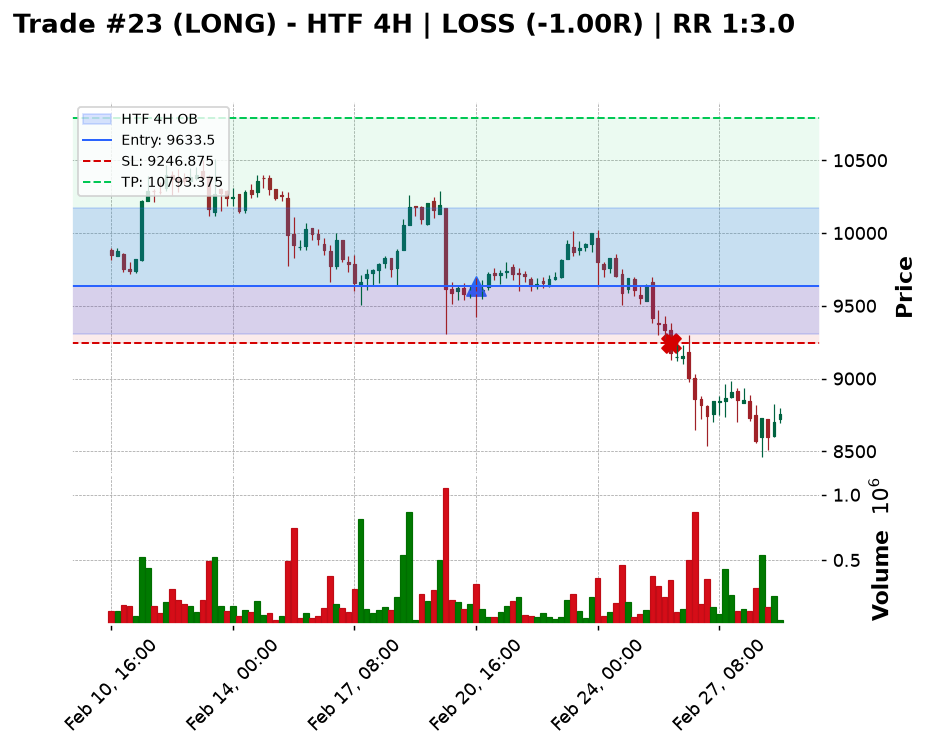

#### Khung vào lệnh Limit LTF

---

### Lệnh #24 — LONG | Kết quả: **LOSS (-1.00R)**
- **Tín hiệu CHoCH:** `2020-03-11 22:00:00+00:00` | **Khớp Limit:** `2020-03-12 01:00:00+00:00` | **Đóng lệnh:** `2020-03-12 06:00:00+00:00`
- **Entry Limit:** `7876.0` | **SL:** `7551.6371` | **TP:** `9133.625` | **RR mục tiêu:** `1:3.88`
- **Vùng OB 4H:** `7610.0 - 7843.0` (Cấu trúc 4H: `SIDEWAY`)

#### Khung cấu trúc HTF 4H (Kèm Entry / SL / TP)

#### Khung vào lệnh Limit LTF
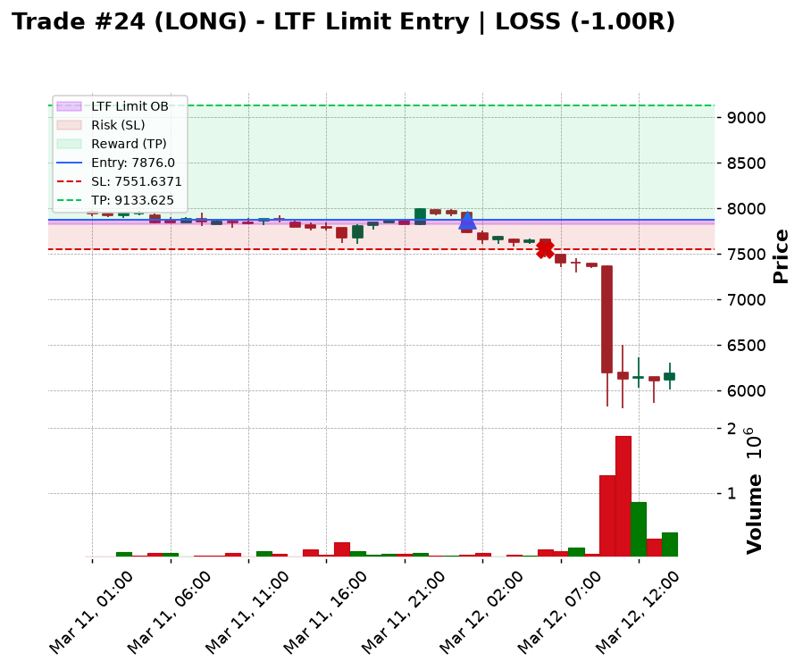

---

### Lệnh #25 — SHORT | Kết quả: **LOSS (-1.00R)**
- **Tín hiệu CHoCH:** `2020-05-07 00:00:00+00:00` | **Khớp Limit:** `2020-05-07 02:00:00+00:00` | **Đóng lệnh:** `2020-05-07 13:00:00+00:00`
- **Entry Limit:** `9280.9` | **SL:** `9455.8193` | **TP:** `8566.16` | **RR mục tiêu:** `1:4.09`
- **Vùng OB 4H:** `9153.5 - 9403.0` (Cấu trúc 4H: `SIDEWAY`)

#### Khung cấu trúc HTF 4H (Kèm Entry / SL / TP)

#### Khung vào lệnh Limit LTF

---

### Lệnh #26 — LONG | Kết quả: **WIN (+3.00R)**
- **Tín hiệu CHoCH:** `2020-05-11 11:00:00+00:00` | **Khớp Limit:** `2020-05-11 16:00:00+00:00` | **Đóng lệnh:** `2020-07-27 16:00:00+00:00`
- **Entry Limit:** `8650.6` | **SL:** `8011.8879` | **TP:** `10566.7364` | **RR mục tiêu:** `1:3.0`
- **Vùng OB 4H:** `8100.0 - 9544.5` (Cấu trúc 4H: `SIDEWAY`)

#### Khung cấu trúc HTF 4H (Kèm Entry / SL / TP)

#### Khung vào lệnh Limit LTF
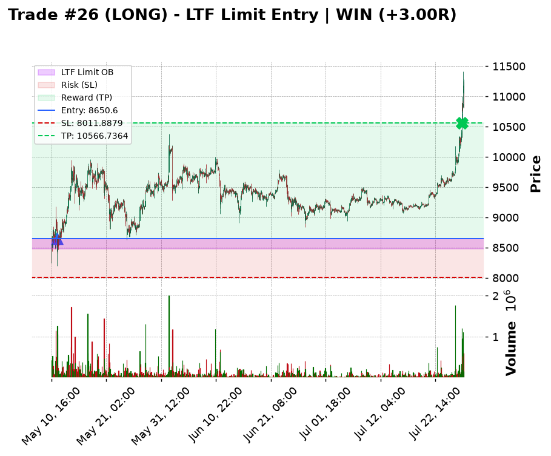

---

### Lệnh #27 — SHORT | Kết quả: **LOSS (-1.00R)**
- **Tín hiệu CHoCH:** `2020-08-31 20:00:00+00:00` | **Khớp Limit:** `2020-08-31 21:00:00+00:00` | **Đóng lệnh:** `2020-09-01 06:00:00+00:00`
- **Entry Limit:** `11733.9` | **SL:** `11836.7307` | **TP:** `11400.0` | **RR mục tiêu:** `1:3.25`
- **Vùng OB 4H:** `11698.9 - 11804.5` (Cấu trúc 4H: `SIDEWAY`)

#### Khung cấu trúc HTF 4H (Kèm Entry / SL / TP)

#### Khung vào lệnh Limit LTF
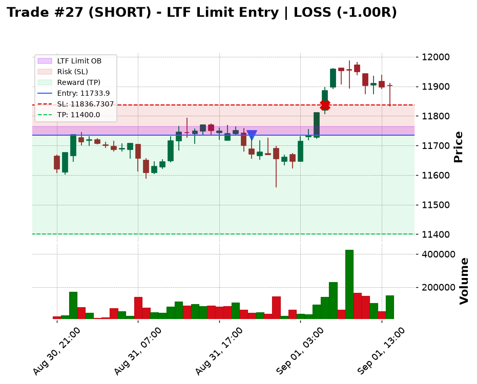

---

### Lệnh #28 — LONG | Kết quả: **WIN (+3.00R)**
- **Tín hiệu CHoCH:** `2020-12-24 20:00:00+00:00` | **Khớp Limit:** `2020-12-24 21:00:00+00:00` | **Đóng lệnh:** `2020-12-27 06:00:00+00:00`
- **Entry Limit:** `23395.9` | **SL:** `22182.1014` | **TP:** `27037.2957` | **RR mục tiêu:** `1:3.0`
- **Vùng OB 4H:** `22400.3 - 23173.0` (Cấu trúc 4H: `SIDEWAY`)

#### Khung cấu trúc HTF 4H (Kèm Entry / SL / TP)

#### Khung vào lệnh Limit LTF
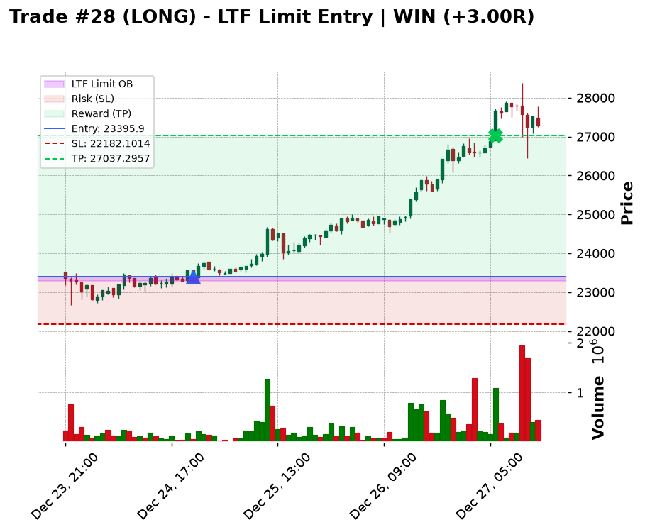

---

### Lệnh #29 — LONG | Kết quả: **LOSS (-1.00R)**
- **Tín hiệu CHoCH:** `2021-02-26 16:00:00+00:00` | **Khớp Limit:** `2021-02-26 19:00:00+00:00` | **Đóng lệnh:** `2021-02-28 05:00:00+00:00`
- **Entry Limit:** `47002.3` | **SL:** `44361.1093` | **TP:** `57731.44` | **RR mục tiêu:** `1:4.06`
- **Vùng OB 4H:** `44952.3 - 46475.8` (Cấu trúc 4H: `SIDEWAY`)

#### Khung cấu trúc HTF 4H (Kèm Entry / SL / TP)

#### Khung vào lệnh Limit LTF
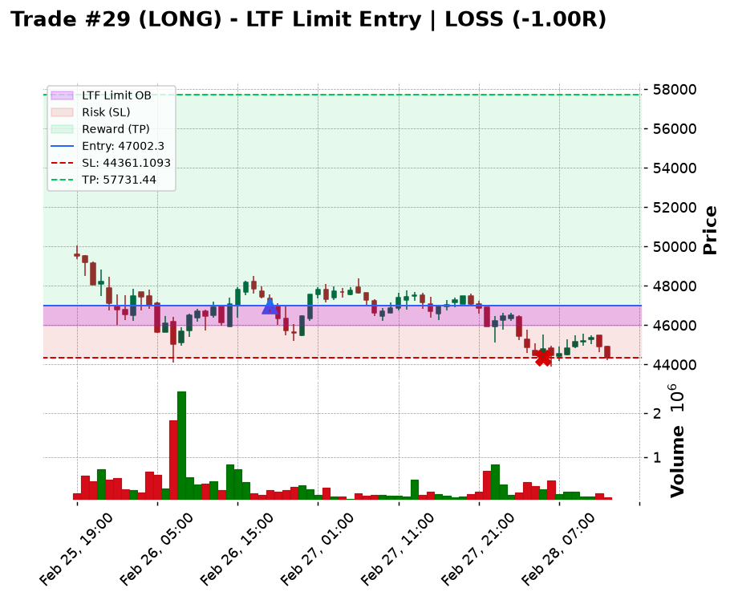

---

### Lệnh #30 — LONG | Kết quả: **LOSS (-1.00R)**
- **Tín hiệu CHoCH:** `2021-03-21 19:00:00+00:00` | **Khớp Limit:** `2021-03-21 23:00:00+00:00` | **Đóng lệnh:** `2021-03-22 20:00:00+00:00`
- **Entry Limit:** `57500.0` | **SL:** `55212.1036` | **TP:** `64363.6893` | **RR mục tiêu:** `1:3.0`
- **Vùng OB 4H:** `55550.0 - 56934.7` (Cấu trúc 4H: `SIDEWAY`)

#### Khung cấu trúc HTF 4H (Kèm Entry / SL / TP)

#### Khung vào lệnh Limit LTF
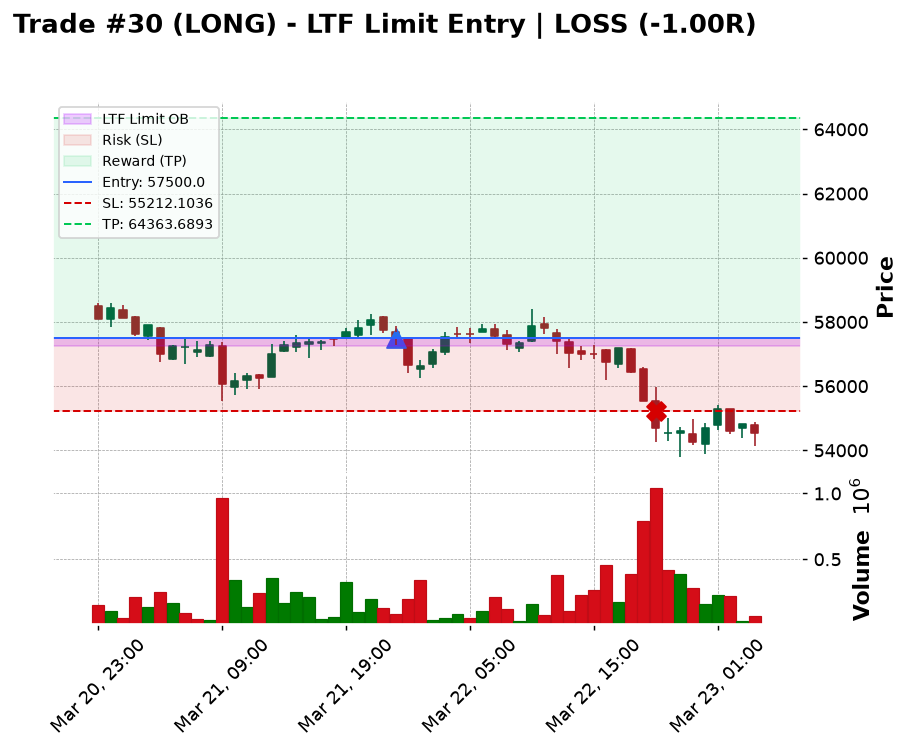

---

### Lệnh #31 — SHORT | Kết quả: **WIN (+3.00R)**
- **Tín hiệu CHoCH:** `2021-05-09 12:00:00+00:00` | **Khớp Limit:** `2021-05-09 21:00:00+00:00` | **Đóng lệnh:** `2021-05-12 22:00:00+00:00`
- **Entry Limit:** `58000.0` | **SL:** `59686.8586` | **TP:** `52939.4243` | **RR mục tiêu:** `1:3.0`
- **Vùng OB 4H:** `58551.7 - 59333.0` (Cấu trúc 4H: `SIDEWAY`)

#### Khung cấu trúc HTF 4H (Kèm Entry / SL / TP)
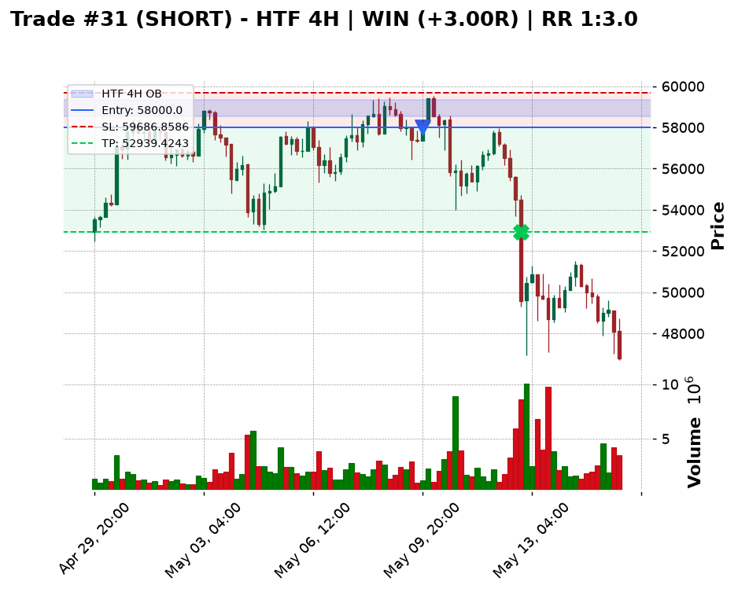

#### Khung vào lệnh Limit LTF

---

### Lệnh #32 — SHORT | Kết quả: **WIN (+3.15R)**
- **Tín hiệu CHoCH:** `2021-06-30 08:00:00+00:00` | **Khớp Limit:** `2021-06-30 11:00:00+00:00` | **Đóng lệnh:** `2021-07-19 13:00:00+00:00`
- **Entry Limit:** `34963.8` | **SL:** `36328.2214` | **TP:** `30666.185` | **RR mục tiêu:** `1:3.15`
- **Vùng OB 4H:** `35113.1 - 36061.8` (Cấu trúc 4H: `SIDEWAY`)

#### Khung cấu trúc HTF 4H (Kèm Entry / SL / TP)
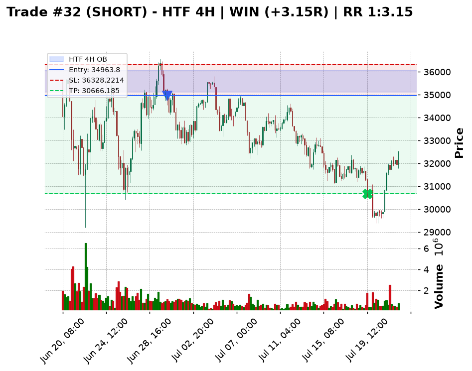

#### Khung vào lệnh Limit LTF
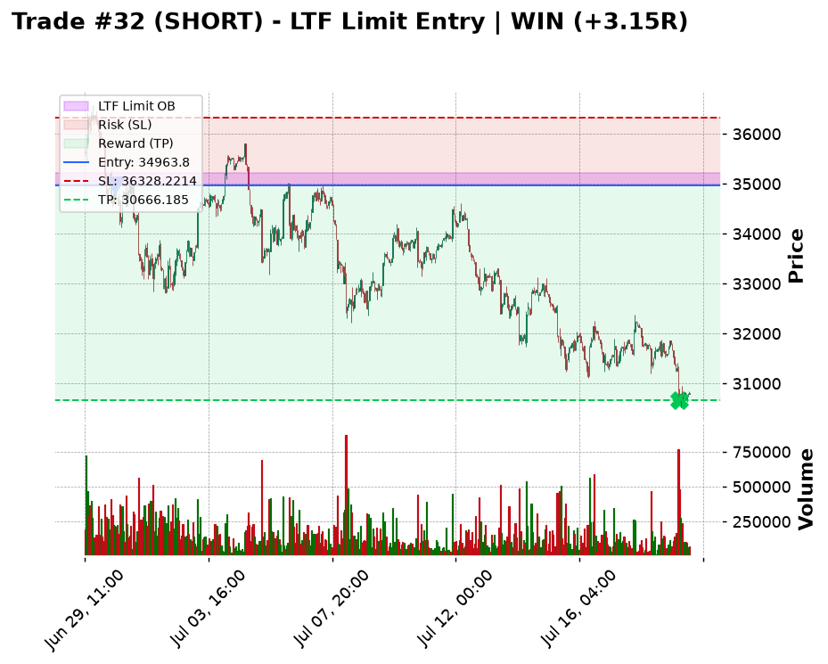

---

### Lệnh #33 — SHORT | Kết quả: **WIN (+3.83R)**
- **Tín hiệu CHoCH:** `2021-09-19 01:00:00+00:00` | **Khớp Limit:** `2021-09-19 03:00:00+00:00` | **Đóng lệnh:** `2021-09-20 10:00:00+00:00`
- **Entry Limit:** `48001.0` | **SL:** `48924.8029` | **TP:** `44458.7` | **RR mục tiêu:** `1:3.83`
- **Vùng OB 4H:** `48403.2 - 48728.8` (Cấu trúc 4H: `SIDEWAY`)

#### Khung cấu trúc HTF 4H (Kèm Entry / SL / TP)
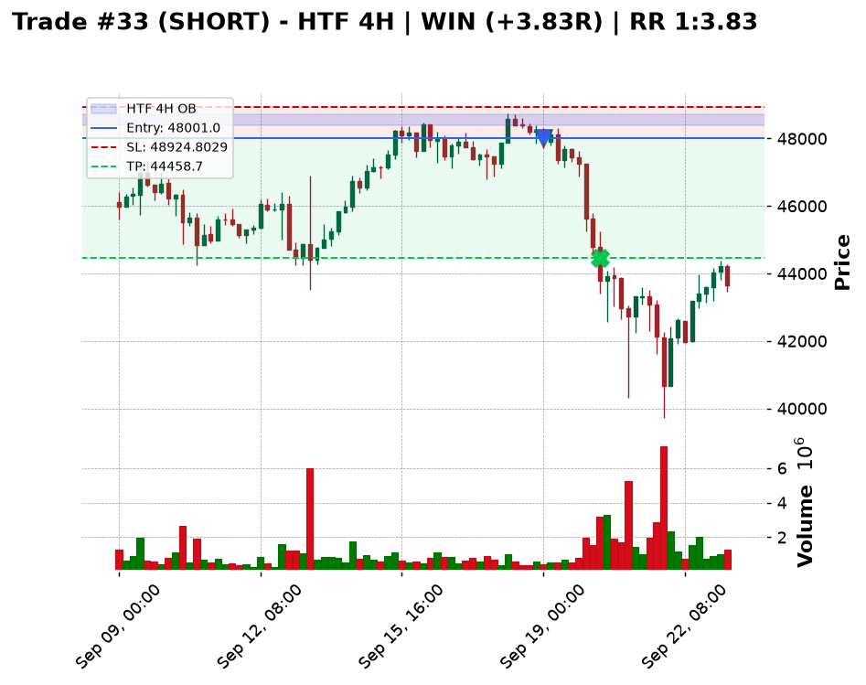

#### Khung vào lệnh Limit LTF
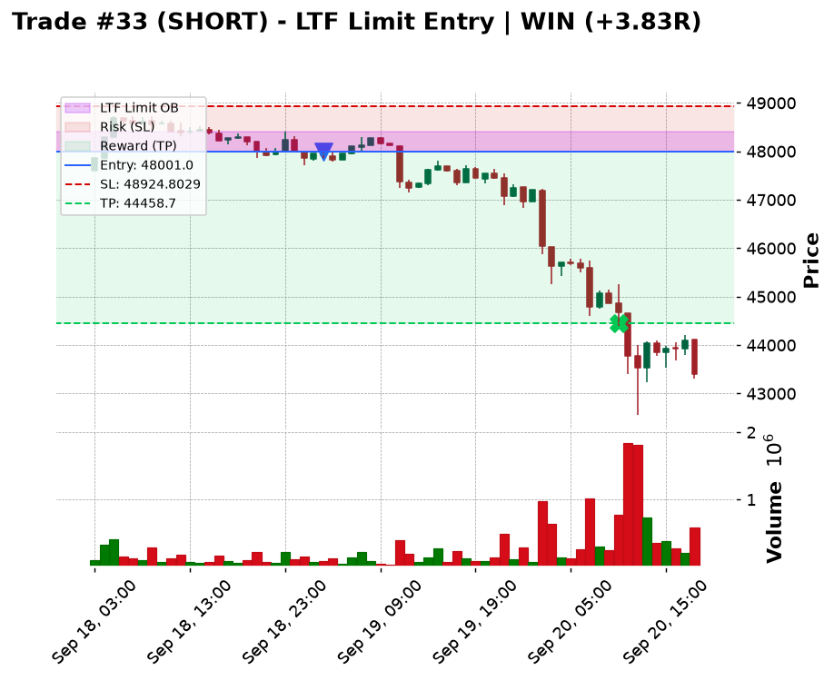

---

### Lệnh #34 — LONG | Kết quả: **WIN (+3.00R)**
- **Tín hiệu CHoCH:** `2021-09-29 05:00:00+00:00` | **Khớp Limit:** `2021-09-29 15:00:00+00:00` | **Đóng lệnh:** `2021-10-01 10:00:00+00:00`
- **Entry Limit:** `41777.6` | **SL:** `40566.8007` | **TP:** `45409.9979` | **RR mục tiêu:** `1:3.0`
- **Vùng OB 4H:** `40825.0 - 42166.0` (Cấu trúc 4H: `SIDEWAY`)

#### Khung cấu trúc HTF 4H (Kèm Entry / SL / TP)
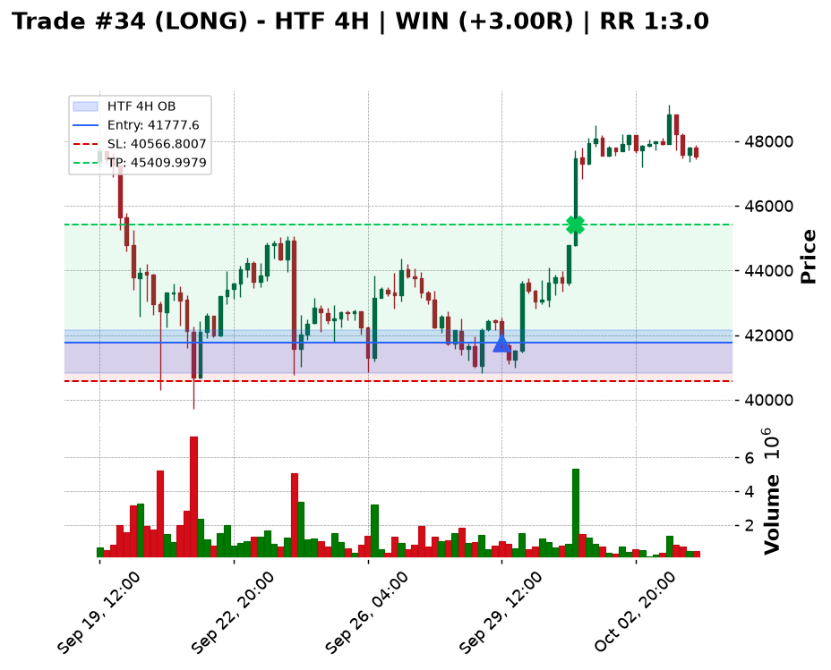

#### Khung vào lệnh Limit LTF
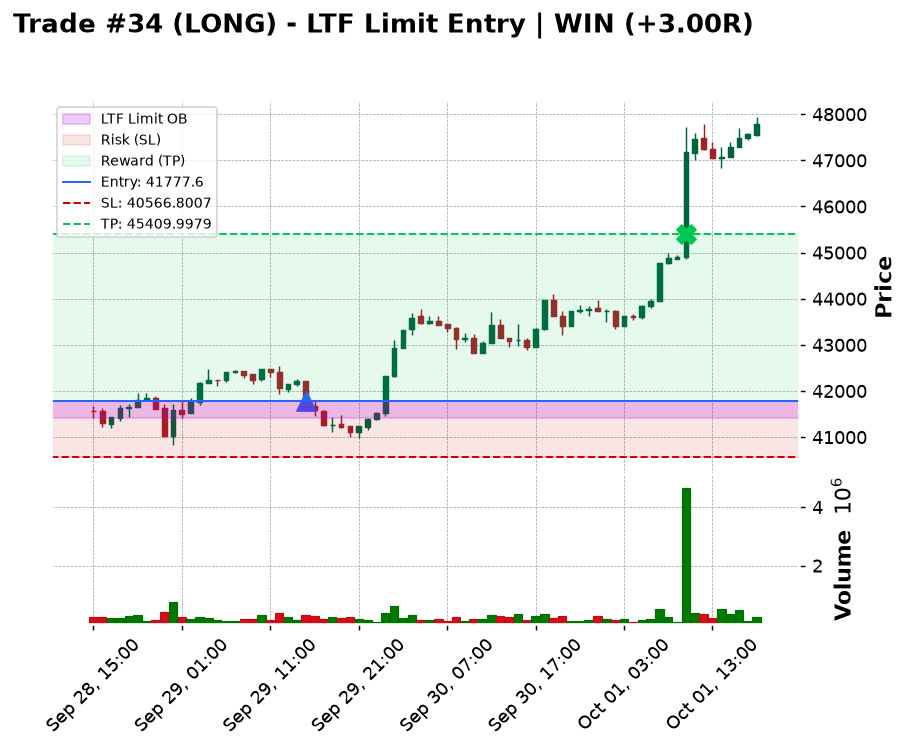

---

### Lệnh #35 — SHORT | Kết quả: **LOSS (-1.00R)**
- **Tín hiệu CHoCH:** `2021-10-04 02:00:00+00:00` | **Khớp Limit:** `2021-10-04 13:00:00+00:00` | **Đóng lệnh:** `2021-10-04 17:00:00+00:00`
- **Entry Limit:** `47970.5` | **SL:** `48991.1221` | **TP:** `41846.7671` | **RR mục tiêu:** `1:6.0`
- **Vùng OB 4H:** `48207.3 - 48819.4` (Cấu trúc 4H: `SIDEWAY`)

#### Khung cấu trúc HTF 4H (Kèm Entry / SL / TP)
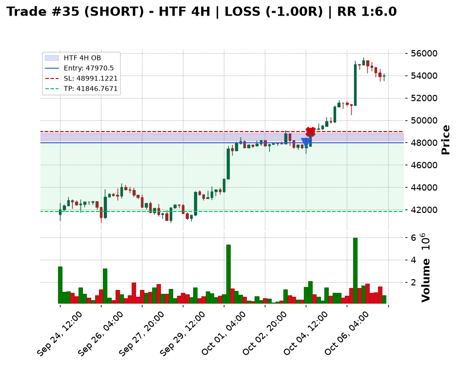

#### Khung vào lệnh Limit LTF
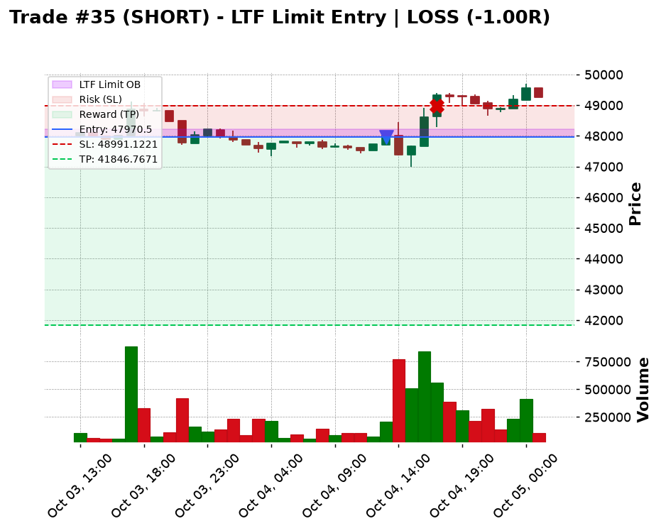

---

### Lệnh #36 — LONG | Kết quả: **LOSS (-1.00R)**
- **Tín hiệu CHoCH:** `2021-10-28 12:00:00+00:00` | **Khớp Limit:** `2021-10-28 17:00:00+00:00` | **Đóng lệnh:** `2021-10-28 18:00:00+00:00`
- **Entry Limit:** `61056.3` | **SL:** `58752.9593` | **TP:** `67966.3221` | **RR mục tiêu:** `1:3.0`
- **Vùng OB 4H:** `59075.5 - 60981.0` (Cấu trúc 4H: `SIDEWAY`)

#### Khung cấu trúc HTF 4H (Kèm Entry / SL / TP)
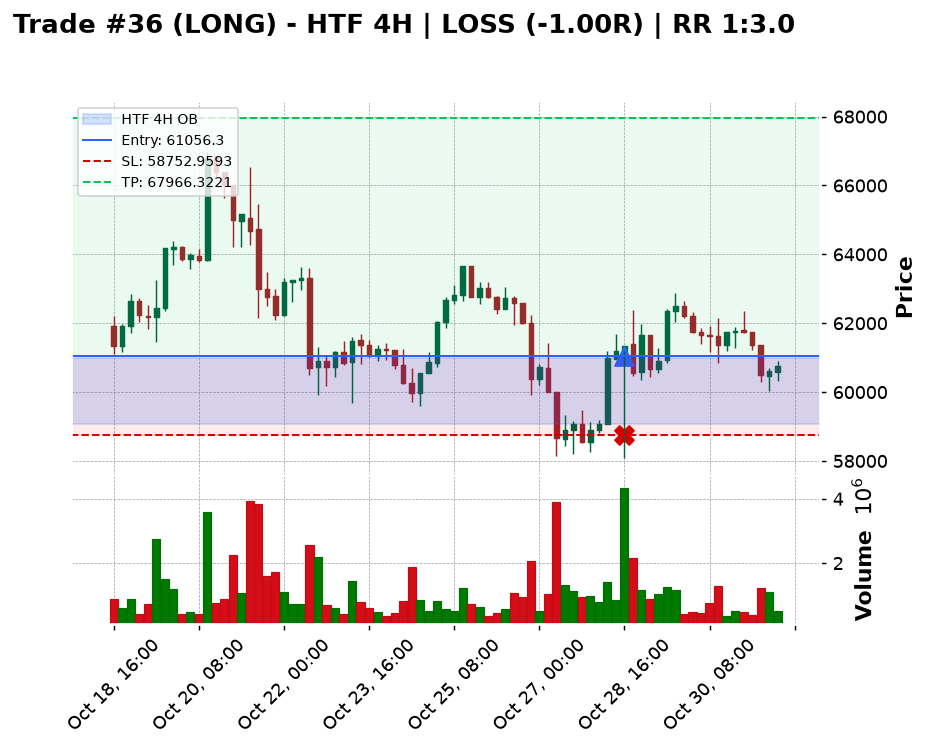

#### Khung vào lệnh Limit LTF
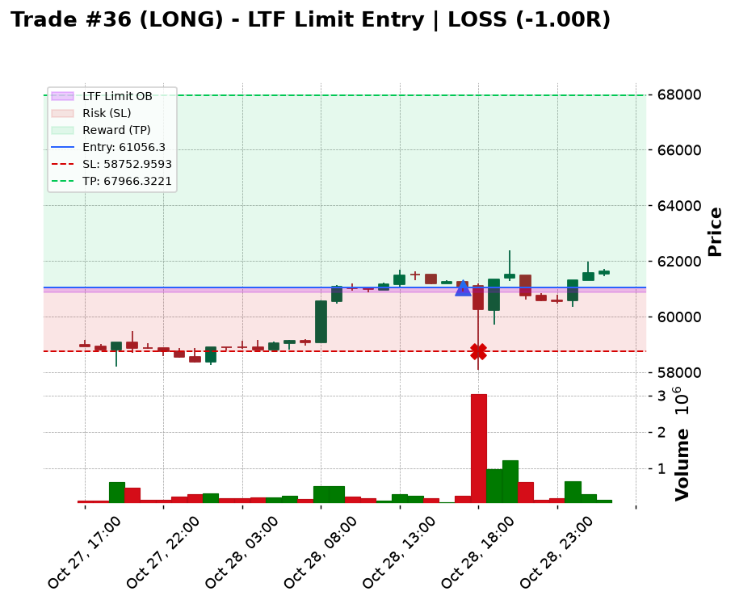

---

### Lệnh #37 — SHORT | Kết quả: **WIN (+3.00R)**
- **Tín hiệu CHoCH:** `2022-01-15 12:00:00+00:00` | **Khớp Limit:** `2022-01-15 14:00:00+00:00` | **Đóng lệnh:** `2022-01-21 03:00:00+00:00`
- **Entry Limit:** `43064.9` | **SL:** `44582.1007` | **TP:** `38513.2979` | **RR mục tiêu:** `1:3.0`
- **Vùng OB 4H:** `43217.7 - 44379.5` (Cấu trúc 4H: `SIDEWAY`)

#### Khung cấu trúc HTF 4H (Kèm Entry / SL / TP)
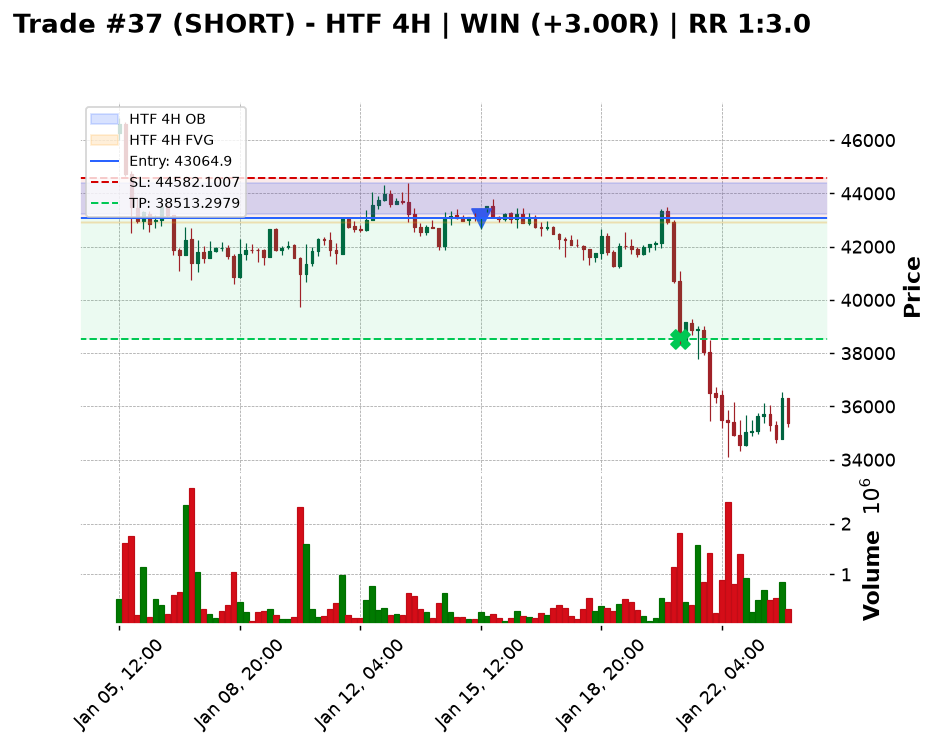

#### Khung vào lệnh Limit LTF
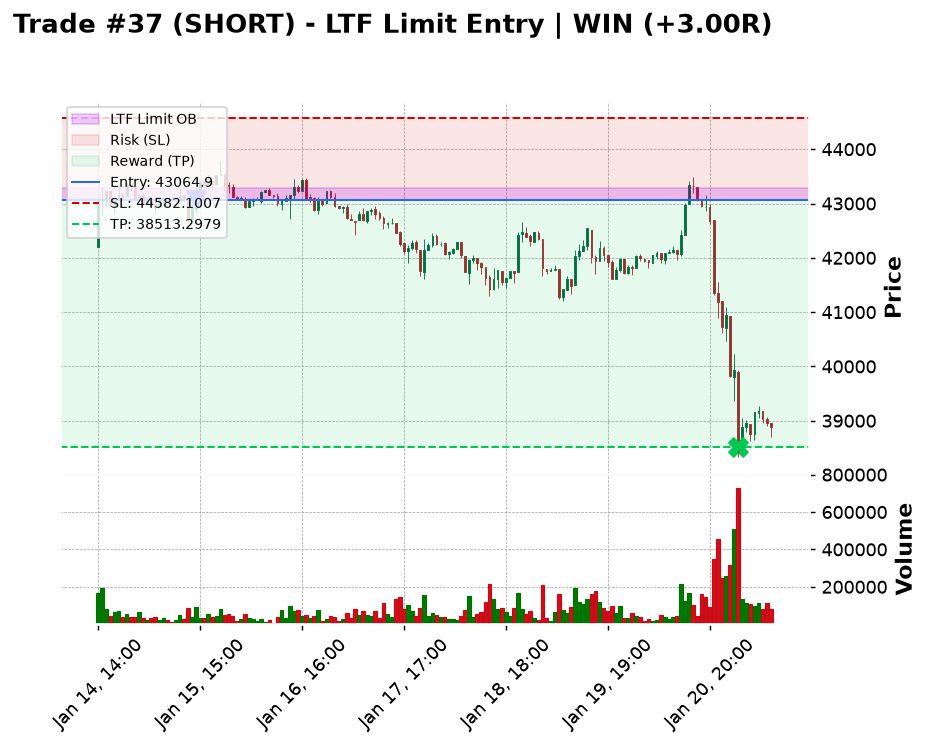

---

### Lệnh #38 — SHORT | Kết quả: **LOSS (-1.00R)**
- **Tín hiệu CHoCH:** `2022-05-16 06:00:00+00:00` | **Khớp Limit:** `2022-05-16 10:00:00+00:00` | **Đóng lệnh:** `2022-05-30 21:00:00+00:00`
- **Entry Limit:** `30133.4` | **SL:** `31541.9857` | **TP:** `25907.6429` | **RR mục tiêu:** `1:3.0`
- **Vùng OB 4H:** `30306.2 - 31318.4` (Cấu trúc 4H: `SIDEWAY`)

#### Khung cấu trúc HTF 4H (Kèm Entry / SL / TP)
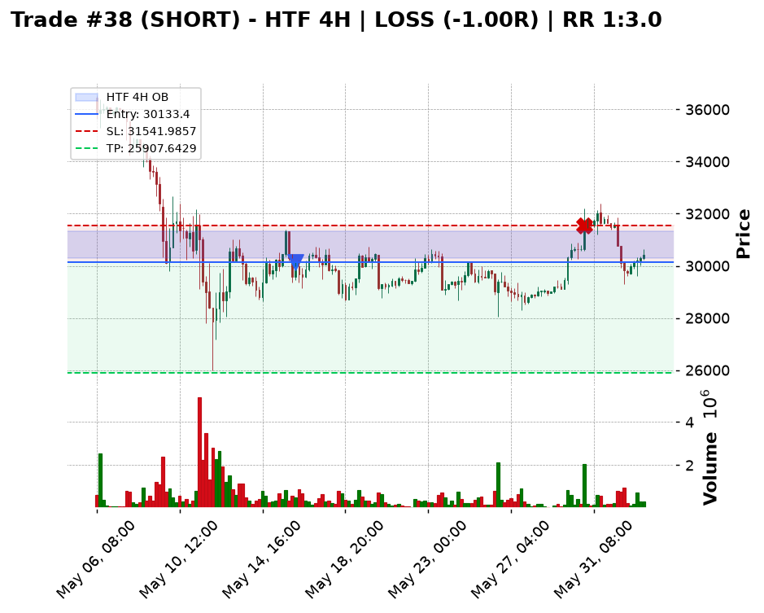

#### Khung vào lệnh Limit LTF
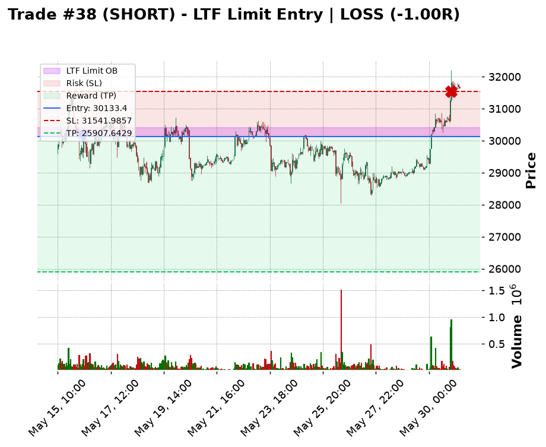

---

### Lệnh #39 — SHORT | Kết quả: **WIN (+3.00R)**
- **Tín hiệu CHoCH:** `2022-06-10 00:00:00+00:00` | **Khớp Limit:** `2022-06-10 03:00:00+00:00` | **Đóng lệnh:** `2022-06-13 07:00:00+00:00`
- **Entry Limit:** `30022.9` | **SL:** `31715.7579` | **TP:** `24944.3264` | **RR mục tiêu:** `1:3.0`
- **Vùng OB 4H:** `31346.6 - 31566.0` (Cấu trúc 4H: `SIDEWAY`)

#### Khung cấu trúc HTF 4H (Kèm Entry / SL / TP)
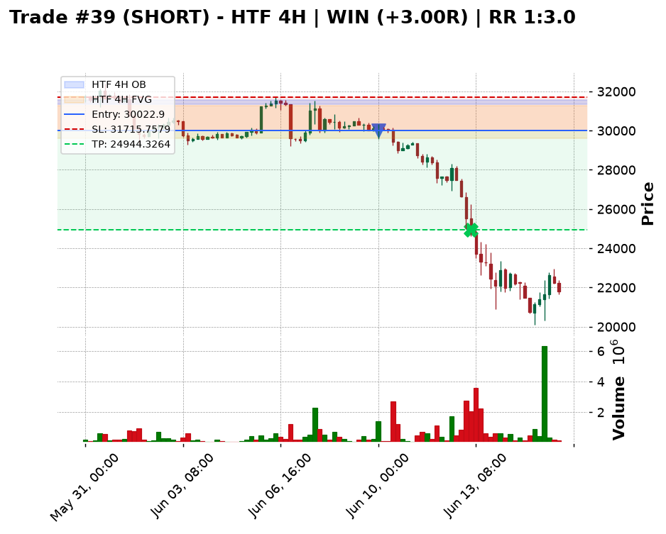

#### Khung vào lệnh Limit LTF
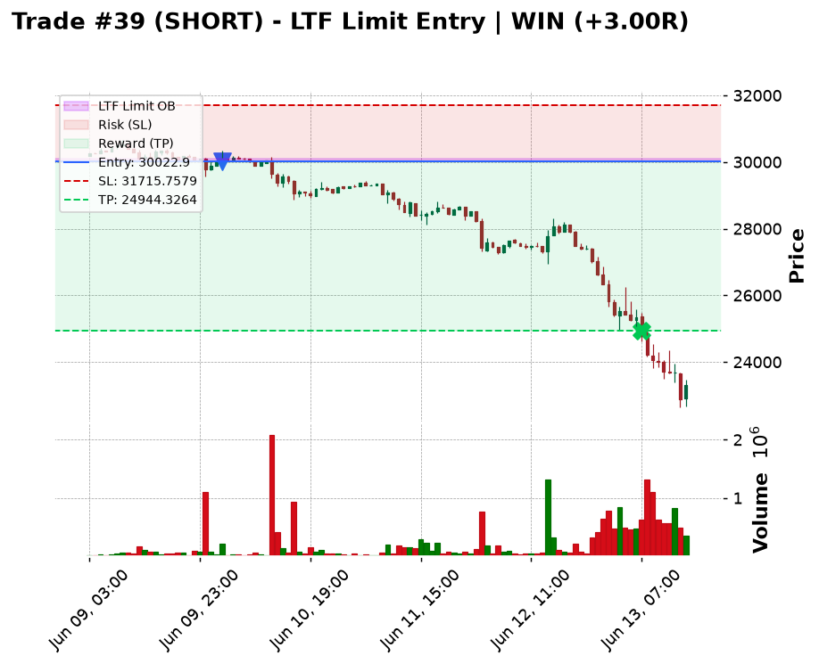

---

### Lệnh #40 — SHORT | Kết quả: **WIN (+3.00R)**
- **Tín hiệu CHoCH:** `2022-06-26 17:00:00+00:00` | **Khớp Limit:** `2022-06-26 19:00:00+00:00` | **Đóng lệnh:** `2022-06-30 08:00:00+00:00`
- **Entry Limit:** `21311.2` | **SL:** `21982.1136` | **TP:** `19298.4593` | **RR mục tiêu:** `1:3.0`
- **Vùng OB 4H:** `21357.7 - 21865.0` (Cấu trúc 4H: `SIDEWAY`)

#### Khung cấu trúc HTF 4H (Kèm Entry / SL / TP)
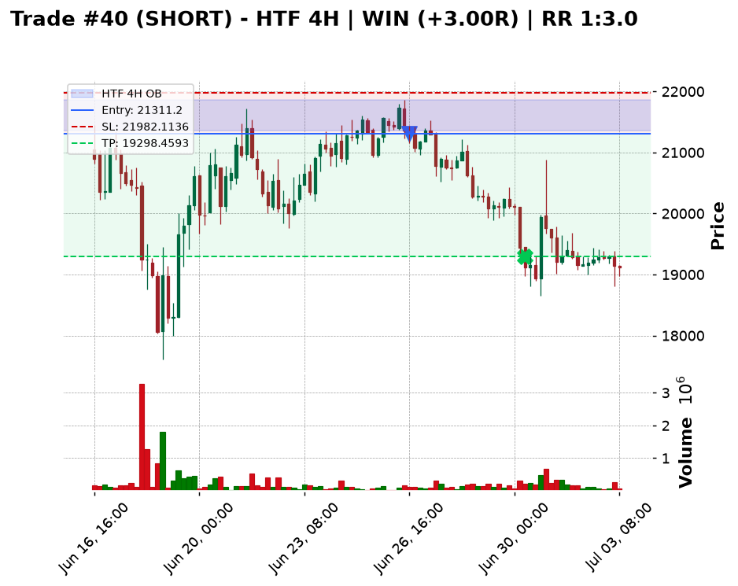

#### Khung vào lệnh Limit LTF
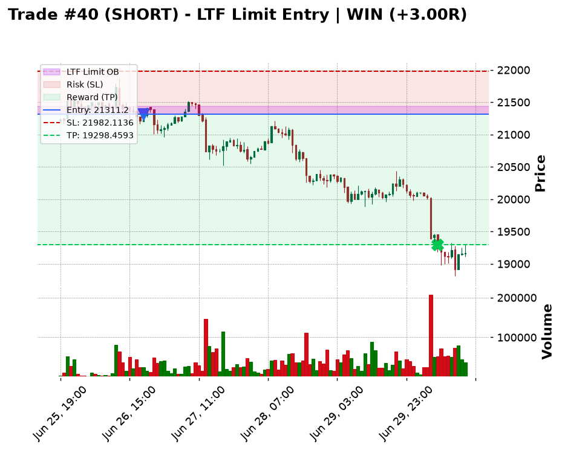

---

### Lệnh #41 — SHORT | Kết quả: **LOSS (-1.00R)**
- **Tín hiệu CHoCH:** `2022-07-18 20:00:00+00:00` | **Khớp Limit:** `2022-07-18 23:00:00+00:00` | **Đóng lệnh:** `2022-07-19 00:00:00+00:00`
- **Entry Limit:** `22205.5` | **SL:** `22920.1679` | **TP:** `19152.425` | **RR mục tiêu:** `1:4.27`
- **Vùng OB 4H:** `21652.8 - 22752.8` (Cấu trúc 4H: `SIDEWAY`)

#### Khung cấu trúc HTF 4H (Kèm Entry / SL / TP)
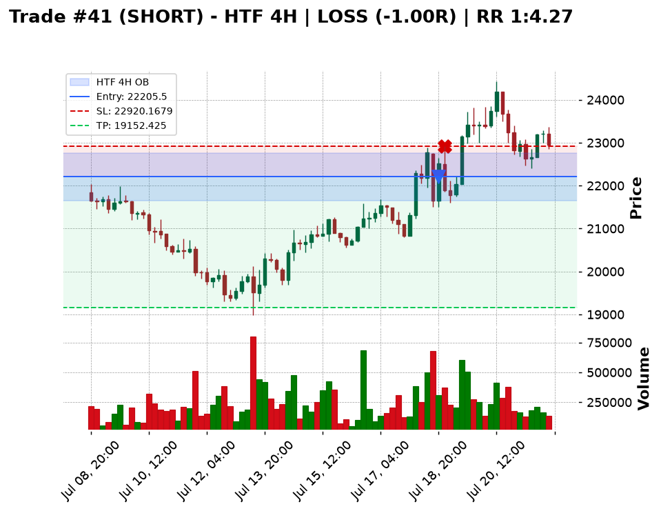

#### Khung vào lệnh Limit LTF
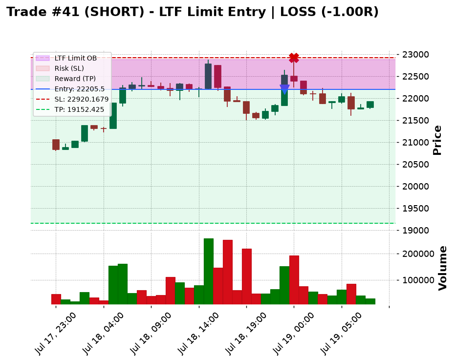

---

### Lệnh #42 — LONG | Kết quả: **LOSS (-1.00R)**
- **Tín hiệu CHoCH:** `2022-07-24 05:00:00+00:00` | **Khớp Limit:** `2022-07-24 12:00:00+00:00` | **Đóng lệnh:** `2022-07-25 02:00:00+00:00`
- **Entry Limit:** `22478.9` | **SL:** `22094.5179` | **TP:** `23668.705` | **RR mục tiêu:** `1:3.1`
- **Vùng OB 4H:** `22221.6 - 22478.4` (Cấu trúc 4H: `SIDEWAY`)

#### Khung cấu trúc HTF 4H (Kèm Entry / SL / TP)
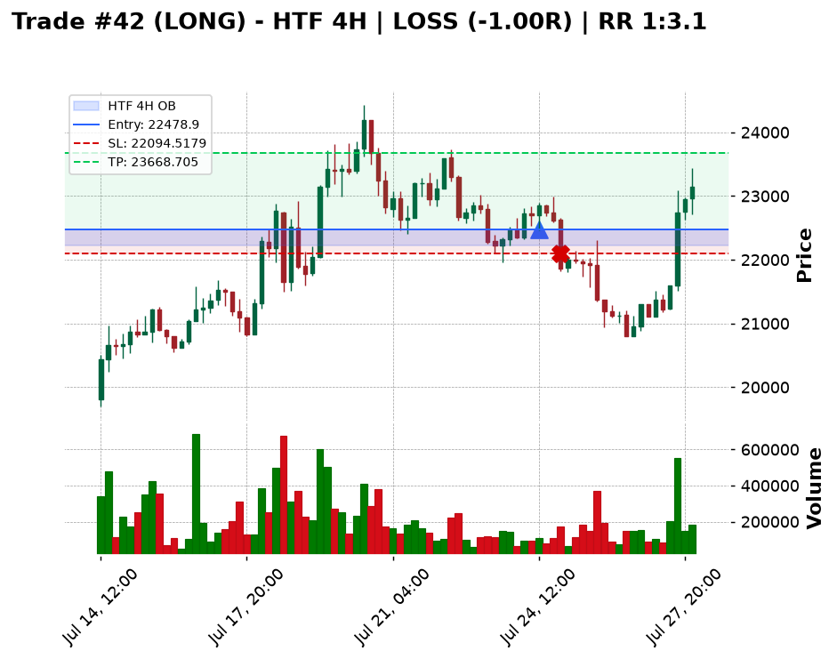

#### Khung vào lệnh Limit LTF
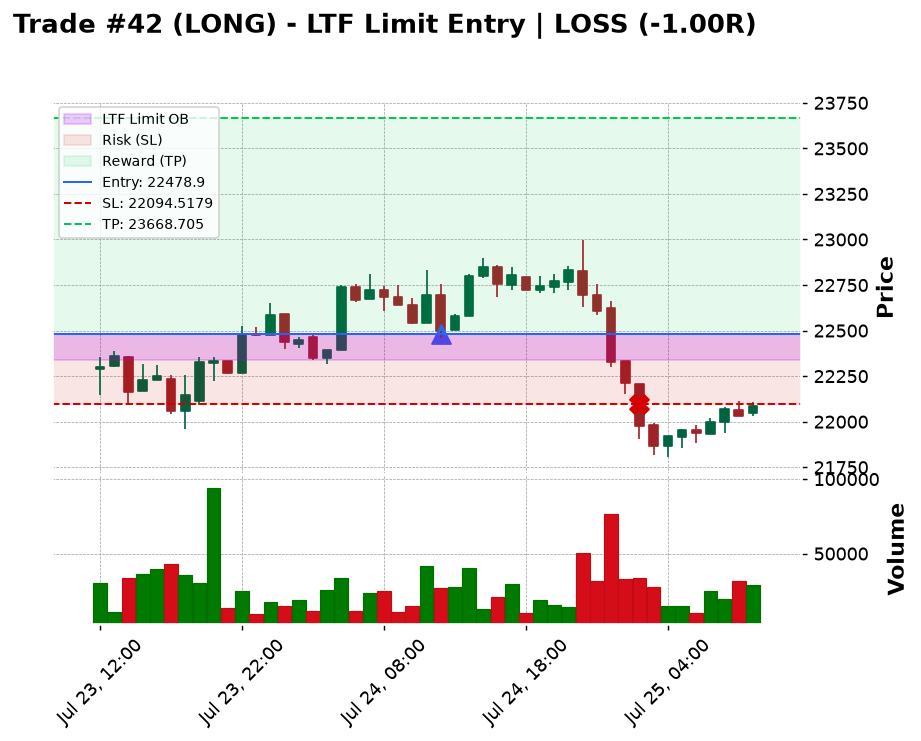

---

### Lệnh #43 — SHORT | Kết quả: **LOSS (-1.00R)**
- **Tín hiệu CHoCH:** `2022-08-11 22:00:00+00:00` | **Khớp Limit:** `2022-08-12 02:00:00+00:00` | **Đóng lệnh:** `2022-08-13 01:00:00+00:00`
- **Entry Limit:** `24085.3` | **SL:** `24550.3864` | **TP:** `22690.0407` | **RR mục tiêu:** `1:3.0`
- **Vùng OB 4H:** `24218.7 - 24420.3` (Cấu trúc 4H: `SIDEWAY`)

#### Khung cấu trúc HTF 4H (Kèm Entry / SL / TP)
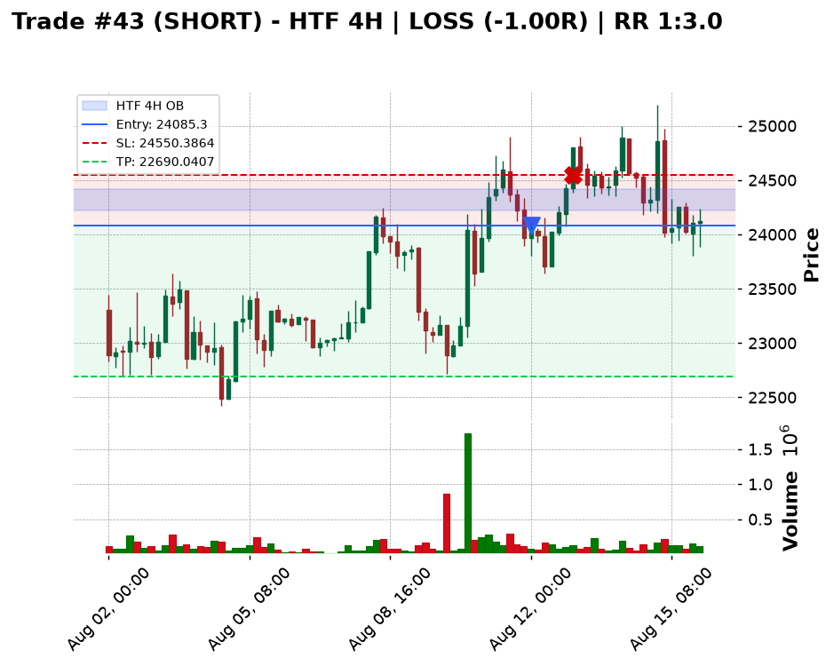

#### Khung vào lệnh Limit LTF
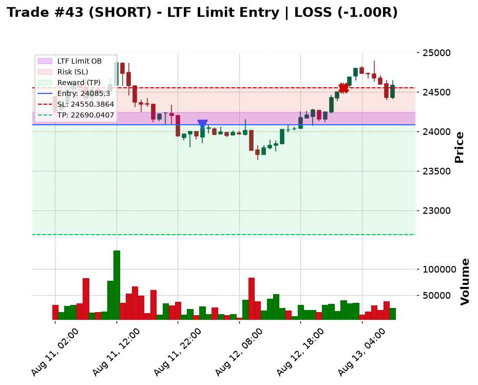

---

### Lệnh #44 — LONG | Kết quả: **LOSS (-1.00R)**
- **Tín hiệu CHoCH:** `2022-09-04 12:00:00+00:00` | **Khớp Limit:** `2022-09-04 13:00:00+00:00` | **Đóng lệnh:** `2022-09-06 17:00:00+00:00`
- **Entry Limit:** `19827.3` | **SL:** `19555.9236` | **TP:** `20641.4293` | **RR mục tiêu:** `1:3.0`
- **Vùng OB 4H:** `19619.2 - 19860.8` (Cấu trúc 4H: `SIDEWAY`)

#### Khung cấu trúc HTF 4H (Kèm Entry / SL / TP)
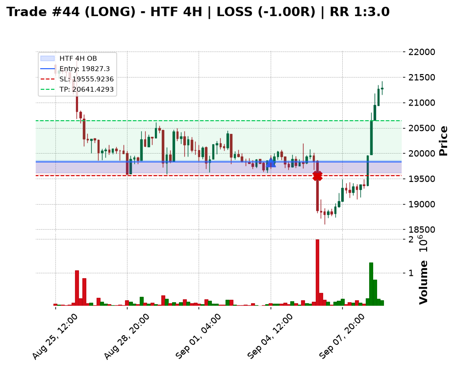

#### Khung vào lệnh Limit LTF
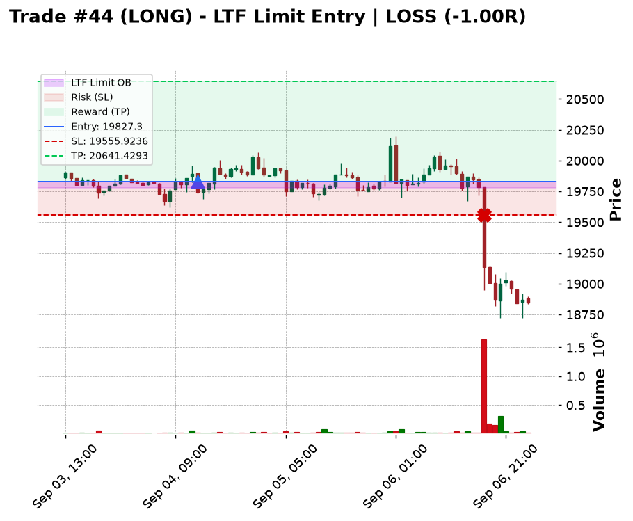

---

### Lệnh #45 — LONG | Kết quả: **LOSS (-1.00R)**
- **Tín hiệu CHoCH:** `2022-10-09 10:00:00+00:00` | **Khớp Limit:** `2022-10-09 19:00:00+00:00` | **Đóng lệnh:** `2022-10-10 22:00:00+00:00`
- **Entry Limit:** `19465.8` | **SL:** `19121.3114` | **TP:** `20499.2657` | **RR mục tiêu:** `1:3.0`
- **Vùng OB 4H:** `19180.0 - 19385.6` (Cấu trúc 4H: `SIDEWAY`)

#### Khung cấu trúc HTF 4H (Kèm Entry / SL / TP)
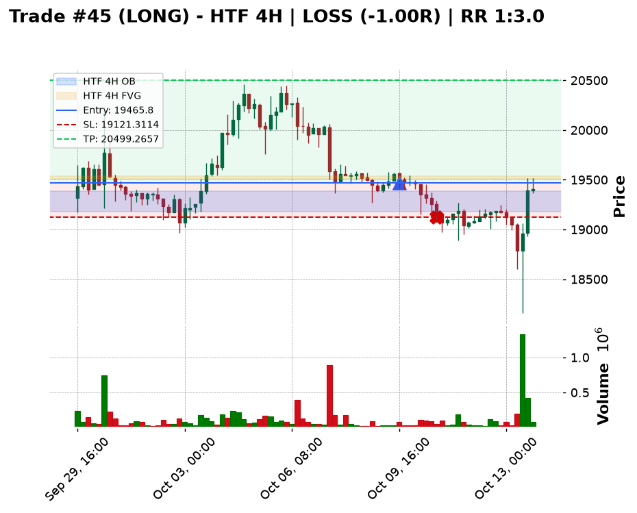

#### Khung vào lệnh Limit LTF

---

### Lệnh #46 — LONG | Kết quả: **LOSS (-1.00R)**
- **Tín hiệu CHoCH:** `2022-10-20 09:00:00+00:00` | **Khớp Limit:** `2022-10-20 12:00:00+00:00` | **Đóng lệnh:** `2022-10-21 12:00:00+00:00`
- **Entry Limit:** `19184.5` | **SL:** `18914.9536` | **TP:** `19993.1393` | **RR mục tiêu:** `1:3.0`
- **Vùng OB 4H:** `18970.4 - 19149.0` (Cấu trúc 4H: `SIDEWAY`)

#### Khung cấu trúc HTF 4H (Kèm Entry / SL / TP)

#### Khung vào lệnh Limit LTF

---

### Lệnh #47 — SHORT | Kết quả: **LOSS (-1.00R)**
- **Tín hiệu CHoCH:** `2022-12-03 22:00:00+00:00` | **Khớp Limit:** `2022-12-04 01:00:00+00:00` | **Đóng lệnh:** `2022-12-04 18:00:00+00:00`
- **Entry Limit:** `16985.6` | **SL:** `17185.75` | **TP:** `16044.3` | **RR mục tiêu:** `1:4.7`
- **Vùng OB 4H:** `17095.3 - 17133.4` (Cấu trúc 4H: `SIDEWAY`)

#### Khung cấu trúc HTF 4H (Kèm Entry / SL / TP)

#### Khung vào lệnh Limit LTF

---

### Lệnh #48 — SHORT | Kết quả: **WIN (+3.00R)**
- **Tín hiệu CHoCH:** `2023-02-02 14:00:00+00:00` | **Khớp Limit:** `2023-02-02 15:00:00+00:00` | **Đóng lệnh:** `2023-02-09 19:00:00+00:00`
- **Entry Limit:** `23827.0` | **SL:** `24301.4679` | **TP:** `22403.5964` | **RR mục tiêu:** `1:3.0`
- **Vùng OB 4H:** `23737.1 - 24232.8` (Cấu trúc 4H: `SIDEWAY`)

#### Khung cấu trúc HTF 4H (Kèm Entry / SL / TP)

#### Khung vào lệnh Limit LTF

---

### Lệnh #49 — SHORT | Kết quả: **WIN (+4.91R)**
- **Tín hiệu CHoCH:** `2023-02-18 07:00:00+00:00` | **Khớp Limit:** `2023-02-18 14:00:00+00:00` | **Đóng lệnh:** `2023-03-09 18:00:00+00:00`
- **Entry Limit:** `24638.0` | **SL:** `25307.1407` | **TP:** `21351.8` | **RR mục tiêu:** `1:4.91`
- **Vùng OB 4H:** `24915.0 - 25154.1` (Cấu trúc 4H: `SIDEWAY`)

#### Khung cấu trúc HTF 4H (Kèm Entry / SL / TP)

#### Khung vào lệnh Limit LTF

---

### Lệnh #50 — SHORT | Kết quả: **LOSS (-1.00R)**
- **Tín hiệu CHoCH:** `2023-04-01 14:00:00+00:00` | **Khớp Limit:** `2023-04-01 16:00:00+00:00` | **Đóng lệnh:** `2023-04-10 16:00:00+00:00`
- **Entry Limit:** `28459.4` | **SL:** `28892.7143` | **TP:** `26855.3` | **RR mục tiêu:** `1:3.7`
- **Vùng OB 4H:** `28684.2 - 28774.3` (Cấu trúc 4H: `SIDEWAY`)

#### Khung cấu trúc HTF 4H (Kèm Entry / SL / TP)

#### Khung vào lệnh Limit LTF

---

### Lệnh #51 — LONG | Kết quả: **LOSS (-1.00R)**
- **Tín hiệu CHoCH:** `2023-05-19 12:00:00+00:00` | **Khớp Limit:** `2023-05-19 14:00:00+00:00` | **Đóng lệnh:** `2023-05-24 13:00:00+00:00`
- **Entry Limit:** `26925.2` | **SL:** `26597.1757` | **TP:** `27909.2729` | **RR mục tiêu:** `1:3.0`
- **Vùng OB 4H:** `26663.6 - 26833.2` (Cấu trúc 4H: `BULL`)

#### Khung cấu trúc HTF 4H (Kèm Entry / SL / TP)

#### Khung vào lệnh Limit LTF

---

### Lệnh #52 — LONG | Kết quả: **WIN (+3.00R)**
- **Tín hiệu CHoCH:** `2023-06-16 14:00:00+00:00` | **Khớp Limit:** `2023-06-16 15:00:00+00:00` | **Đóng lệnh:** `2023-06-20 17:00:00+00:00`
- **Entry Limit:** `25573.5` | **SL:** `24911.0386` | **TP:** `27560.8843` | **RR mục tiêu:** `1:3.0`
- **Vùng OB 4H:** `24974.6 - 25399.5` (Cấu trúc 4H: `BULL`)

#### Khung cấu trúc HTF 4H (Kèm Entry / SL / TP)

#### Khung vào lệnh Limit LTF

---

### Lệnh #53 — LONG | Kết quả: **LOSS (-1.00R)**
- **Tín hiệu CHoCH:** `2023-08-21 21:00:00+00:00` | **Khớp Limit:** `2023-08-21 23:00:00+00:00` | **Đóng lệnh:** `2023-08-22 17:00:00+00:00`
- **Entry Limit:** `26132.0` | **SL:** `25854.3971` | **TP:** `27797.6171` | **RR mục tiêu:** `1:6.0`
- **Vùng OB 4H:** `25888.1 - 26019.7` (Cấu trúc 4H: `SIDEWAY`)

#### Khung cấu trúc HTF 4H (Kèm Entry / SL / TP)

#### Khung vào lệnh Limit LTF

---

### Lệnh #54 — SHORT | Kết quả: **LOSS (-1.00R)**
- **Tín hiệu CHoCH:** `2023-11-08 15:00:00+00:00` | **Khớp Limit:** `2023-11-08 18:00:00+00:00` | **Đóng lệnh:** `2023-11-08 23:00:00+00:00`
- **Entry Limit:** `35420.0` | **SL:** `35997.9093` | **TP:** `33686.2721` | **RR mục tiêu:** `1:3.0`
- **Vùng OB 4H:** `35282.0 - 35900.0` (Cấu trúc 4H: `SIDEWAY`)

#### Khung cấu trúc HTF 4H (Kèm Entry / SL / TP)

#### Khung vào lệnh Limit LTF

---

### Lệnh #55 — SHORT | Kết quả: **LOSS (-1.00R)**
- **Tín hiệu CHoCH:** `2024-01-07 23:00:00+00:00` | **Khớp Limit:** `2024-01-08 06:00:00+00:00` | **Đóng lệnh:** `2024-01-08 11:00:00+00:00`
- **Entry Limit:** `43977.9` | **SL:** `44551.69` | **TP:** `42256.53` | **RR mục tiêu:** `1:3.0`
- **Vùng OB 4H:** `43955.5 - 44449.9` (Cấu trúc 4H: `SIDEWAY`)

#### Khung cấu trúc HTF 4H (Kèm Entry / SL / TP)

#### Khung vào lệnh Limit LTF

---

### Lệnh #56 — SHORT | Kết quả: **WIN (+3.00R)**
- **Tín hiệu CHoCH:** `2024-04-24 18:00:00+00:00` | **Khớp Limit:** `2024-04-25 17:00:00+00:00` | **Đóng lệnh:** `2024-04-30 19:00:00+00:00`
- **Entry Limit:** `64400.0` | **SL:** `65885.4964` | **TP:** `59943.5107` | **RR mục tiêu:** `1:3.0`
- **Vùng OB 4H:** `64666.5 - 65700.0` (Cấu trúc 4H: `SIDEWAY`)

#### Khung cấu trúc HTF 4H (Kèm Entry / SL / TP)

#### Khung vào lệnh Limit LTF

---

### Lệnh #57 — LONG | Kết quả: **LOSS (-1.00R)**
- **Tín hiệu CHoCH:** `2024-11-04 04:00:00+00:00` | **Khớp Limit:** `2024-11-04 05:00:00+00:00` | **Đóng lệnh:** `2024-11-04 16:00:00+00:00`
- **Entry Limit:** `69176.6` | **SL:** `68468.2564` | **TP:** `71381.115` | **RR mục tiêu:** `1:3.11`
- **Vùng OB 4H:** `68693.4 - 69158.1` (Cấu trúc 4H: `SIDEWAY`)

#### Khung cấu trúc HTF 4H (Kèm Entry / SL / TP)

#### Khung vào lệnh Limit LTF

---

### Lệnh #58 — LONG | Kết quả: **LOSS (-1.00R)**
- **Tín hiệu CHoCH:** `2025-07-21 06:00:00+00:00` | **Khớp Limit:** `2025-07-21 10:00:00+00:00` | **Đóng lệnh:** `2025-07-22 01:00:00+00:00`
- **Entry Limit:** `118498.3` | **SL:** `116602.9429` | **TP:** `124184.3714` | **RR mục tiêu:** `1:3.0`
- **Vùng OB 4H:** `116773.3 - 118298.3` (Cấu trúc 4H: `SIDEWAY`)

#### Khung cấu trúc HTF 4H (Kèm Entry / SL / TP)

#### Khung vào lệnh Limit LTF

---

### Lệnh #59 — SHORT | Kết quả: **WIN (+3.00R)**
- **Tín hiệu CHoCH:** `2025-07-30 18:00:00+00:00` | **Khớp Limit:** `2025-07-30 23:00:00+00:00` | **Đóng lệnh:** `2025-08-01 22:00:00+00:00`
- **Entry Limit:** `117623.3` | **SL:** `119164.9071` | **TP:** `112998.4786` | **RR mục tiêu:** `1:3.0`
- **Vùng OB 4H:** `118473.3 - 118923.3` (Cấu trúc 4H: `BEAR`)

#### Khung cấu trúc HTF 4H (Kèm Entry / SL / TP)

#### Khung vào lệnh Limit LTF

---

### Lệnh #60 — SHORT | Kết quả: **LOSS (-1.00R)**
- **Tín hiệu CHoCH:** `2025-08-08 15:00:00+00:00` | **Khớp Limit:** `2025-08-08 17:00:00+00:00` | **Đóng lệnh:** `2025-08-10 15:00:00+00:00`
- **Entry Limit:** `116625.0` | **SL:** `118802.0729` | **TP:** `110093.7814` | **RR mục tiêu:** `1:3.0`
- **Vùng OB 4H:** `118223.3 - 118523.3` (Cấu trúc 4H: `SIDEWAY`)

#### Khung cấu trúc HTF 4H (Kèm Entry / SL / TP)

#### Khung vào lệnh Limit LTF

---

### Lệnh #61 — LONG | Kết quả: **WIN (+3.12R)**
- **Tín hiệu CHoCH:** `2025-09-09 06:00:00+00:00` | **Khớp Limit:** `2025-09-09 15:00:00+00:00` | **Đóng lệnh:** `2025-09-10 12:00:00+00:00`
- **Entry Limit:** `111425.0` | **SL:** `110820.2657` | **TP:** `113312.4` | **RR mục tiêu:** `1:3.12`
- **Vùng OB 4H:** `110962.5 - 111287.5` (Cấu trúc 4H: `BULL`)

#### Khung cấu trúc HTF 4H (Kèm Entry / SL / TP)

#### Khung vào lệnh Limit LTF

---

### Lệnh #62 — SHORT | Kết quả: **WIN (+3.00R)**
- **Tín hiệu CHoCH:** `2025-11-17 17:00:00+00:00` | **Khớp Limit:** `2025-11-17 18:00:00+00:00` | **Đóng lệnh:** `2025-11-21 12:00:00+00:00`
- **Entry Limit:** `93024.0` | **SL:** `96856.7357` | **TP:** `81525.7929` | **RR mục tiêu:** `1:3.0`
- **Vùng OB 4H:** `95577.0 - 96474.0` (Cấu trúc 4H: `BEAR`)

#### Khung cấu trúc HTF 4H (Kèm Entry / SL / TP)

#### Khung vào lệnh Limit LTF

---

### Lệnh #63 — SHORT | Kết quả: **LOSS (-1.00R)**
- **Tín hiệu CHoCH:** `2025-12-04 13:00:00+00:00` | **Khớp Limit:** `2025-12-04 15:00:00+00:00` | **Đóng lệnh:** `2025-12-09 16:00:00+00:00`
- **Entry Limit:** `92900.0` | **SL:** `94440.2286` | **TP:** `84930.0` | **RR mục tiêu:** `1:5.17`
- **Vùng OB 4H:** `92700.0 - 93940.0` (Cấu trúc 4H: `SIDEWAY`)

#### Khung cấu trúc HTF 4H (Kèm Entry / SL / TP)

#### Khung vào lệnh Limit LTF

---

### Lệnh #64 — LONG | Kết quả: **LOSS (-1.00R)**
- **Tín hiệu CHoCH:** `2025-12-14 00:00:00+00:00` | **Khớp Limit:** `2025-12-14 04:00:00+00:00` | **Đóng lệnh:** `2025-12-14 11:00:00+00:00`
- **Entry Limit:** `90260.0` | **SL:** `89012.8571` | **TP:** `94540.0` | **RR mục tiêu:** `1:3.43`
- **Vùng OB 4H:** `89420.0 - 90860.0` (Cấu trúc 4H: `SIDEWAY`)

#### Khung cấu trúc HTF 4H (Kèm Entry / SL / TP)

#### Khung vào lệnh Limit LTF

---

### Lệnh #65 — SHORT | Kết quả: **WIN (+3.00R)**
- **Tín hiệu CHoCH:** `2026-02-17 10:00:00+00:00` | **Khớp Limit:** `2026-02-17 12:00:00+00:00` | **Đóng lệnh:** `2026-02-23 01:00:00+00:00`
- **Entry Limit:** `68210.6` | **SL:** `69277.2964` | **TP:** `65010.5107` | **RR mục tiêu:** `1:3.0`
- **Vùng OB 4H:** `68560.6 - 68985.6` (Cấu trúc 4H: `BEAR`)

#### Khung cấu trúc HTF 4H (Kèm Entry / SL / TP)

#### Khung vào lệnh Limit LTF

---

### Lệnh #66 — LONG | Kết quả: **LOSS (-1.00R)**
- **Tín hiệu CHoCH:** `2026-05-10 22:00:00+00:00` | **Khớp Limit:** `2026-05-11 00:00:00+00:00` | **Đóng lệnh:** `2026-05-11 03:00:00+00:00`
- **Entry Limit:** `81425.0` | **SL:** `80627.5` | **TP:** `83817.5` | **RR mục tiêu:** `1:3.0`
- **Vùng OB 4H:** `80725.0 - 80800.0` (Cấu trúc 4H: `BULL`)

#### Khung cấu trúc HTF 4H (Kèm Entry / SL / TP)

#### Khung vào lệnh Limit LTF

---

### Lệnh #67 — LONG | Kết quả: **LOSS (-1.00R)**
- **Tín hiệu CHoCH:** `2026-05-14 05:00:00+00:00` | **Khớp Limit:** `2026-05-14 11:00:00+00:00` | **Đóng lệnh:** `2026-05-16 06:00:00+00:00`
- **Entry Limit:** `79350.0` | **SL:** `78556.9643` | **TP:** `82222.5` | **RR mục tiêu:** `1:3.62`
- **Vùng OB 4H:** `78775.0 - 79575.0` (Cấu trúc 4H: `SIDEWAY`)

#### Khung cấu trúc HTF 4H (Kèm Entry / SL / TP)

#### Khung vào lệnh Limit LTF

---

### Lệnh #68 — SHORT | Kết quả: **LOSS (-1.00R)**
- **Tín hiệu CHoCH:** `2026-06-12 20:00:00+00:00` | **Khớp Limit:** `2026-06-12 21:00:00+00:00` | **Đóng lệnh:** `2026-06-13 21:00:00+00:00`
- **Entry Limit:** `63500.0` | **SL:** `64559.4029` | **TP:** `60321.7914` | **RR mục tiêu:** `1:3.0`
- **Vùng OB 4H:** `63550.0 - 64287.5` (Cấu trúc 4H: `SIDEWAY`)

#### Khung cấu trúc HTF 4H (Kèm Entry / SL / TP)

#### Khung vào lệnh Limit LTF

---

### Lệnh #69 — LONG | Kết quả: **LOSS (-1.00R)**
- **Tín hiệu CHoCH:** `2026-10-06 10:00:00+00:00` | **Khớp Limit:** `2026-10-06 17:00:00+00:00` | **Đóng lệnh:** `2026-10-07 01:00:00+00:00`
- **Entry Limit:** `85550.0` | **SL:** `85182.8571` | **TP:** `87175.0` | **RR mục tiêu:** `1:4.43`
- **Vùng OB 4H:** `85275.0 - 85475.0` (Cấu trúc 4H: `BULL`)

#### Khung cấu trúc HTF 4H (Kèm Entry / SL / TP)

#### Khung vào lệnh Limit LTF

---

### Lệnh #70 — SHORT | Kết quả: **LOSS (-1.00R)**
- **Tín hiệu CHoCH:** `2026-10-19 13:00:00+00:00` | **Khớp Limit:** `2026-10-19 14:00:00+00:00` | **Đóng lệnh:** `2026-10-20 14:00:00+00:00`
- **Entry Limit:** `82275.0` | **SL:** `83097.8571` | **TP:** `79806.4286` | **RR mục tiêu:** `1:3.0`
- **Vùng OB 4H:** `82250.0 - 82950.0` (Cấu trúc 4H: `SIDEWAY`)

#### Khung cấu trúc HTF 4H (Kèm Entry / SL / TP)

#### Khung vào lệnh Limit LTF

---

### Lệnh #71 — LONG | Kết quả: **LOSS (-1.00R)**
- **Tín hiệu CHoCH:** `2026-11-07 08:00:00+00:00` | **Khớp Limit:** `2026-11-07 10:00:00+00:00` | **Đóng lệnh:** `2026-11-08 21:00:00+00:00`
- **Entry Limit:** `75950.0` | **SL:** `74736.0714` | **TP:** `80828.75` | **RR mục tiêu:** `1:4.02`
- **Vùng OB 4H:** `75125.0 - 76225.0` (Cấu trúc 4H: `SIDEWAY`)

#### Khung cấu trúc HTF 4H (Kèm Entry / SL / TP)

#### Khung vào lệnh Limit LTF

---
